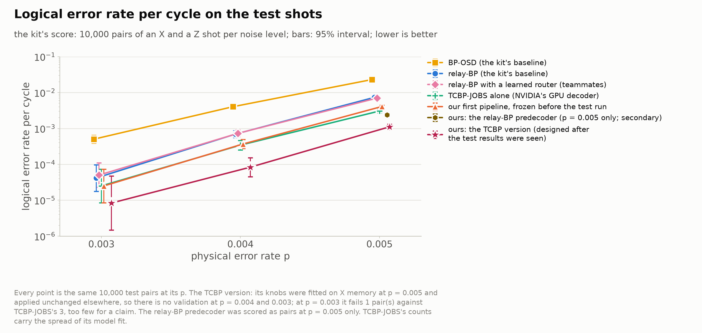
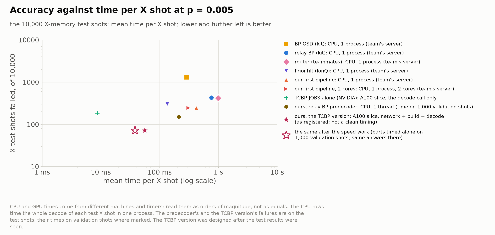

<!-- BEGIN our front page: written by challenge-1-ml-decoder-kit/report/make_tables.py from committed result files; edit it there -->
# ML-assisted decoding of the Gross code [[144, 12, 12]]

Our entry to Infleqtion's Challenge 1 at HackMidwest 2026, the main entry of this repository; the challenge statement is in [CHALLENGE.md](CHALLENGE.md). Every number on this page is written by `challenge-1-ml-decoder-kit/report/make_tables.py` from committed result files.

**In short.** A small neural network reads a shot's syndrome and tells NVIDIA's GPU decoder TCBP-JOBS which of the 8,784 possible faults to suspect in that shot. With these per-shot priors, TCBP-JOBS fails **132 of 10,000 test pairs at p = 0.005** (1.11e-03 ± 9.6e-05 per cycle), against 360 with its fixed priors (3.05e-03 ± 1.6e-04) and 845 for the kit's relay-BP (7.33e-03 ± 2.5e-04); at p = 0.004 10 against 41 and 83; at p = 0.003 1 against 3 and 5 (too few to claim anything). **This version was designed after the test results were seen** (no validation at p = 0.004 and 0.003); on 5,000 fresh X shots at p = 0.005, simulated after it was designed (exploration on new Stim shots), it fails 48 against TCBP-JOBS's 112. The decoder we froze before the test run is the first pipeline below (the table's row "ours, frozen before the test run").



## Results on the test shots

The kit's score on the team's saved test files (Stim circuit shots, seeds 301 and 302): failed pairs of 10,000 (a pair is shot k of X memory and shot k of Z memory, and fails when either fails) · logical error rate per cycle ± the kit's error. Every row decodes the same shots. The label says what kind of number it is; rows of different labels are not equals.

| Method | Label | p = 0.003 | p = 0.004 | p = 0.005 |
|---|---|---|---|---|
| BP-OSD (kit baseline) | the kit's baseline | 60 · 5.01e-04 ± 6.5e-05 | 472 · 4.02e-03 ± 1.8e-04 | 2,433 · 2.30e-02 ± 4.6e-04 |
| relay-BP (kit baseline) | the kit's baseline | 5 · 4.17e-05 ± 1.9e-05 | 83 · 6.94e-04 ± 7.6e-05 | 845 · 7.33e-03 ± 2.5e-04 |
| relay-BP with a learned router | the teammates' (pre-registered) | 6 · 5.00e-05 ± 2.0e-05 | 87 · 7.28e-04 ± 7.8e-05 | 807 · 6.99e-03 ± 2.5e-04 |
| PriorTilt, one run | IonQ's decoder (pre-registered) | 4 · 3.33e-05 ± 1.7e-05 | 74 · 6.19e-04 ± 7.2e-05 | 601 · 5.15e-03 ± 2.1e-04 |
| TCBP-JOBS (NVIDIA, GPU) | NVIDIA's decoder (pre-registered) | 3 · 2.50e-05 ± 1.4e-05 | 41 · 3.42e-04 ± 5.3e-05 | 360 · 3.05e-03 ± 1.6e-04 |
| our hierarchy, neural tie-break | **ours, frozen before the test run** (pre-registered) | 3 · 2.50e-05 ± 1.4e-05 | 44 · 3.67e-04 ± 5.5e-05 | 479 · 4.08e-03 ± 1.9e-04 |
| the relay-BP predecoder: relay-BP with the network's per-shot priors | ours; X at p = 0.005 secondary (chosen after its own gate failed); X at p = 0.004 and 0.003 and the pair score a registered extension, run after it | X only: 2 of 10,000 X shots | X only: 15 of 10,000 X shots | 281 · 2.37e-03 ± 1.4e-04 |
| the predecoder with a fallback to TCBP-JOBS where its relay-BP does not converge | ours; designed after the first test result: post hoc on X at p = 0.005 and 0.004; frozen before the file was opened for X at p = 0.003 and for Z at p = 0.005 | X only: 1 of 10,000 X shots | X only: 10 of 10,000 X shots | 206 · 1.73e-03 ± 1.2e-04 |
| **the TCBP version: TCBP-JOBS with the network's per-shot priors** | **ours; designed after the test results were seen; formerly a separate branch (predecoder-tcbp)**; no validation at p = 0.004 or 0.003 | 1 · 8.33e-06 ± 8.3e-06 (no claim: exact p = 0.50 against TCBP-JOBS) | **10 · 8.34e-05 ± 2.6e-05** | **132 · 1.11e-03 ± 9.6e-05** |

Paired on the same pairs, the TCBP version against TCBP-JOBS alone: only the TCBP version fails 41 and only TCBP-JOBS 269 at p = 0.005 (exact p = 3e-42); 4 and 35 at p = 0.004 (exact p = 3e-07). TCBP-JOBS fits its model when it starts, and three fits on the same validation shots fail 91, 96 and 100, so its counts carry about ±5%. Every method with its label, its X failures and its time per pair: [report/tables/master_comparison.md](challenge-1-ml-decoder-kit/report/tables/master_comparison.md).

## How we got here

1. **The first pipeline, frozen before the test run** (`hierarchy/`, `neural/`). Two runs of a fast decoder (IonQ's PriorTilt) settle the shots they agree on; where they disagree, relay-BP joins and a neural network (893,697 parameters) picks the most likely of the answers. At p = 0.005 our decoder fails 479 of 10,000 pairs, relay-BP 845 (only ours fails 93, only relay-BP 459, exact p = 4e-59), in 825 ms per pair against relay-BP's 1,471 ms per pair, or 608 ms per pair with its two fast decodes side by side on two cores; PriorTilt run once fails 601 in 264 ms per pair. In plain words: on the timed rows the network does not do measurably more than a good hand-written rule, and on one core its time is within 4% of the rule's at every p, the size of the run-to-run spread of these rows, so it costs no time the timer can see. The gain over relay-BP is PriorTilt's and the hierarchy's, as in the offline ablation above. (The offline ablation: [report/REPORT.md](challenge-1-ml-decoder-kit/report/REPORT.md), section 4, "The ablation: what the learned part adds".)
2. **The relay-BP predecoder** (`predecoder/`). A second output of the same network gives every one of the 8,784 fault columns a probability for this shot, and relay-BP decodes with those priors (called H below). Scored as the kit scores (a pair of an X and a Z shot fails when either fails), at p = 0.005: relay-BP with the head's priors fails 281 pairs, a logical error rate of 2.37e-03 ± 1.4e-04 per cycle, against TCBP-JOBS's 360 (3.05e-03 ± 1.6e-04) (only H 114, only TCBP-JOBS 193, exact p = 8e-06) and relay-BP's 845 (exact p = 6e-131); the fallback rule, post hoc on its X half, fails 206, 1.73e-03 ± 1.2e-04 per cycle (against TCBP-JOBS: only the rule 39, only TCBP-JOBS 193, exact p = 1e-25). This pair score is part of the registered extension, not a held-out result, and it is not in the pair-scored tables of our decoder; accuracy only (its times come from a shared pool on the team's PC); TCBP-JOBS's counts come from its stored test file and carry its fit's spread (above).
3. **The TCBP version** (`predecoder/README_tcbp.md`). The same per-shot priors given to TCBP-JOBS instead of relay-BP (called TH below). On the test shots (designed after the test results were seen; formerly a separate branch (predecoder-tcbp); decoded one basis at a time; its knobs were fitted on X at p = 0.005 and applied unchanged to Z and at p = 0.004 and 0.003, no validation at these p): X at p = 0.005, TH fails 72 against TCBP-JOBS's 186 (only TH 22, only TCBP-JOBS 136, exact p = 3e-21; the same run's kit-priors arm fails 186); X at p = 0.004, TH fails 4 against TCBP-JOBS's 20 (only TH 2, only TCBP-JOBS 18, exact p = 4e-04); X at p = 0.003, TH fails 0 against TCBP-JOBS's 1 (only TH 0, only TCBP-JOBS 1, exact p = 1.00: no claim); Z at p = 0.005, TH fails 61 against TCBP-JOBS's 177 (only TH 20, only TCBP-JOBS 136, exact p = 2e-22); Z at p = 0.004, TH fails 6 against TCBP-JOBS's 21 (only TH 2, only TCBP-JOBS 17, exact p = 7e-04); Z at p = 0.003, TH fails 1 against TCBP-JOBS's 2 (only TH 0, only TCBP-JOBS 1, exact p = 1.00: no claim). Scored as the kit scores (a pair fails when its X or its Z shot fails), TH's failed pairs of 10,000 against TCBP-JOBS's: at p = 0.005, 132 against TCBP-JOBS's 360 (1.11e-03 ± 9.6e-05 against 3.05e-03 ± 1.6e-04 per cycle; only TH 41, only TCBP-JOBS 269, exact p = 3e-42; relay-BP 845, 7.33e-03 ± 2.5e-04); at p = 0.004 (no validation at these p), 10 against TCBP-JOBS's 41 (8.34e-05 ± 2.6e-05 against 3.42e-04 ± 5.3e-05 per cycle; only TH 4, only TCBP-JOBS 35, exact p = 3e-07); at p = 0.003 (no validation at these p), 1 against TCBP-JOBS's 3 (8.33e-06 ± 8.3e-06 against 2.50e-05 ± 1.4e-05 per cycle; only TH 0, only TCBP-JOBS 2, exact p = 0.50: no claim). TCBP-JOBS's stored counts carry its fit's spread (above).
4. **Also tried**, none of them replacing the above. Our ensemble, combined offline from saved answers with its rule frozen beforehand (where two PriorTilt runs and TCBP-JOBS agree, that answer; otherwise joint decoding of both check types, the slow decoder of the measurements before building): at p = 0.003 2 against TCBP-JOBS's 3 failed pairs (only the ensemble fails 0, only TCBP-JOBS 1, exact p = 1.00; joint decoding ran on 5 disputed shots, about 5 s each); at p = 0.004 16 against TCBP-JOBS's 41 failed pairs (only the ensemble fails 1, only TCBP-JOBS 26, exact p = 4e-07; joint decoding ran on 93 disputed shots, about 24 s each); at p = 0.005 joint decoding was not run, so the ensemble fails exactly TCBP-JOBS's 360 pairs. Its members are NVIDIA's, IonQ's and the kit's; the rule is ours, and it has no time measured as one decoder. A learned selector among these decoders' answers (`selector/`) fails 353 pairs at p = 0.005 against TCBP-JOBS's 360 (exact p = 0.41): its declared line was not met.

## Speed

Mean time per X shot in ms (one X-memory decode; a pair is an X shot and a Z shot). CPU and GPU times are on different machines and timers and do not compare as equals.

| Method | Where and how timed | p = 0.003 | p = 0.004 | p = 0.005 |
|---|---|---|---|---|
| BP-OSD (kit baseline) | CPU, one process, the team's server; the whole decode | 62.7 | 143 | 286 |
| relay-BP (kit baseline) | CPU, one process, the team's server; the whole decode | 44.3 | 156 | 760 |
| relay-BP with a learned router | CPU, one process, the team's server; the whole decode | 20.8 | 153 | 996 |
| our hierarchy, neural tie-break | CPU, one process, the team's server; the whole decode | 23.7 | 104 | 420 |
| TCBP-JOBS (NVIDIA, GPU) | an A100 GPU slice; the decode call alone | 2.0 | 3.9 | 8.7 |
| the relay-BP predecoder | the team's server, one process, one thread; network and decode; 1,000 validation shots | 52.9 | 94.0 | 212 |
| the TCBP version, as registered | an A100 slice shared with another job (not a clean timing); network on validation shots | not measured | not measured | 55.8 |
| the TCBP version after the speed work | the A100 slice; each part timed alone on 1,000 validation shots | not measured | not measured | about 38 |
| the TCBP version with the fast path | the A100 slice; 5,000 fresh X shots; its own time model, in which the TCBP version alone takes 46.2 | not measured | not measured | 33.5 |

**In plain words:** the TCBP version buys its accuracy with time. At p = 0.005 it takes about 38 ms per X shot on the GPU after the speed work (55.8 ms as registered), against 8.7 ms for TCBP-JOBS alone (one decode call, its decoder built once) and 760 ms for relay-BP on one CPU core; most of it is building TCBP-JOBS anew for every shot.

After the speed work (branch `tcbp-speed`; exploration shots: the first 1,000 validation X shots at p = 0.005 on the A100, each part timed alone, not one end-to-end timer), the same decoder takes about 38 ms per X shot instead of about 52 measured the same way on the same shots: the network as a CUDA graph 1.7 ms instead of 8.3, TCBP-JOBS built with H as a scipy CSR matrix 34.0 instead of 41.2, its decode 2.7; freeing the decoder adds 4.6 to 4.8 ms before the next shot. The answers were the same on all 1,000 shots checked. The registered time (55.8 ms, jobs 4 and 5) is another measurement, on other shots; the test numbers were made with the registered path and were not rerun.

**A fast path for easy shots** (exploration after the test results): when the network is confident, the shot goes to TCBP-JOBS with fixed priors, built once; the rest to the TCBP version. On 5,000 fresh X shots at p = 0.005 (seed 2026112251), simulated after the rule was frozen, it sends 35.3% of the shots down the fast path and fails 48 against the TCBP version's 48, in 33.5 ms mean per X shot against 46.2; its 99th percentile does not improve (68.2 ms against 67.6). Details: `predecoder/fastpath/README.md`.



## Robustness: other noise, and atom loss (exploration, on our own simulated shots)

- **Atom loss** (our own simplified loss model, X memory, p = 0.004): relay-BP that uses the loss flags fails 4.4% of shots where a loss-blind one fails 57.7%; our loss-time tracker, which estimates from the syndrome when each atom was lost, recovers 58% (38% to 78%) of what knowing the true loss time would add (`loss/`, `loss_tracker/`, [report/tables/loss.md](challenge-1-ml-decoder-kit/report/tables/loss.md)).
- **Noise shaped like neutral-atom hardware** (a model built from Infleqtion's published figures, not Infleqtion's noise model; `neutral_atom_noise/RESULTS.md`): decoders that know the shape of the noise fail several times less than with the kit's uniform priors. The TCBP version's network helps on some noise pictures and hurts on others (Z-biased noise), and under atom loss it does not make up for not knowing the shape.
- **The head retrained on that noise** makes TCBP-JOBS worse on its own base: 27 failures against 8 for the matched priors alone (run 1; exploration).

## Resources

- The network: 893,697 parameters, trained on a laptop GPU (RTX 4060, 8 GB) for X memory and on an A100 slice for Z memory ([report/tables/networks.md](challenge-1-ml-decoder-kit/report/tables/networks.md)).
- The first pipeline runs on one CPU core; the TCBP version needs an NVIDIA GPU (cudaq-qec 0.9.0) and builds one decoder per shot, which is most of its time.
- The GPU memory of the TCBP version and of TCBP-JOBS: not measured.
- Peak memory and start-up time of each row: [report/tables/resources.md](challenge-1-ml-decoder-kit/report/tables/resources.md).

## Reproduce

From `challenge-1-ml-decoder-kit/` in a fresh clone (every stage, its time and where it was run: [report/REPRODUCE.md](challenge-1-ml-decoder-kit/report/REPRODUCE.md)):

```sh
sh report/reproduce_ours.sh env                  # once: .venv-ours with Python 3.12, the kit's requirements, torch (CPU) and PriorTilt; needs python3.12 and a Rust toolchain
.venv-ours/bin/python -m pytest -p no:cacheprovider report     # the report's tests
sh report/reproduce_ours.sh smoke                # our decoder and relay-BP on a few shots, through the team's evaluator
sh report/reproduce_ours.sh report               # every table and figure, and this page, from report/data/
```

The TCBP-JOBS steps need Linux, an NVIDIA GPU and `cudaq-qec` 0.9.0 (`predecoder/README_tcbp.md`); training the network needs a GPU.

## Where it falls short

- The TCBP version was designed after the test results were seen, its two knobs were fitted on X memory at p = 0.005 only and applied unchanged to Z and to the lower p (no validation at these p); its only fresh check is the 5,000 new X shots above.
- TCBP-JOBS's answers vary from one model fit to the next (see the results), so every count of it, and of the TCBP version, carries that spread.
- Building TCBP-JOBS for every shot costs 34.0 ms of the TCBP version's time even after the speed work; cudaq-qec 0.9.0 cannot change a built decoder's priors.
- In the first pipeline the network is no better than the best hand-written tie-break on the test shots.
- Our pipeline under atom loss was not tested on the kit's shots; the loss and neutral-atom studies use our own simulated shots.

## Where things are

| Folder | What |
|---|---|
| [`report/`](challenge-1-ml-decoder-kit/report/) | the write-up ([REPORT.md](challenge-1-ml-decoder-kit/report/REPORT.md)), every table and figure, made by scripts from `report/data/` |
| [`predecoder/`](challenge-1-ml-decoder-kit/predecoder/) | the network's per-shot priors, the relay-BP predecoder, the TCBP version (`README_tcbp.md`) and its fast path (`fastpath/`) |
| [`hierarchy/`](challenge-1-ml-decoder-kit/hierarchy/), [`neural/`](challenge-1-ml-decoder-kit/neural/) | the first pipeline and its network |
| [`neutral_atom_noise/`](challenge-1-ml-decoder-kit/neutral_atom_noise/), [`loss/`](challenge-1-ml-decoder-kit/loss/), [`loss_tracker/`](challenge-1-ml-decoder-kit/loss_tracker/) | noise shaped like neutral-atom hardware, and atom loss |
| [`selector/`](challenge-1-ml-decoder-kit/selector/), [`ml_decoder/`](challenge-1-ml-decoder-kit/ml_decoder/) | a learned selector; an ML-first decoder |
| [`evaluation/`](challenge-1-ml-decoder-kit/evaluation/) | the team's evaluator and the teammates' learned router |
| [information.md](information.md) | everything we built and why |
| [`challenge2/`](challenge2/) | the teammates' Challenge 2 work (Give Your LLM a Quantum Backend): [context_selection/README.md](challenge2/context_selection/README.md), [qfm_token_relations/README.md](challenge2/qfm_token_relations/README.md) |

The section below is the teammates' earlier technical review; current results are above.
<!-- END our front page -->

# This repository: Challenge 1 implementation and technical review

The challenge text above is preserved from [Infleqtion's MidQWest 2026 challenge repository](https://github.com/Infleqtion/MidQWest-2026). The work below addresses **Challenge 1**. Challenge 2 remains part of the original problem statement; this repository does not contain a quantum backend for a language model. The [decoder kit README](challenge-1-ml-decoder-kit/README.md) documents the supplied baseline experiment, and the [evaluation guide](challenge-1-ml-decoder-kit/evaluation/README.md) gives the detailed commands and artifact formats for our additions.

## Research question and approach

The practical question is whether a small learned decision can save decoding time without giving up the logical accuracy of the supplied Relay-BP decoder on the `[[144,12,12]]` Gross code. The implemented candidate runs Relay-BP until its **first solution**, then uses a logistic model to decide whether a hard shot needs the kit's full five-solution Relay-BP run. A converged solution from the first 80-iteration leg is accepted directly. This is a routing policy: Relay-BP produces every candidate correction. The training target is whether the first candidate gets **any** of the 12 logical observables wrong, rather than whether its physical error vector matches the sampled fault.

The code also implements an algebraically correct predecoder interface and validation procedure for committing high-confidence fault mechanisms before routing. That interface can use an eight-iteration memory-BP control or a separately supplied CNN. **No trained CNN, loss-aware decoder, herald schema, or leakage tracker is integrated on `main`.** Consequently, the currently implemented router evaluates the no-loss Stim memory experiment; it does not yet address the challenge's loss-specific objective.

## Literature and design decisions

| Source | Finding relevant here | What this repository does with it |
| --- | --- | --- |
| [Bravyi *et al.*, *Nature* 627, 778–782 (2024)](https://doi.org/10.1038/s41586-024-07107-7) | Bivariate bicycle codes include the Gross `[[144,12,12]]` memory code. Its sparse checks and repeated syndrome circuit make decoding both a space and a time problem. | The kit's [X and Z memory circuits](challenge-1-ml-decoder-kit/circuits/README.md) use 144 data and 144 check qubits over 12 noisy cycles. We retain those circuits and the required physical-noise sweep. |
| [Roffe *et al.*, *Physical Review Research* 2, 043423 (2020)](https://doi.org/10.1103/PhysRevResearch.2.043423) | Belief propagation can stall on quantum LDPC structure; ordered-statistics postprocessing supplies a stronger, more expensive recovery step. | The supplied BP-OSD combination-sweep order-10 decoder is an accuracy and latency reference. We do not describe it as a learned component. |
| [Müller *et al.*, “Improved belief propagation is sufficient for real-time decoding of quantum memory” (2025)](https://arxiv.org/abs/2506.01779) and its [code/data](https://github.com/trmue/relay) | Relay-BP uses memory in message passing and varied memory strengths across legs to escape difficult BP states and search for multiple valid corrections. | The supplied five-solution settings are kept as the strong reference. Our router exposes the first solution, pays for a full rerun only when its frozen risk rule escalates, and counts that rerun in latency. |
| [Gidney, “Stim: a fast stabilizer circuit simulator” (2021)](https://arxiv.org/abs/2103.02202) | Stabilizer-circuit sampling and detector error models make large, repeatable QEC experiments feasible. | Stim produces the saved circuit shots and the error-mechanism matrices. Our optional independent-mechanism DEM samples are labeled training/diagnostic data and are never substituted for the held-out circuit-shot test. |
| [NVIDIA Ising Decoding](https://github.com/NVIDIA/Ising-Decoding) and its [predecoding documentation](https://nvidia.github.io/cudaq-qec/components/qec/ai_predecoding.html) | A learned local correction can simplify a residual syndrome before a global decoder, provided its logical-frame contribution is restored and total pipeline time is measured. | Our predecoder interface implements that residual and logical-frame composition for Gross-code mechanisms. NVIDIA's trained models and reported gains are **not** results for this code or this repository. |
| [Liu *et al.*, “Achieving Optimal-Distance Atom-Loss Correction via Pauli Envelope” (2026)](https://arxiv.org/abs/2603.04156) and [Clifft's loss simulator](https://github.com/unitaryfoundation/clifft) | An atom-loss flag does not uniquely reveal when loss occurred or which errors propagated. A loss-aware experiment needs a physical loss model, observable heralds, and a decoder map for possible effects. | Loss and herald work is being explored on a separate branch. The current saved-shot loader has no herald fields, and the no-loss router results cannot be interpreted as loss performance. |

These sources motivate different pieces of the pipeline; none supplies a transferable performance claim for the combined candidate. The learned router and its validation rule are our implementation choices, evaluated against the supplied decoders on this kit's shots.

## Exact decoding problem

The kit's Gross code uses the bivariate-bicycle polynomials `A = x^3 + y + y^2` and `B = y^3 + x + x^2` on a `12 × 6` torus. An X-memory shot starts in `|+⟩`, and a Z-memory shot starts in `|0⟩`; each has 12 noisy syndrome cycles and a final data measurement. The circuits have 1,728 detector bits and 12 logical-observable bits per shot. The supplied baselines retain 936 check detectors of the memory basis. The other 792 detectors are available in the full circuit record but are not used by these baseline and router decoders.

For each basis, `circuit.dem_matrices` merges duplicate detector-error-model effects and constructs a binary detector matrix `H` of shape `936 × 8,784`, an observable matrix `L` of shape `12 × 8,784`, and one prior probability per error mechanism. A decoder proposes `e ∈ {0,1}^8784` for syndrome `s ∈ {0,1}^936`; the syndrome equation is `H e = s (mod 2)`, and the predicted logical flips are `L e (mod 2)`. A returned correction is scored against all 12 true observable bits even when an iterative decoder does not converge. The 8,784 columns represent **circuit error mechanisms**, not 8,784 data qubits or a 144-bit physical correction.

Shot `k` of X memory and shot `k` of Z memory are separate samples paired for the kit's score. A basis shot fails if any observable prediction is wrong; a pair fails if either basis fails. For `N` pairs, let `P = failures_pair/N`. The reported logical rate per cycle is `1 − (1 − P)^(1/12)`. This convention matters: a per-basis failure fraction, a per-pair failure fraction, and a per-cycle logical rate are different quantities. A change in fault-vector agreement or syndrome weight is not itself a logical gain.

## Baselines and controls

The supplied [`decoders.py`](challenge-1-ml-decoder-kit/decoders.py) defines BP-OSD with up to 80 minimum-sum BP iterations and `OSD_CS` order 10. Relay-BP uses an 80-iteration first leg with memory strength `0.15`, up to 300 further legs of at most 60 iterations with sampled memory strengths, and stops after five converged solutions. The supplied [`baseline.py`](challenge-1-ml-decoder-kit/baseline.py) runs both decoders on fresh sampled shots. Its [`baselines.log`](challenge-1-ml-decoder-kit/baselines.log) is a useful aggregate reproduction of the official kit procedure at `p = 0.003, 0.004, 0.005`, but contains rounded summaries rather than per-shot predictions and timings.

The saved-shot evaluator adds two controls: `relay-first-solution` stops at one solution, and `relay-first-leg-or-full` accepts a converged first leg but otherwise reruns full Relay-BP. These isolate the value of the first solution and of a simple nonlearned routing rule. The full Relay-BP row remains the accuracy reference for the learned router. A separate [`tcbp_jobs_baseline.py`](challenge-1-ml-decoder-kit/tcbp_jobs_baseline.py) probes NVIDIA TCBP-JOBS; it is a standalone baseline experiment, outside the eleven-row comparison catalog and the current paired router report.

## Learned first-solution router

The pipeline is implemented in [`router_features.py`](challenge-1-ml-decoder-kit/evaluation/router_features.py), [`router_train.py`](challenge-1-ml-decoder-kit/evaluation/router_train.py), and [`router.py`](challenge-1-ml-decoder-kit/evaluation/router.py):

1. On each training or validation shot, decode with Relay-BP configured to stop after its first solution. Save the candidate's 12 observable bits and label it wrong if **any** bit differs from truth. Truth is used for labeling and scoring, never passed to the deployed decoder.
2. Call a shot *easy* only if its first solution converged within the initial 80 iterations. Train the risk model on the remaining *hard* shots. Its 17 inputs are first-solution iterations, convergence, mean absolute posterior log-odds clipped at 100, correction weight, and syndrome weight in each of 13 time slices. The fitted model standardizes features and uses L2-regularized logistic loss to estimate `P(first candidate wrong | features)`.
3. Choose a separate threshold for each basis and physical error rate using validation shots only. The selected threshold is the largest one for which at most `MAX_MISSED_WRONG` incorrect **hard** candidates would be accepted. The current frozen models use a budget of zero. A hard candidate is escalated when its risk is **greater** than the threshold; easy candidates bypass the model. Zero observed validation misses is a count on that finite validation set, not a bound of zero test error.
4. At inference, rerun the kit's full five-solution Relay-BP for escalated shots; otherwise return the first candidate. The rerun repeats work already done to obtain the first solution. Both decoder calls and router work belong in the candidate's latency.

The six committed frozen model files cover X and Z at all three required rates. Their validation reports show how restrictive the zero-miss rule is:

| `p` | Basis | Hard validation shots / 5,000 | Wrong hard candidates | Hard shots escalated | Wrong hard candidates accepted |
| --- | --- | ---: | ---: | ---: | ---: |
| 0.003 | X | 163 | 1 | 131 | 0 |
| 0.003 | Z | 165 | 6 | 139 | 0 |
| 0.004 | X | 691 | 36 | 683 | 0 |
| 0.004 | Z | 680 | 29 | 637 | 0 |
| 0.005 | X | 1,799 | 248 | 1,765 | 0 |
| 0.005 | Z | 1,812 | 240 | 1,807 | 0 |

These are **validation candidate** counts, not held-out logical-error or latency gains. In particular, one wrong hard X candidate at `p = 0.003` gives little information about rare test errors. The frozen JSON records model coefficients, feature schema, threshold, basis, `p`, source dataset hashes, an exact byte fingerprint, and a portable semantic fingerprint of the ordered binary `H` and `L` matrices and priors rounded to 14 decimals. The loader checks the semantic fingerprint when present, allowing the same mathematical problem across Mac and Linux builds; the exact hash remains provenance. A failed identity check still needs investigation rather than a manual hash edit.

## Predecoder interface and alternatives under study

[`predecoder_layout.py`](challenge-1-ml-decoder-kit/evaluation/predecoder_layout.py) checks a Gross-code grid representation: 936 basis detectors become `(13,12,6)`; 8,784 mechanism columns become `(122,12,6)` through their verified translation orbits. It verifies all 72 spatial translations and round trips. Spatial padding may wrap the `12 × 6` torus; time does not wrap. This provides a documented input and output contract for a future CNN but contains no trained CNN weights.

For a first-stage binary mechanism commit `c`, [`predecoder.py`](challenge-1-ml-decoder-kit/evaluation/predecoder.py) passes the residual `s ⊕ Hc` downstream and restores the logical frame as `Lc ⊕ prediction(residual)`. This identity is the reason a predecoder can alter the syndrome without silently changing the requested logical answer. The implemented BP control uses memory BP with **at most** eight iterations and commits mechanisms only when the posterior log-odds of fault *absence* are sufficiently negative. The CNN contract accepts one probability or logit per mechanism, not one per data qubit, and requires a frozen model/threshold manifest. [`predecoder_eval.py`](challenge-1-ml-decoder-kit/evaluation/predecoder_eval.py) selects that threshold on validation shots and defines a separate 5,000-shot X-memory `p = 0.004` go/no-go screen before a full sweep. The CNN model and its training are still external to `main`, so rows requiring it are interfaces, not measured decoder results.

The [eleven-row catalog](challenge-1-ml-decoder-kit/evaluation/comparison_rows.py) separates baseline, router, loss, and predecoder comparisons. Rows 1–4 have evaluator implementations; row 5 requires frozen router models; rows 6–8 await integrated loss/herald/tracker inputs; rows 9–11 require validation-frozen BP or CNN commits and their downstream models. Exploratory [failure analysis](https://github.com/Trade42/HackMidwest/tree/gates/challenge-1-ml-decoder-kit/analysis), [loss simulation](https://github.com/Trade42/HackMidwest/tree/loss-gates/challenge-1-ml-decoder-kit/loss), and an [ML-first logical decoder](https://github.com/Trade42/HackMidwest/tree/MLDecoder/challenge-1-ml-decoder-kit/ml_decoder) live on separate branches. Their branch reports describe exploratory conditions; they are not part of the main-branch paired gain result. The ML-first branch predicts logical bits directly, which is a different model target from the mechanism-commit CNN interface above.

## Evaluation design and interpretation

[`reproduce_eval.sh`](challenge-1-ml-decoder-kit/reproduce_eval.sh) organizes dataset generation, baseline/control evaluation, router-feature extraction, training, and plots as separate stages. For every `p`, the saved Stim datasets have 20,000 training, 5,000 validation, and 10,000 final-test shots **per basis**. X-memory at `p = 0.004` also has a separate 5,000-shot go/no-go set. The script assigns distinct seeds to these splits, while the dataset loader records file hashes and rejects split reuse. Reusing tracked NPZ files across machines preserves the exact test shots; using the same Stim seed with a different build or platform does not by itself guarantee identical files. The detailed commands and schemas are in the [evaluation guide](challenge-1-ml-decoder-kit/evaluation/README.md).

[`evaluation.evaluate`](challenge-1-ml-decoder-kit/evaluation/evaluate.py) processes saved shots in file order with one process, scores all 12 prediction bits, and writes `summary.json`, `summary.csv`, per-shot NPZ arrays, and per-shot diagnostic JSON. The kit-compatible timer covers the baseline decoder call. The separate `seconds_total_X/Z/pair` arrays cover the full per-shot path, including observable projection, router inference, optional predecoder work, and fallback reruns. Model/decoder construction, training, and batch throughput are recorded separately. Mean, median, and p99 pair latency, convergence/fallback statistics, package versions, machine settings, and parent-process peak RSS are recorded; parent RSS is not total worker or accelerator memory.

[`evaluation.compare_gain`](challenge-1-ml-decoder-kit/evaluation/compare_gain.py) computes a paired report only after it verifies matching X/Z test-file hashes, circuit identity, physical rate, environment metadata, predictions, failure masks, and pair totals. For either the per-cycle rate or total pair latency, **percent reduction** is `100 × (reference − candidate) / reference`; a negative value means the candidate is worse. It reports candidate-only and reference-only failures, an exact test on discordant pairs, and paired bootstrap intervals. At low failure counts, the logical-gain interval may be unavailable or wide. Even identical saved shots cannot remove machine-load drift from separately timed runs.

The printed `baselines.log` cannot serve as the reference input to that paired report: it uses other sampled shots and has no per-shot outcomes. It remains a valid record of the kit's aggregate baseline reproduction. A claim of percent gain requires complete saved-shot baseline **and** candidate artifacts for the same `p`, both bases, and the same test files. The committed paired reports currently cover two rates on different machines:

| Site and rate | Relay-BP pair failures | Router pair failures | Observed logical-rate reduction | Mean total pair-latency reduction | p99 total pair-latency reduction |
| --- | ---: | ---: | ---: | ---: | ---: |
| [ICRN, `p = 0.003`](challenge-1-ml-decoder-kit/results/icrn/gain_p0.003_portable/comparison.json) | 5 / 10,000 | 6 / 10,000 | −20.01% | 44.92% | −25.61% |
| [Mac, `p = 0.004`](challenge-1-ml-decoder-kit/results/mac/gain_p0.004/comparison.json) | 84 / 10,000 | 84 / 10,000 | 0% | 5.47% | −20.22% |

Both are held-out **paired saved-shot** comparisons within their respective sites. The logical-rate bootstrap intervals are wide: `[-200.03%, 40.01%]` at `p = 0.003` and `[-22.34%, 18.25%]` at `p = 0.004`; neither supports a confident logical improvement claim. The Mac mean-latency reduction has a paired bootstrap 95% interval of `[2.02%, 8.96%]`, while its p99 latency worsens. Do not pool latency measurements from ICRN and Mac. The `p = 0.005` paired report and a loss-aware final comparison remain outstanding.

## Reproduction and completion criteria

Run from `challenge-1-ml-decoder-kit/` in a Python 3.12 environment with its `requirements.txt` installed; Relay-BP also needs Rust when built from source. Use the [kit setup instructions](challenge-1-ml-decoder-kit/README.md#setup) and the [evaluation stage guide](challenge-1-ml-decoder-kit/evaluation/README.md). The saved-shot order is **dataset → router features → validation-frozen router → baseline/control evaluate → candidate evaluate → paired compare → plot**. For a fresh site output, `MIDQ_PY=/path/to/python ./exec.sh 0.005 delta` runs the last three evaluation stages after validating both router models. Existing output directories are protected against overwrite, so give each new run its own output path. The final comparison should include all three required physical rates, both memory bases, logical rate, full per-shot latency including fallback, resource measurements, and a plot. Record the exact code revision, NPZ hashes, model hashes, package versions, and machine for each run. Test a loss-aware pipeline separately once its simulator, herald representation, priors, and paired baseline are integrated.
