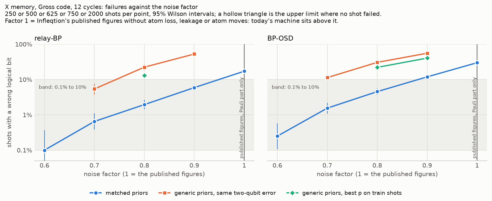

# Results: the Gross code under noise shaped like neutral-atom hardware

Task `infleqtion-noise`, branch `infleqtion-noise`. Plain-language summary: [README.md](README.md).
**A model built from Infleqtion's published figures, not Infleqtion's noise model.** Simulated, not measured.

**Status (2026-11-22, 12:05 UTC): final.** Every table below was measured; what was not run is listed at the end.

## In short

1. **Knowing the shape of the noise cuts failures several times over.** On the same shots, with priors matched to
   the noise instead of the kit's one-strength picture, BP-OSD at 0.8 of the published rates fails 91 of 2,000
   shots instead of 442 (against the best uniform p we could fit); relay-BP 9 of 500 instead of 65, with a quarter
   of the work. It holds at every factor tried, for both decoders, in X and in Z memory.
2. **The loss flags are worth even more**, and the shape still helps on top of them: with atoms being lost,
   relay-BP without flags fails 62 of 100 shots at factor 0.6, with flags 9 of the same 100; with flags and
   generic instead of matched priors, 47 of 150 against 10.
3. **Where the code works:** without loss, up to about 0.9 of the published rates (relay-BP 5.9% of shots failing
   at 0.9, 17% at 1). With loss, only up to somewhere between 0.6 and 0.8 (6% at 0.6, 57% at 0.8). **Today's published figures sit
   above both ranges, far above the one with loss**, and the model still leaves out leakage, atom moves and the
   mid-circuit readout their machine does not have yet.

## The model

Every rate is multiplied by one **factor**; factor 1 is the published figures. The published figures
(`model.PUBLISHED`; "M" measured on hardware, "F" a parameter of the authors' simulator, fitted to their hardware).
**Every figure below was checked by us** against the paper's own LaTeX source (arxiv.org/e-print) on 2026-11-22
(`checked=True` in `model.py`); none is taken from the research notes unchecked:

| Figure | Value | Kind | Source |
|---|---|---|---|
| phase error on each atom per CZ | 0.73% | F | arXiv:2509.13247v2, Appendix "System error model", table "Simulation Noise Model", row CZ |
| transitions per CZ between the five atom levels (scattering, leakage, loss) | matrix, ×10⁻⁶ | F | same row; the 4×4 block is Eq. 3 of arXiv:2408.08288v3 |
| loss per CZ of an atom in state 1 | 0.5% (none from state 0) | F | same row (matrix entry 5000×10⁻⁶) |
| CZ fidelity after discarding lost atoms, array median | 98.7% | M | arXiv:2509.13247v2, Appendix "Gate Fidelities" |
| readout: 0 read as 1, 1 read as 0 | 0.2%, 2.3% | F | arXiv:2509.13247v2, same table, row Measure |
| state preparation fidelity | 97.9% | F | same table, row State Prep |
| one-qubit gates: local, global | 99.80(5)%, 99.96(1)% | M | arXiv:2509.13247v2, Appendix "Gate Fidelities" |
| coherence with decoupling, T2 | 2.8 s (97% lower bound 128 ms) | M | arXiv:2408.08288v3, Sec. "Quantum processor implementation and characterization" |
| coherence without decoupling, T2* | 12.7(5) ms | M | same |
| readout time | 6 ms | M | arXiv:2408.08288v3, Sec. "Non-destructive State Selective Readout" |
| loss per CZ, one benchmarked pair | about 0.38% (CZ fidelity 99.35(4)%, 99.73(3)% after discarding lost atoms) | M | arXiv:2408.08288v3, Sec. "Quantum processor implementation and characterization" |

Our rates at factor 1 (`model.MODEL`):

| Where in the kit's circuit | Our channel | Rate | Status | How |
|---|---|---|---|---|
| after each CX | Z on the control, X on the target | 0.73% each | published | the CZ phase error per atom, carried to CX through the Hadamards on the target (README.md) |
| after each CX | one-atom depolarizing on both atoms | 0.0157% | derived | 3/4 of the state-averaged chance (2.09×10⁻⁴) that scattering leaves the atom in a qubit state |
| idle data atoms (the kit's three idle slots) | Z | 0.107% | our choice | (1 − e^(−t/T2))/2 with t = 6 ms, T2 = 2.8 s. No idle error per step is published |
| before each check readout | flip | 1.25% | derived | mean of 0.2% and 2.3%; mid-circuit use is our choice (their machine reads out only at the end) |
| after each check reset | flip | 2.1% | our choice | 1 − preparation fidelity; their machine has no mid-circuit reset |
| after each CX (question 2 only) | atom loss, each atom | 0.25% | derived | half of 0.5%: an atom is in state 1 half the time (our assumption) |

Total two-qubit Pauli error at factor 1: 1.486% per CX (`Noise.two_qubit_error`). Left out though published:
leakage (5.4×10⁻⁴ per atom per CZ), one-qubit gate errors (the kit's circuit has no one-qubit gate), loss during
readout (0.9%), state-dependent readout, and atom moves (2.6% to 4.1% phase error per move). Each would push
today's hardware further above factor 1.

## Checks

| Check | Result | Where |
|---|---|---|
| With every rate at the kit's uniform p = 0.004, our circuit's detector error model equals the kit's term for term (72,864 error terms for X memory, 73,296 for Z), and the circuits are equal | pass, X and Z | `test_uniform_rates_give_the_kits_detector_error_model` |
| At the model's rates: gates, detectors (1,728), observables (12), detector coordinates equal the kit's; noiseless shots give zero detectors and observables | pass, X and Z | `test_only_the_noise_differs_from_the_kit` |
| Matched priors are the model circuit's error model on the kit's columns; every model mechanism is a kit column (all 8,784 fire); generic priors come from the kit's uniform circuit; H and L do not depend on p | pass | `test_matched_priors_*`, `test_generic_priors_*` |
| No fitted quantity is scored on the shots it was fitted on: the generic p is fitted on train seeds 5100 (factor 0.8) and 5101 (factor 0.9), scored on test seed 4100 | enforced | `job.py` refuses equal seeds |
| Rows of one point decode the same shot file | enforced | `summarize.py` refuses to pair rows whose shot files differ (sha256) |
| A shot fails when any of the 12 observables is wrong; unconverged shots are scored on the decoder's output | by construction | `run._decode` |
| The truth reaches no decoder: a decoder gets the 936 X-check detector bits (and, with loss, the heralds); the observables are compared after decoding | by construction | `run._decode`; the loss shot files hold no loss times (`clifft_text(..., probes=False)`) |
| Our loss loop equals `python -m loss.job` (`starter`) on the kit's noise: shots bit-identical, decoding identical shot for shot | pass on 12 shots in the suite, and on 100 shots at p = 0.004, s = 10⁻³, seed 5300 (luminaty, lane C, 11:04 UTC): shots, heralds and decoding all equal, 3 failures each | `test_our_loss_loop_equals_*`, `loss_check.py`, `logs/loss_check.log` |
| Clifft (used for loss) samples our circuit like Stim at loss 0 | pass | `test_clifft_samples_our_circuit_like_stim_*` |
| Our loop on the kit's own noise gives the kit's failure rates | pass, both decoders (two seeds for relay-BP; table below) | `runs/lane_b.sh reference`, `checks`; `logs/reference.log`, `logs/checks.log` |
| A lost atom's partner keeps its own error in Clifft (our one-atom channels), unlike under a two-atom channel | pass | `test_the_partner_of_a_lost_atom_keeps_*` |

**The reference.** The kit's own uniform noise at p = 0.004, X memory, sampled by `make_shots.py` and decoded by
this folder's loop with the kit's priors; luminaty, 4 processes, 2026-11-22 (lane B 08:50-08:58, lane D 10:53-11:05
UTC). Results: `results/reference_*`.

| Decoder | Shots (seed) | Failures | Fraction (95% Wilson) | Kit README, X memory | Unconverged | Mean iterations |
|---|---|---|---|---|---|---|
| BP-OSD | 2,000 (4100) | 42 | 2.10% (1.56–2.83%) | 253 / 10,000 = 2.53% | 733 | 52 |
| relay-BP | 2,000 (4100) | 3 | 0.15% (0.05–0.44%) | | 1 | 524 |
| relay-BP | 2,000 (4101) | 12 | 0.60% (0.34–1.05%) | | 4 | 547 |
| relay-BP, both seeds | 4,000 | 15 | 0.38% (0.23–0.62%) | 45 / 10,000 = 0.45% | 5 | 535 |

Both decoders agree with the kit. The first relay-BP seed alone was low (3 against about 9 expected), so we ran a
second seed before using any relay-BP row; pooled, the two agree with the kit's 0.45%. Our relay-BP gets a fresh
decoder with seed 1 for every shot, as `loss/` does; the kit's `baseline.py` reuses one decoder per process.

**A control for the fitted generic p.** Under our model, BP-OSD decodes best with a uniform p about 2 to 4 times the
model's two-qubit error (question 1). Is that BP-OSD preferring inflated priors on any noise? No: on the kit's own
noise at p = 0.004 (seed 4100), BP-OSD with p = 0.011 in its priors fails 52 of the same 2,000 shots against 42 with
the true p (30 shots only the inflated priors get wrong, 20 only the true ones; exact sign test p = 0.20). So the
shift of the best uniform p is a property of the neutral-atom shape, not of BP-OSD.

## Pilot (not results)

The factors 0.6, 0.7, 0.8, 0.9 and the marked point 1 were chosen from a pilot of 40 to 100 shots per point (X
memory, seed 900, run inline under a one-minute cap; **no committed log**, so none of its numbers is quoted here).
Every number in the tables below comes from the logged runs.

## Question 1: what knowing the shape buys

The same shots, decoded twice by each decoder: with **matched** priors (the error model of the circuit that made the
shots) and with **generic** priors (the kit's uniform model). Two generic baselines, as the brief asks:

- **same two-qubit error**: the kit's uniform model at the p whose two-qubit error equals the model's total
  (p = 0.01486 × factor);
- **best p on train shots**: the kit's uniform model at the p that decodes best on 250 train shots of another seed
  (5100 at factor 0.8), found by a grid that is extended until its best point is inside it (`job.fit_generic`).
  Done for BP-OSD at factors 0.8 and 0.9 (train seeds 5100 and 5101) and for relay-BP at 0.8 on 100 train shots
  (seed 5100). Not done for relay-BP at 0.7 and 0.9 or for BP-OSD at 0.7: there the comparison is against the
  same-two-qubit-error baseline only, and the table says so.

X memory, test seed 4100 (the shots of question 3), luminaty. "Only generic wrong" counts the shots that only the
generic row gets wrong, "only matched wrong" the reverse; the p value is the exact two-sided sign test on them.

| Factor | Decoder | Generic picture | Shots | Failures: generic, matched | Only generic wrong | Only matched wrong | Sign test p | Mean iterations: generic, matched | Unconverged: generic, matched |
|---|---|---|---|---|---|---|---|---|---|
| 0.7 | relay-BP | same two-qubit error (p = 0.0104) | 500 | 27, 3 | 25 | 1 | 8e-7 | 3,571, 286 | 27, 0 |
| 0.7 | BP-OSD | same two-qubit error (p = 0.0104) | 2,000 | 227, 31 | 202 | 6 | 5e-52 | 74, 49 | 1,681, 840 |
| 0.8 | relay-BP | same two-qubit error (p = 0.0119) | 500 | 112, 9 | 104 | 1 | 5e-30 | 8,413, 1,113 | 102, 4 |
| 0.8 | relay-BP | **best p on train shots (p = 0.0457)** | 500 | 65, 9 | 57 | 1 | 4e-16 | 4,626, 1,113 | 54, 4 |
| 0.8 | BP-OSD | same two-qubit error (p = 0.0119) | 2,000 | 613, 91 | 540 | 18 | 7e-135 | 78, 60 | 1,883, 1,177 |
| 0.8 | BP-OSD | **best p on train shots (p = 0.0326)** | 2,000 | 442, 91 | 372 | 21 | 4e-84 | 75, 60 | 1,757, 1,177 |
| 0.9 | relay-BP | same two-qubit error (p = 0.0134) | 250 | 132, 14 | 118 | 0 | 6e-36 | 13,813, 2,630 | 126, 7 |
| 0.9 | BP-OSD | same two-qubit error (p = 0.0134) | 2,000 | 1,113, 238 | 887 | 12 | 3e-244 | 79, 69 | 1,965, 1,482 |
| 0.9 | BP-OSD | **best p on train shots (p = 0.0719)** | 625 | 253, 82 | 182 | 11 | 4e-41 | 77, 69 | 575, 466 |

The generic rows on their own, with intervals (the matched rows are in question 3's table):

| Factor | Decoder | Generic picture | Failed shots (95% Wilson) | Per cycle |
|---|---|---|---|---|
| 0.7 | relay-BP | same two-qubit error | 27 / 500 = 5.4% (3.7–7.7%) | 4.6e-3 |
| 0.7 | BP-OSD | same two-qubit error | 227 / 2,000 = 11.4% (10.0–12.8%) | 1.0e-2 |
| 0.8 | relay-BP | same two-qubit error | 112 / 500 = 22.4% (19.0–26.3%) | 2.1e-2 |
| 0.8 | relay-BP | best p on train shots | 65 / 500 = 13.0% (10.3–16.2%) | 1.2e-2 |
| 0.8 | BP-OSD | same two-qubit error | 613 / 2,000 = 30.7% (28.7–32.7%) | 3.0e-2 |
| 0.8 | BP-OSD | best p on train shots | 442 / 2,000 = 22.1% (20.3–24.0%) | 2.1e-2 |
| 0.9 | relay-BP | same two-qubit error | 132 / 250 = 52.8% (46.6–58.9%) | 6.1e-2 |
| 0.9 | BP-OSD | same two-qubit error | 1,113 / 2,000 = 55.7% (53.5–57.8%) | 6.5e-2 |
| 0.9 | BP-OSD | best p on train shots | 253 / 625 = 40.5% (36.7–44.4%) | 4.2e-2 |

**Bold** in the paired table: the better generic baseline of its point (lower failure rate), where both were run. Rows on fewer than 2,000 shots are the
first shots of the 2,000 (relay-BP's generic rows are slow: up to 18,080 iterations a shot). Failure rates of every
row with intervals: `results/X_tables.md`; per-shot outcomes: `results/X_per_shot.npz`.

**What it shows.**

- **Knowing the shape cuts failures several times over, at every factor and for both decoders**, and the shots it
  loses are rare: at factor 0.8, BP-OSD with matched priors fails 91 of 2,000 shots, against 442 with the best
  uniform p and 613 at the same two-qubit error; 372 shots only the best generic picture gets wrong, 21 only the
  matched one.
- **For relay-BP the wrong picture also costs work**: 4 to 12 times the iterations per shot (4.2 times against the
  fitted p at 0.8), and many more shots that never converge (54 of 500 against 4 at 0.8). Iterations do not depend
  on the machine. For BP-OSD the cost shows as unconverged shots, each of which runs the slow OSD step.
- **Why.** The matched picture knows that most faults are single readout-like events and that hook faults almost
  never happen (`logs/explain.log`): at factor 0.7 it expects 77 faults per shot, 59% of them readout-like and 0.2%
  that flip 5 or 6 detectors. The uniform picture at the same two-qubit error expects 122, 26% readout-like and
  7.9% of the 5-or-6 kind; it rates 5,256 of the 8,784 kinds of fault at least 20 times likelier than they are.
- **The best uniform p is not the true strength.** For BP-OSD at factor 0.8 the best uniform p on train shots is
  about 2 to 4 times the same-two-qubit-error p at factor 0.8 (train failures, of 250: 89 at 1×, 77 at 1.4×, 75 at
  1.96×, 58 at 2.74×, 61 at 3.84×) and about 5 times at 0.9 (107, 103, 97, 87, 100 at 1.96× to 7.53×); relay-BP's
  at 0.8 about 4 times (25, 19, 14, 15 of 100 at 1×, 1.96×, 3.84×, 5.38×). `results/X_fit.json` has every point. The control above shows that BP-OSD does not prefer inflated priors on
  the kit's own noise, so this too is the shape at work. A decoder told only "the noise is about this strong" is
  hard to tune by hand.

**What it does not show.** The matched priors are exact: they come from the very model that made the shots. On real
hardware they would come from calibration and would be only approximately right, so the gain here is the ceiling
of what knowing the shape can give, not what a calibrated decoder would get.

## Question 3: where the code starts to work

Every rate of the model times one factor; matched priors; X memory, 12 cycles. A shot fails when any of the 12
logical bits is wrong. Test shots seed 4100 (luminaty, `logs/shots.log`); 2,000 shots per point except relay-BP at
1, where its slow shots are costly (fewer shots, marked).

| Factor | Two-qubit error per CX | relay-BP: failed shots (95% Wilson) | per cycle | BP-OSD: failed shots (95% Wilson) | per cycle |
|---|---|---|---|---|---|
| 0.6 | 0.89% | 2 / 2,000 = 0.10% (0.03–0.36%) | 8.3e-5 | 5 / 2,000 = 0.25% (0.11–0.58%) | 2.1e-4 |
| 0.7 | 1.04% | 13 / 2,000 = 0.65% (0.38–1.11%) | 5.4e-4 | 31 / 2,000 = 1.55% (1.09–2.19%) | 1.3e-3 |
| 0.8 | 1.19% | 39 / 2,000 = 1.95% (1.43–2.65%) | 1.6e-3 | 91 / 2,000 = 4.55% (3.72–5.55%) | 3.9e-3 |
| 0.9 | 1.34% | 118 / 2,000 = 5.9% (5.0–7.0%) | 5.1e-3 | 238 / 2,000 = 11.9% (10.6–13.4%) | 1.1e-2 |
| 1 (the published figures) | 1.49% | 129 / 750 = 17.2% (14.7–20.1%), 750 shots | 1.6e-2 | 599 / 2,000 = 30.0% (28.0–32.0%) | 2.9e-2 |

With atom loss: `results/X_loss_failure_vs_factor_X_loss.png`; Z memory: `results/Z_failure_vs_factor_Z.png`.

**Relay-BP fails between 0.1% and 10% of shots from factor 0.6 to just above 0.9.** BP-OSD reaches 10% a little
below 0.9. **With atom loss added (question 2), the range moves down: it starts between factors 0.4 and 0.5 and ends
between 0.6 and 0.8**, and at 0.8
of the published figures more than half the runs fail.

**Where today's hardware sits.** The Pauli part of the published figures (factor 1) is just above that range:
relay-BP fails about one shot in six. That is **not** today's machine running this experiment, which sits further
above it, for four reasons this model leaves out:

- **atom loss**: about 0.4% of a pair per gate on their best pair, 0.5% from state 1 in their simulator. Question
  2 below adds it, and then the code works only up to a factor between 0.6 and 0.8;
- **leakage** (5×10⁻⁴ per atom per gate) and **atom moves**: the Gross code needs gates between distant atoms,
  and on today's machine a move costs 2.6% to 4.1% phase error in their table;
- **mid-circuit readout and reset**: their machine has neither today; the rates here are our assumptions;
- the **figures are the authors' simulator parameters** fitted to small circuits, not a benchmark of this code.

And one choice of ours moves factor 1 itself: the idle error. We charge each idle slot 6 ms at the decoupled
T2 = 2.8 s (0.107% phase error). The paper's 97% lower bound on T2, 128 ms, would make it 2.3%, about 20 times
larger, and then factor 1 would sit further above the range.

**Why the factor reaches so far.** At factor 0.7 the two-qubit error is 1.04% per CX, 2.6 times the kit's
p = 0.004; yet relay-BP fails 0.65% of shots, close to the kit's 0.45% at p = 0.004 (the kit's `README.md`; our
reference above, two seeds: 0.38%). A phase error on a CZ arrives on the kit's CX as Z on the control and X on the target;
neither spreads through the rest of the check's gates, so this noise makes almost no "hook" faults (one check atom
spreading its fault onto several data atoms). In the matched picture 0.2% of the expected faults flip 5 or 6
detectors, against 7.9% in the kit's uniform picture (`logs/explain.log`). Noise of this shape is easier for this
code than its strength suggests, **provided the decoder knows the shape** (question 1).

## Z memory

The same at factors 0.7 and 0.8 for Z memory (data prepared in |0⟩, decoded from the 936 Z-check detectors), test
seed 4200, luminaty; `results/Z_*`, `logs/z_memory.log`. Only the generic baseline at the same two-qubit error was
run.

| Factor | Decoder | Matched: failures (95% Wilson) | Generic, same two-qubit error | Paired: only generic wrong / only matched wrong (p) | Mean iterations: generic, matched |
|---|---|---|---|---|---|
| 0.7 | relay-BP | 3 / 2,000 = 0.15% (0.05–0.44%) | not run | | |
| 0.7 | BP-OSD | 14 / 2,000 = 0.70% (0.42–1.17%) | not run | | |
| 0.8 | relay-BP | 13 / 2,000 = 0.65% (0.38–1.11%) | 67 / 500 = 13.4% (10.7–16.7%) | 64 / 1 (4e-18), on 500 shots | 6,699, 447 |
| 0.8 | BP-OSD | 32 / 2,000 = 1.60% (1.14–2.25%) | 440 / 2,000 = 22.0% (20.2–23.9%) | 415 / 7 (8e-113) | 77, 54 |

Z memory fails about three times less often than X memory at the same factor (relay-BP at 0.8: 0.65% against
1.95%). Our reading, not tested: the idle error of this model is a phase error (Z), and only X memory's logical bits
are flipped by Z errors on the data. The shape matters as much in Z as in X. The kit's pair rate (a pair fails when
its X or its Z shot fails) is not computed here: X and Z were sampled with different seeds and are not paired.

## Question 2: what the loss flags add

**The setup.** The same circuit and Pauli model, plus atom loss: after every CX each of its two atoms is lost with
probability 0.25% × factor (half the published 0.5% from state 1). The shots come from Clifft through `loss/`'s
circuit text and readout model, unchanged (`make_shots.sample_loss`): a lost atom takes no part in later gates, its
readout is flagged and records a random bit, a reset brings a lost check atom back, and a lost data atom stays lost
and is flagged only at the final readout. At factor 0.4 the loss rate is 10⁻³ per atom per CX, the rate `loss/`
studied most: 10 data atoms are lost per shot on average. **The loss share** follows Infleqtion's simulator table
(0.5% from state 1, beside 0.73% phase error per atom): a CX loses one of its atoms with probability about
2 × 0.25% = 0.5%, against 1.49% Pauli error, so loss is about a quarter of the CX error here. On their best measured
pair (arXiv:2408.08288) loss was 58% of the CZ error; we followed the simulator table, which describes the array. Our choices beyond `loss/`'s: our CX noise is one channel
per atom, so the partner of a lost atom still gets its own phase or bit error (`loss/`'s two-atom channel is
skipped whole); no loss at readout or idle; flags are perfect.

**The decoders.** Relay-BP at the kit's settings (fresh decoder, seed 1, per shot), on the kit's H and L:

- **with flags**: `loss/`'s flag-aware recipe (`starter`, the published method: raise the columns a flagged atom
  can fire), added on top of our Pauli priors, matched or generic;
- **without flags** (`blind`): the same Pauli priors and no use of the flags.

The decoder gets the detector bits and the flags, never when or where an atom was really lost (the shot files do not
hold it). Test seed 6100, luminaty; `results/X_loss_*`, `logs/q2_loss.log`.

| Factor | Picture | Failures / shots | Fraction (95% Wilson) | Unconverged | Mean iterations |
|---|---|---|---|---|---|
| 0.4 | with flags, matched | 0 / 2,000 | 0% (0–0.19%) | 0 | 133 |
| 0.4 | with flags, generic (same two-qubit error) | 3 / 1,000 | 0.30% (0.10–0.88%) | 1 | 709 |
| 0.4 | without flags, matched | 18 / 300 | 6.0% (3.8–9.3%) | 9 | 3,003 |
| 0.6 | with flags, matched | 60 / 1,000 | 6.0% (4.7–7.7%) | 44 | 2,222 |
| 0.6 | with flags, generic (same two-qubit error) | 47 / 150 | 31.3% (24.5–39.1%) | 45 | 9,611 |
| 0.6 | without flags, matched | 62 / 100 | 62% (52–71%) | 51 | 13,547 |

Paired, on the same shots:

| Factor | Comparison | Shots | Failures | Only the first wrong / only the second | Exact sign test p | Mean iterations |
|---|---|---|---|---|---|---|
| 0.4 | without flags against with flags (matched) | 300 | 18, 0 | 18 / 0 | 7.6e-6 | 3,003 against 125 |
| 0.6 | without flags against with flags (matched) | 100 | 62, 9 | 53 / 0 | 2.2e-16 | 13,547 against 2,489 |
| 0.4 | generic against matched (with flags) | 1,000 | 3, 0 | 3 / 0 | 0.25 | 709 against 119 |
| 0.6 | generic against matched (with flags) | 150 | 47, 10 | 37 / 0 | 1.5e-11 | 9,611 against 2,096 |

**What it shows.**

- **The flags are worth the most.** Without them relay-BP fails 6% of shots at factor 0.4 (300 shots) and 62% at
  0.6 (100 shots); with them, 0% (2,000 shots) and 6% (1,000 shots; 9 of the same 100). No shot was lost by using
  the flags.
- **Knowing the shape still pays under loss**, on top of the flags: at factor 0.6, 47 failures with generic Pauli
  priors against 10 with matched ones on the same 150 shots, and 4.6 times the iterations. At 0.4 both are near
  zero and only the work differs (6 times the iterations).
- **Loss moves the working range down a long way.** Without loss relay-BP fails 0.1% at factor 0.6; with loss and
  its flags, 6%. Question 3 again, now with loss (flag-aware, matched priors, seed 6100):

  | Factor | Loss per atom per CX | Lost data atoms per shot | Failed shots (95% Wilson) | Mean iterations |
  |---|---|---|---|---|
  | 0.3 | 0.075% | about 7.5 | 0 / 1,000 (0–0.38%) | 63 |
  | 0.4 | 0.1% | about 10 | 0 / 2,000 (0–0.19%) | 133 |
  | 0.5 | 0.125% | about 12.5 | 8 / 1,000 = 0.8% (0.41–1.57%) | 493 |
  | 0.6 | 0.15% | about 15 | 60 / 1,000 = 6.0% (4.7–7.7%) | 2,222 |
  | 0.8 | 0.2% | about 20 | 170 / 300 = 56.7% (51.0–62.2%) | 13,217 |

  **With loss the code works (0.1% to 10% of shots failing) only from a factor between 0.4 and 0.5 (0 of 2,000
  at 0.4, 0.8% at 0.5) to one between 0.6 and 0.8 (6% at 0.6, 57% at 0.8).** The published
  figures, loss included, sit far above that range: at 0.8 of them more than half the runs fail. This is the honest
  headline of question 3. (Lost data atoms per shot: 144 × (1 − (1 − s)^72), the count `loss/RESULTS.md` confirms.)
- Only the generic baseline at the same two-qubit error was run under loss; the fitted one was not.

## What was not done

- **PriorTilt** with matched priors (the brief's optional decoder) and **the network**: not run.
- **The fitted generic p** was run for BP-OSD at factors 0.8 and 0.9 and for relay-BP at 0.8 only; not for relay-BP
  at 0.7 and 0.9, BP-OSD at 0.7, Z memory, or any row with loss. Those comparisons are against the generic baseline
  at the same two-qubit error, which overstates the noise, and the tables name it.
- **Generic rows** were not run at factor 0.6 (X), at 1, or at 0.7 in Z memory. Relay-BP's generic rows use the first
  250 or 500 of the 2,000 shots; relay-BP's matched row at 1 uses 750.
- **Z memory** only at factors 0.7 and 0.8; the kit's pair rate (X and Z together) is not computed.
- **Loss**: relay-BP only (no BP-OSD); the rows without flags on 300 and 100 shots; one loss rate per factor (no
  separate loss knob); perfect flags; no loss at readout or idle.
- **Left out of the model**: leakage, one-qubit gate errors, readout loss, state-dependent readout, atom moves.
- **Times** per shot are in the tables (`Mean ms per shot`) but are not quoted anywhere: the machine was shared and
  both threads of each core were busy. Iterations are the machine-independent cost.

## Machine, commands, seeds

**Machine.** luminaty (AMD Ryzen 7 7730U, 8 cores / 16 threads), Python 3.12.15, stim 1.16.0, ldpc 2.4.1, relay-bp
0.2.2, clifft 0.13.0, numpy 2.5.5. Every run used 4 worker processes on one lane of 4 hardware threads, niced
(lanes B, C, D: CPUs 8-11, 12-15, 0-3). Failure counts and iterations do not depend on the number of processes (every relay-BP shot gets a fresh decoder
with seed 1; BP-OSD is deterministic): one BP-OSD part (125 shots) and one relay-BP part (50 shots) decoded again
with 1 process gave the same outcome on every shot (`logs/checks.log`). Milliseconds depend on the machine and are
inflated because both threads of each core were busy.

**Commands.** Every row was made by `python -m neutral_atom_noise.job` (shots, decoding, fit), called by the
functions of `runs/lane_b.sh`; each call appends to `logs/<name>.log`, which repeats the job's command line, the time
and the commit at the start of each hold. `runs/collect.sh` rebuilt `results/` from the run folders. To get a table
back, run the job with the same arguments. On this PC the same seed gives the same shot file: resampling factor
0.6, seed 4100 gave the logged sha256 again (`logs/checks.log`). On another machine the shots may differ (the brief:
seeds do not transfer between machines); the printed sha256 says whether they did, and the rates should then agree
within their intervals:

| Table | Job arguments (from `challenge-1-ml-decoder-kit/`) | Log |
|---|---|---|
| reference | `make_shots --basis X --uniform-p 0.004 --shots 2000 --seed 4100` (and `--seed 4101`), then `run --decoder bposd|relay --priors uniform:0.004`; BP-OSD also `--priors uniform:0.011` | `reference.log`, `checks.log` |
| question 1 and 3 (X) | `job --basis X --shots 2000 --seed 4100 --train-seed 5100 --train-shots 250 --workers 4 --part 125 --relay-part 50`, with `--factors 0.6,0.7,0.8 --decoders relay,bposd --rows matched`; `--factors 0.9,1 --decoders bposd --rows matched`; `--factors 0.9 --decoders relay --rows matched`; `--factors 1 --decoders relay --rows matched --first 750`; `--factors 0.8,0.9,0.7 --decoders bposd --rows generic-2q`; `--factors 0.9 --decoders relay --rows generic-2q --first 250`; `--factors 0.8 --decoders relay --rows generic-2q --first 500`; `--factors 0.7 --decoders relay --rows generic-2q --first 500`; `--factors 0.8 --decoders bposd --rows generic-fit`; `--factors 0.8 --decoders relay --rows generic-fit --first 500 --train-first 100 --grid 1,1.96,3.8416`; `--factors 0.9 --decoders bposd --rows generic-fit --train-seed 5101 --grid 1.96,2.744,3.8416 --first 625` | `q1_*.log` |
| question 2 (X with loss) | `job --basis X --loss --shots 2000 --seed 6100 --workers 4 --relay-part 50 --decoders relay`, with `--factors 0.4 --rows starter/matched`; `--factors 0.4 --rows starter/generic-2q --first 1000`; `--factors 0.4 --rows blind/matched --first 300`; `--factors 0.6 --rows starter/matched --first 1000`; `--factors 0.6 --rows starter/generic-2q --first 150`; `--factors 0.6 --rows blind/matched --first 100`; `--factors 0.3,0.5 --rows starter/matched --first 1000`; `--factors 0.8 --rows starter/matched --first 300` | `q2_loss.log` |
| Z memory | `job --basis Z --shots 2000 --seed 4200 --workers 4 --part 125 --relay-part 50`, with `--factors 0.7,0.8 --decoders relay,bposd --rows matched`; `--factors 0.8 --decoders bposd --rows generic-2q`; `--factors 0.8 --decoders relay --rows generic-2q --first 500` | `z_memory.log` |
| the loss check | `loss_check --shots 100 --p 0.004 --s 1e-3 --seed 5300 --workers 4` | `loss_check.log` |

**Seeds and shot files.** Test shots: 4100 (X), 4200 (Z), 6100 (X with loss), 4100 and 4101 (reference); train shots
of the fitted generic p: 5100 (factor 0.8) and 5101 (factor 0.9), never a test seed (`job.py` refuses it). The shot
files stay in `/home/sal/hackMidwest/orchestration/scratch/infleqtion-noise/runs/` and are not committed; their
sha256 are in `logs/shots.log` and in the first lines of each log. Every row of a point decoded the same file:
`summarize.py` refuses to pair rows whose files differ.

**Per-shot outcomes.** `results/<table>_per_shot.npz` holds, for every row, whether each shot failed and converged,
and its iterations, so every count and paired test above can be recomputed without decoding.
