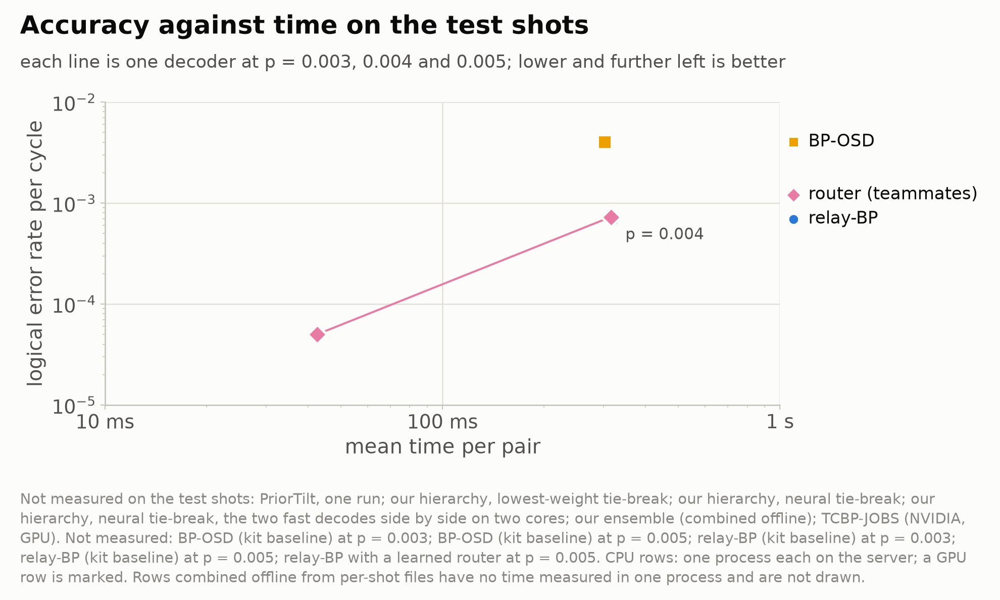

# Appendix to REPORT.md: the full tables

Written by `python -m report.make_tables` from the files under `report/data/`. Each table is also in `report/tables/`
as Markdown and as CSV.

## A. The test shots: every row, per noise level

<!-- BEGIN table:test_p0.003 -->
<!-- END table:test_p0.003 -->

<!-- BEGIN table:test_p0.004 -->
<!-- END table:test_p0.004 -->

<!-- BEGIN table:test_p0.005 -->
<!-- END table:test_p0.005 -->

## B. Paired comparisons on the test shots

<!-- BEGIN table:test_comparisons -->
<!-- END table:test_comparisons -->

## C. The teammates' earlier runs on the same test files, as a cross-check

<!-- BEGIN table:earlier_runs -->
<!-- END table:earlier_runs -->

## D. TCBP-JOBS on its own sampled shots

<!-- BEGIN table:tcbp_own_shots -->
<!-- END table:tcbp_own_shots -->

## E. Exploration shots

<!-- BEGIN table:exploration_p0.004 -->
<!-- END table:exploration_p0.004 -->

<!-- BEGIN table:where_failures -->
<!-- END table:where_failures -->

<!-- BEGIN table:exploration_p0.005 -->
<!-- END table:exploration_p0.005 -->

## F. Atom loss

<!-- BEGIN table:loss -->
<!-- END table:loss -->

## G. The networks

<!-- BEGIN table:networks -->
<!-- END table:networks -->

## H. What we measured before building, and what did not work

<!-- BEGIN table:background -->
<!-- END table:background -->

## I. Checks made on every run

<!-- BEGIN table:checks -->
<!-- END table:checks -->
