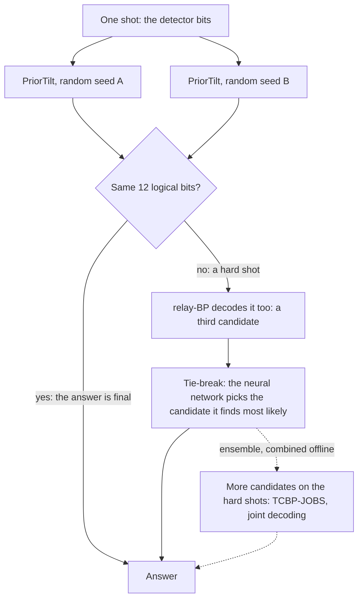
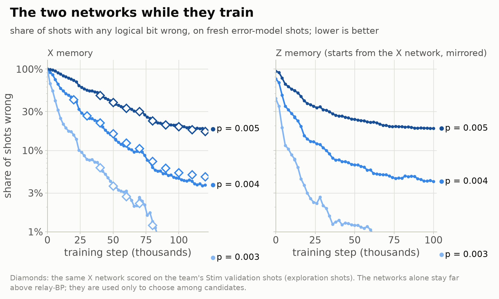
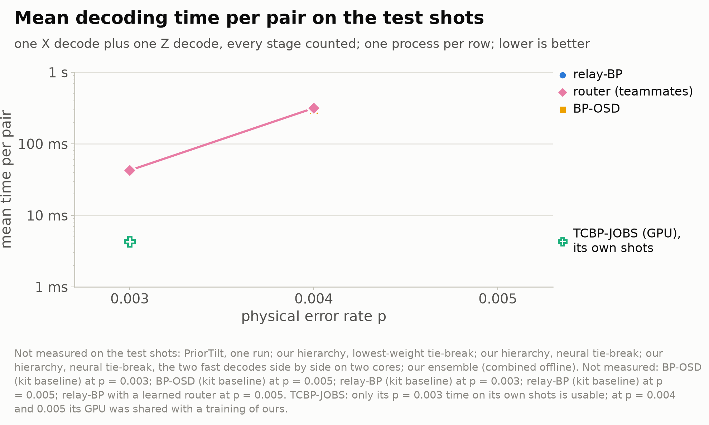
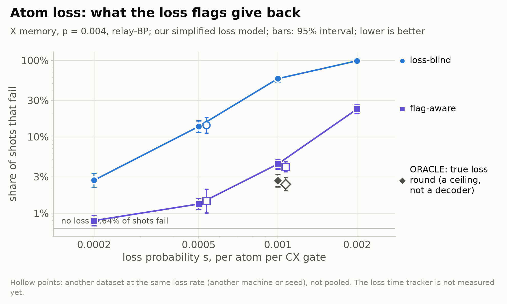

# A hierarchical decoder for the Gross code with a learned tie-breaker

Infleqtion Challenge 1 (ML-assisted decoding of the Gross code `[[144, 12, 12]]`), our part of the team's work.
The teammates' part, a learned router on relay-BP's first answer, is described in the top-level `README.md`.

**How to read this page.** Every table is written by `python -m report.make_tables` and every figure by
`python -m report.make_plots`, from the result files copied into `report/data/` (`report/data/SOURCES.md` says where
each came from). Every single number in the text is written by the same script and listed in `report/tables/facts.md`.
A row that was not measured says "not measured". Numbers on the **test shots** and numbers on **exploration shots**
(the train and validation files, on which choices were made) are kept in separate tables and are labelled wherever
they appear. The full tables are in `APPENDIX.md`. Much of the code was written with AI coding assistants under the
team's direction, as the challenge allows.

## 1. The question

A quantum memory measures parity checks over and over. A **decoder** reads which checks fired (the syndrome) and says
which of the 12 logical bits were flipped by errors. It fails when it gets any of the 12 bits wrong. The challenge
gives two decoders as baselines, BP-OSD and relay-BP, and asks whether machine learning can improve on them in
accuracy, in speed, or in the handling of atom loss.

Our question: **can a hierarchy of fast decoders, with a neural network that settles the hard cases, fail less often
than relay-BP without taking more time?** And for atom loss: how much do the loss flags give back, and what is still
to gain?

The experiment is the kit's, unchanged: X memory and Z memory of the Gross code, 12 noisy cycles, physical error
rate p = 0.003, 0.004 and 0.005. Shot k of X memory is paired with shot k of Z memory; a pair fails when either
fails; with failure fraction P over the pairs, the logical error rate per cycle is `1 - (1 - P)^(1/12)`. Every time
is per pair: one X decode plus one Z decode.

## 2. The approach in one picture



1. **Two fast decodes.** PriorTilt is a belief-propagation decoder published by IonQ for this code. When it gets
   stuck it nudges its inputs at random and tries again, so two runs with different random seeds can end on
   different answers.
2. **The agreement test.** If both runs predict the same 12 bits, that is the answer. This is the hierarchy's router,
   and nothing in it is learned.
3. **The hard shots.** Where the two runs differ, relay-BP decodes the shot as a third opinion, and a tie-break
   chooses among the candidates: a neural network (the learned part), or, without a network, the candidate with the
   most probable set of faults ("lowest weight").
4. **The ensemble** adds stronger members on the hard shots and lets the same network choose among all of them. It is
   combined offline from the members' saved answers; it is not one decoder timed in one process.

Why this shape: on the exploration shots at p = 0.004 the two fast decodes disagree on <!--f:expl_disagree-->214<!--/f--> of
<!--f:expl_shots-->50,000<!--/f--> shots (<!--f:expl_disagree_share-->0.4%<!--/f-->), and those few shots hold <!--f:expl_one_run_wrong_disagree-->145<!--/f--> of the
<!--f:expl_one_run_wrong-->208<!--/f--> failures of a single fast decode. The expensive stage runs only there. The test shots show the same: at
p = 0.004 the two runs of our decoder disagree on <!--f:tsplit_disagree-->90<!--/f--> of <!--f:tsplit_shots-->20,000<!--/f--> shots, which hold <!--f:tsplit_fail_disagree-->27<!--/f--> of its
<!--f:tsplit_fail-->44<!--/f--> failed shots (the figure).


## 3. What is learned, and what machine learning does here

| Part | Learned? | Whose work |
|---|---|---|
| PriorTilt's schedule (14 parameters per noise level) | fitted by its authors on their circuits; used unchanged | IonQ (arXiv:2611.13373) |
| "the two seeds disagree" as the test for a hard shot | no | ours |
| relay-BP as the third candidate | no: the kit's settings | the kit |
| the tie-break by lowest weight | no | ours |
| **the tie-break by the neural network** | **yes**: trained on shots drawn fresh from the kit's error model | ours |
| the loss-aware priors and the loss-time tracker (section 5) | the tracker is the learned part | ours |
| the router on relay-BP's first answer (a separate row of the table) | yes: a logistic model | teammates |

**The network.** A convolutional network that follows the code's own connections (each check touches six data
qubits, each data qubit six checks, the same weights at all 72 positions of the torus), after the published "Cascade"
recipe (arXiv:2604.08358), written by us from the paper's description and scaled down to one laptop GPU:
<!--f:net_parameters-->893,697<!--/f--> parameters per memory basis. It reads all 1,728 detector bits of a shot and gives 12 numbers, one
per logical bit.

**Its role.** Alone, the network is a poor decoder: on the test shots at p = 0.004 it gets <!--f:netalone4_X-->4.2%<!--/f--> of X-memory
shots wrong and <!--f:netalone4_Z-->4.3%<!--/f--> of Z-memory shots, where relay-BP gets <!--f:t4_relay_bp_xz-->36, 47<!--/f--> of 10,000 shots wrong (X, Z;
`APPENDIX.md`, "The networks"). It is not asked to decode.
It is asked which of two or three given answers is more likely, on the few shots where the fast decoders disagree.
That is an easier question, and one where the classical score is weak: among 16 relay-BP candidates the right answer
is present on <!--f:cand_present-->114<!--/f--> of <!--f:cand_shots-->145<!--/f--> hard shots, and the lowest weight picks it on only <!--f:cand_lowest-->71<!--/f-->
(exploration shots; `APPENDIX.md`, "What we measured before building"). How it turned out: the network clearly beats the
lowest weight, and on the test shots it is <!--f:abl_verdict-->no better than<!--/f--> the best hand-written rule (lowest weight among the candidates
that converged): in one offline decode of the test shots at the three p, <!--f:abl_pooled_a-->544<!--/f--> against <!--f:abl_pooled_aw-->525<!--/f--> failed pairs (section 4, the ablation).



## 4. Results on the test shots

The team's saved test files: 10,000 shots per basis and noise level. Every setting was frozen before they were opened, at
commit `<!--f:test_frozen_commit-->fd3aed3c0d1f<!--/f-->`. Before the test files were opened, the tie-break of each basis was chosen on the
exploration shots at p = 0.004 with the final networks, and the test job chose the <!--f:rule_X-->network<!--/f--> for X memory
(<!--f:rule_X_network-->60<!--/f--> failures with the network against <!--f:rule_X_converged-->67<!--/f--> for the best classical rule, on <!--f:rule_X_shots-->25,000<!--/f--> shots)
and the <!--f:rule_Z-->network<!--/f--> for Z memory (<!--f:rule_Z_network-->68<!--/f--> against <!--f:rule_Z_converged-->73<!--/f-->). These choices are in the test job's printout,
`report/data/test/test_run.out`. A timed
row ran through the team's evaluator (`evaluation.evaluate`) in one process on the team's server. A row marked "from
per-shot files" is combined offline from saved answers and has no time measured in one process.

<!-- BEGIN table:test_sweep -->
| Decoder | p = 0.003 | p = 0.004 | p = 0.005 |
|---|---|---|---|
| BP-OSD (kit baseline) | 5.01e-04 ± 6.5e-05 · 60 pairs · 131 ms | 4.02e-03 ± 1.8e-04 · 472 pairs · 302 ms | 2.30e-02 ± 4.6e-04 · 2433 pairs · 581 ms |
| relay-BP (kit baseline) | 4.17e-05 ± 1.9e-05 · 5 pairs · 85.3 ms | 6.94e-04 ± 7.6e-05 · 83 pairs · 319 ms | 7.33e-03 ± 2.5e-04 · 845 pairs · 1,471 ms |
| relay-BP with a learned router | 5.00e-05 ± 2.0e-05 · 6 pairs · 41.0 ms | 7.28e-04 ± 7.8e-05 · 87 pairs · 315 ms | 6.99e-03 ± 2.5e-04 · 807 pairs · 1,928 ms |
| PriorTilt, one run | 3.33e-05 ± 1.7e-05 · 4 pairs · 22.7 ms | 6.19e-04 ± 7.2e-05 · 74 pairs · 87.3 ms | 5.15e-03 ± 2.1e-04 · 601 pairs · 264 ms |
| our hierarchy, lowest-weight tie-break | 3.33e-05 ± 1.7e-05 · 4 pairs · 46.9 ms · **run after the test results were seen (an ablation)** · pre-registered offline decode: 3 pairs | 5.01e-04 ± 6.5e-05 · 60 pairs · 215 ms · **run after the test results were seen (an ablation)** · pre-registered offline decode: 57 pairs | 4.50e-03 ± 2.0e-04 · 527 pairs · offline, no time |
| our hierarchy, classical tie-break (lowest weight among the converged candidates) | 3.33e-05 ± 1.7e-05 · 4 pairs · 46.3 ms | 4.34e-04 ± 6.0e-05 · 52 pairs · 218 ms | 3.99e-03 ± 1.8e-04 · 469 pairs · offline, no time |
| our hierarchy, neural tie-break | 2.50e-05 ± 1.4e-05 · 3 pairs · 45.7 ms | 3.67e-04 ± 5.5e-05 · 44 pairs · 216 ms | 4.08e-03 ± 1.9e-04 · 479 pairs · 825 ms |
| our hierarchy, neural tie-break, the two fast decodes side by side on two cores | 2.50e-05 ± 1.4e-05 · 3 pairs · 28.9 ms | 3.67e-04 ± 5.5e-05 · 44 pairs · 150 ms | 4.08e-03 ± 1.9e-04 · 479 pairs · 608 ms |
| our ensemble (combined offline) | 1.67e-05 ± 1.2e-05 · 2 pairs · offline, no time | 1.33e-04 ± 3.3e-05 · 16 pairs · offline, no time | 3.05e-03 ± 1.6e-04 · 360 pairs · offline, no time; fails exactly TCBP-JOBS's shots |
| TCBP-JOBS (NVIDIA, GPU) | 2.50e-05 ± 1.4e-05 · 3 pairs · 3.9 ms | 3.42e-04 ± 5.3e-05 · 41 pairs · 7.8 ms | 3.05e-03 ± 1.6e-04 · 360 pairs · 16.9 ms |
| our hierarchy, classical tie-break (lowest weight among the converged candidates), the two fast decodes side by side on two cores | 3.33e-05 ± 1.7e-05 · 4 pairs · 29.0 ms · **run after the test results were seen (an ablation)** | 4.34e-04 ± 6.0e-05 · 52 pairs · 150 ms · **run after the test results were seen (an ablation)** | not measured |

Each cell: logical error rate per cycle ± the kit's error · failed pairs of 10,000 · mean time per pair. "Offline" marks a row combined from saved per-shot answers, with no time measured in one process. A cell marked "run after the test results were seen (an ablation)" is a row the team asked for after the test results were seen: an ablation, not our decoder. Test shots; `report/tables/test_p<p>.md` has the intervals, the paired counts and where each row ran.
<!-- END table:test_sweep -->




**What the numbers say.**

- **Our decoder**, timed rows, against relay-BP's timed row (one decoder through all 10,000 shots):
  - <!--f:findings3-->At p = 0.003 our decoder fails 3 of 10,000 pairs, relay-BP 5 (only ours fails 0, only relay-BP 2, exact p = 0.50), in 45.7 ms per pair against relay-BP's 85.3 ms per pair, or 28.9 ms per pair with its two fast decodes side by side on two cores; PriorTilt run once fails 4 in 22.7 ms per pair.<!--/f-->
  - <!--f:findings4-->At p = 0.004 our decoder fails 44 of 10,000 pairs, relay-BP 83 (only ours fails 15, only relay-BP 54, exact p = 3e-06), in 216 ms per pair against relay-BP's 319 ms per pair, or 150 ms per pair with its two fast decodes side by side on two cores; PriorTilt run once fails 74 in 87.3 ms per pair.<!--/f-->
  - <!--f:findings5-->At p = 0.005 our decoder fails 479 of 10,000 pairs, relay-BP 845 (only ours fails 93, only relay-BP 459, exact p = 4e-59), in 825 ms per pair against relay-BP's 1,471 ms per pair, or 608 ms per pair with its two fast decodes side by side on two cores; PriorTilt run once fails 601 in 264 ms per pair.<!--/f-->
- **Against TCBP-JOBS.** <!--f:tcbp_statement-->Against TCBP-JOBS, NVIDIA's GPU decoder, on the same test pairs: at p = 0.003 TCBP-JOBS and our decoder fail as many pairs (3 against 3; only TCBP-JOBS fails 1, only ours 1, exact p = 1.00, not a significant difference); at p = 0.004 TCBP-JOBS fails fewer pairs than our decoder (41 against 44; only TCBP-JOBS fails 17, only ours 20, exact p = 0.74, not a significant difference); at p = 0.005 TCBP-JOBS fails fewer pairs than our decoder (360 against 479; only TCBP-JOBS fails 95, only ours 214, exact p = 1e-11). TCBP-JOBS against relay-BP's timed row: 3 against 5 at p = 0.003 (exact p = 0.62), 41 against 83 at p = 0.004 (exact p = 4e-07), 360 against 845 at p = 0.005 (exact p = 1e-101).<!--/f-->
- **The ensemble.** <!--f:ensemble_statement-->Our ensemble, combined offline from saved answers with its rule frozen beforehand (where two PriorTilt runs and TCBP-JOBS agree, that answer; otherwise joint decoding of both check types, the slow decoder of the measurements before building): at p = 0.003 2 against TCBP-JOBS's 3 failed pairs (only the ensemble fails 0, only TCBP-JOBS 1, exact p = 1.00; joint decoding ran on 5 disputed shots, about 5 s each); at p = 0.004 16 against TCBP-JOBS's 41 failed pairs (only the ensemble fails 1, only TCBP-JOBS 26, exact p = 4e-07; joint decoding ran on 93 disputed shots, about 24 s each); at p = 0.005 joint decoding was not run, so the ensemble fails exactly TCBP-JOBS's 360 pairs. Its members are NVIDIA's, IonQ's and the kit's; the rule is ours, and it has no time measured as one decoder.<!--/f-->
- **Whose gain is whose.** <!--f:framing-->On the test shots (one offline decode of each shot, the same candidates for every rung; p = 0.003, 0.004, 0.005 together), relay-BP fails 889 pairs, PriorTilt run once (IonQ's decoder) 672, and our decoder as frozen (two PriorTilt runs, relay-BP where they disagree, the neural tie-break) 544; a perfect tie-break would fail 429. Of the drop from relay-BP to our decoder, 63% is already there with PriorTilt run once; the hierarchy around it gives the rest. As an ablation, with the best hand-written tie-break (lowest weight among the converged candidates) in place of the network, the hierarchy fails 525 (only the network rule fails 87 pairs, only the hand-written rule 68, exact p = 0.15): the network is no better than the hand-written rule.<!--/f-->

The exact tests, the intervals, the median and 99th-percentile times and what ran beside each row are in `APPENDIX.md`.

### Whose gain is whose

<!-- BEGIN table:test_ladder_short -->
**Whose gain is whose, on the test shots**: failed pairs of 10,000 per noise level, every rung scored on the same per-shot answers (one offline decode: relay-BP and PriorTilt under two seeds on every shot, a fresh decoder per 500 shots; not the timed rows above). `APPENDIX.md` B has each rung's paired test against the rung before it and against relay-BP.

| Rung | Whose work | p = 0.003 | p = 0.004 | p = 0.005 | All three p |
|---|---|---|---|---|---|
| relay-BP (kit baseline), a fresh decoder per 500 shots (the ensemble's member) | the kit | 5 | 90 | 794 | 889 |
| PriorTilt, one run (seed A) | IonQ | 6 | 71 | 595 | 672 |
| our hierarchy, lowest-weight tie-break (nothing learned by us) | ours | 3 | 57 | 527 | 587 |
| our hierarchy, lowest weight among the converged candidates (nothing learned by us) | ours | 3 | 53 | 469 | 525 |
| our hierarchy, neural tie-break | ours | 4 | 50 | 490 | 544 |
| ORACLE: a perfect tie-break on the same candidates (a ceiling, not a decoder) | nobody: needs the truth | 3 | 40 | 386 | 429 |
| TCBP-JOBS (NVIDIA, GPU), for reference | NVIDIA | 3 | 41 | 360 | 404 |
<!-- END table:test_ladder_short -->

### The ablation: what the learned part adds

<!-- BEGIN table:test_ablation -->
**The ablation: what the learned part adds** (the offline decode of the ladder above, not the timed rows). The same hierarchy on the same candidates, with the best tie-break that needs no learning (lowest weight among the converged candidates) and with the neural network. Only the shots where the two fast decodes disagree can differ.

| p | Counted over | Shots where the two fast decodes disagree | Failures, classical tie-break | Failures, neural tie-break | Only the network rule fails / only the classical rule fails | Exact p |
|---|---|---|---|---|---|---|
| 0.003 | X memory, shots | 2 | 2 | 2 | 0 / 0 | 1.00 |
| 0.003 | Z memory, shots | 2 | 1 | 2 | 1 / 0 | 1.00 |
| 0.003 | pairs (the kit's score) |  | 3 | 4 | 1 / 0 | 1.00 |
| 0.004 | X memory, shots | 39 | 24 | 25 | 5 / 4 | 1.00 |
| 0.004 | Z memory, shots | 36 | 29 | 25 | 3 / 7 | 0.34 |
| 0.004 | pairs (the kit's score) |  | 53 | 50 | 8 / 11 | 0.65 |
| 0.005 | X memory, shots | 300 | 241 | 250 | 42 / 33 | 0.36 |
| 0.005 | Z memory, shots | 289 | 231 | 241 | 37 / 27 | 0.26 |
| 0.005 | pairs (the kit's score) |  | 469 | 490 | 78 / 57 | 0.085 |
| 0.003, 0.004, 0.005 together | pairs (the kit's score) |  | 525 | 544 | 87 / 68 | 0.15 |
<!-- END table:test_ablation -->

<!--f:abl_timed-->In the timed rows, where both tie-breaks have one (p = 0.003, 0.004), the network fails 47 pairs and the best hand-written rule 56 (only the network rule fails 8, only the hand-written rule 17, exact p = 0.11, not a significant difference); at p = 0.005 the hand-written rule has no timed row. The timed and the offline decodes draw other random numbers, so they need not agree on which rule is ahead.<!--/f-->

The sentence under "What the numbers say" is chosen by this table: it credits the network with a gain only if the
pooled exact test on the pairs that only one of the two rules fails is below 0.05. The network is never credited
with the gain of the hierarchy itself, which needs no learning of ours.

**The same ablation at scale** (exploration shots never used for a fit: <!--f:a80_shots-->80,000<!--/f--> fresh X-memory shots at
p = 0.004). The neural tie-break fails <!--f:a80_a-->237<!--/f-->, the lowest-weight rule <!--f:a80_aw-->298<!--/f-->, the best classical rule (lowest
weight among the converged candidates) <!--f:a80_ac-->253<!--/f-->, and a perfect tie-break on the same candidates <!--f:a80_perfect_tie_break-->187<!--/f-->.
Against the lowest-weight rule the network's gain is clear (<!--f:a80_a_vs_aw_only_first-->26<!--/f--> against <!--f:a80_a_vs_aw_only_second-->87<!--/f-->
shots that only one rule fails, p = <!--f:a80_a_vs_aw_p-->7e-09<!--/f-->). Against the best classical rule it is smaller and not significant
(<!--f:a80_a_vs_ac_only_first-->39<!--/f--> against <!--f:a80_a_vs_ac_only_second-->55<!--/f-->, p = <!--f:a80_a_vs_ac_p-->0.12<!--/f-->). Where the two fast decodes differ
and some candidate is right (<!--f:a80_chance-->302<!--/f--> shots), the network picks a right one <!--f:a80_a_right-->252<!--/f--> times, the best
classical rule <!--f:a80_ac_right-->236<!--/f-->, lowest weight <!--f:a80_aw_right-->191<!--/f-->. The full table is in `APPENDIX.md`.

### Run after the test results were seen: ablations the team asked for, not our decoder

Everything in this subsection was run, or read from saved answers, **after** the test results above had been seen,
at the team's request. These rows are ablations. None of them is our decoder, and none of them changes the frozen
choices above. Where one fails fewer pairs than our decoder, it is still not our result: picking it now would be
choosing on the test shots.

**The hierarchy without the network, timed.** The team asked for a clean run of our pipeline with no machine-learning
part, to show how much the network actually does. The server ran the frozen decoder through the team's evaluator on
the same test pairs, with a hand-written tie-break in place of the network. There are two such tie-breaks: the best
hand-written rule (lowest weight among the candidates whose decode converged) and plain lowest weight. Each ran on one
core, and the best rule also ran on two cores. The best rule's one-core rows at p = 0.003 and 0.004 already ran in the
test run, among its pre-registered arms. Every other row here ran after the test results were seen.

<!-- BEGIN table:test_network_timed -->
**How much the network does, timed against timed.** Our decoder's timed row (the hierarchy with the neural tie-break) against the same hierarchy with a hand-written tie-break in place of the network, each a timed row of the team's evaluator on the same 10,000 test pairs, in one process ("1 core"; "2 cores": the two fast decodes side by side). Only the shots where the two fast decodes disagree can differ. A row marked "run after the test results were seen (an ablation)" is an ablation the team asked for after the test results were seen, not our decoder; the rows at p = 0.003 and 0.004 of the best hand-written rule on one core ran in the test run itself, among its pre-registered arms. Times are comparable to a few percent (`APPENDIX.md` A).

| p | Cores | Without the network: the tie-break | Failed pairs: with the network against without | Both fail | Only with the network fails / only without | Exact p | Mean time per pair, ms: with against without |
|---|---|---|---|---|---|---|---|
| 0.003 | 1 core | the best hand-written rule (lowest weight among the converged candidates) | 3 against 4 | 3 | 0 / 1 | 1.00 | 45.7 against 46.3 |
| 0.003 | 1 core | plain lowest weight [run after the test results were seen (an ablation)] | 3 against 4 | 3 | 0 / 1 | 1.00 | 45.7 against 46.9 |
| 0.003 | 2 cores | the best hand-written rule (lowest weight among the converged candidates) [run after the test results were seen (an ablation)] (each gives its one-core row's answers on every shot) | 3 against 4 | 3 | 0 / 1 | 1.00 | 28.9 against 29.0 |
| 0.004 | 1 core | the best hand-written rule (lowest weight among the converged candidates) | 44 against 52 | 36 | 8 / 16 | 0.15 | 216 against 218 |
| 0.004 | 1 core | plain lowest weight [run after the test results were seen (an ablation)] | 44 against 60 | 39 | 5 / 21 | 0.002 | 216 against 215 |
| 0.004 | 2 cores | the best hand-written rule (lowest weight among the converged candidates) [run after the test results were seen (an ablation)] (each gives its one-core row's answers on every shot) | 44 against 52 | 36 | 8 / 16 | 0.15 | 150 against 150 |
| 0.005 | 1 core | the best hand-written rule (lowest weight among the converged candidates) | not measured (only offline) |  |  |  |  |
| 0.005 | 1 core | plain lowest weight | not measured (only offline) |  |  |  |  |
| 0.005 | 2 cores | the best hand-written rule (lowest weight among the converged candidates) | not measured |  |  |  |  |
| 0.003, 0.004 together | 1 core | the best hand-written rule (lowest weight among the converged candidates) | 47 against 56 |  | 8 / 17 | 0.11 |  |
| 0.003, 0.004 together | 1 core | plain lowest weight | 47 against 64 |  | 5 / 22 | 0.002 |  |
<!-- END table:test_network_timed -->

<!--f:net_timed_per_p-->With the network against without it, timed rows on one core: at p = 0.003, against the best hand-written rule 3 against 4 failed pairs (only with the network 0, only without 1, exact p = 1.00; 45.7 against 46.3 ms per pair) and against plain lowest weight [run after the test results were seen (an ablation)] 3 against 4 failed pairs (only with the network 0, only without 1, exact p = 1.00; 45.7 against 46.9 ms per pair); at p = 0.004, against the best hand-written rule 44 against 52 failed pairs (only with the network 8, only without 16, exact p = 0.15; 216 against 218 ms per pair) and against plain lowest weight [run after the test results were seen (an ablation)] 44 against 60 failed pairs (only with the network 5, only without 21, exact p = 0.002; 216 against 215 ms per pair).<!--/f--> <!--f:net_timed_statement-->How much the network does, timed against timed (each row through the team's evaluator, one process on the team's server, the same test pairs): against the best hand-written rule (lowest weight among the converged candidates) at p = 0.003, 0.004 together, the network fails 47 pairs and the rule 56 (only the network fails 8, only the rule 17, exact p = 0.11: not significantly different from it); against plain lowest weight at p = 0.003, 0.004 together, the network fails 47 pairs and the rule 64 (only the network fails 5, only the rule 22, exact p = 0.002: better than it; its rows at p = 0.003, 0.004 were run after the test results were seen, at the team's request; an ablation, not our decoder).<!--/f--> <!--f:net_timed_plain-->In plain words: on the timed rows the network does not do measurably more than a good hand-written rule, and on one core its time is within 4% of the rule's at every p, the size of the run-to-run spread of these rows, so it costs no time the timer can see. The gain over relay-BP is PriorTilt's and the hierarchy's, as in the offline ablation above.<!--/f-->

**TCBP-JOBS in place of relay-BP.** The team asked what happens if TCBP-JOBS replaces relay-BP as the third
candidate. No new rule is computed for this. The row below is the ensemble's rule d, which the ensemble had already
scored on the test shots among its pre-registered rules, and it is the closest of them to that swap.

<!-- BEGIN table:test_after_swap_short -->
**Run after the test results were seen, at the team's request; an ablation, not our decoder.** Failed pairs of 10,000 test pairs, every row scored offline by the ensemble on the same saved answers (no time); against T and a: the pairs only one of the two fails, exact p. `APPENDIX.md` J has the full table.

| Row | p = 0.003 | p = 0.004 | p = 0.005 |
|---|---|---|---|
| TCBP-JOBS in place of relay-BP in our hierarchy (the ensemble's rule d; run after the test results were seen, at the team's request; an ablation, not our decoder) | **2** · against T: only d 0, only T 1 (p = 1.00) · against a: only d 0, only a 2 (p = 0.50) | **39** · against T: only d 10, only T 12 (p = 0.83) · against a: only d 4, only a 15 (p = 0.019) | **403** · against T: only d 112, only T 69 (p = 0.002) · against a: only d 25, only a 112 (p = 2e-14) |
| TCBP-JOBS alone (T; NVIDIA, GPU) | 3 | 41 | 360 |
| our frozen decoder, the offline decode of the same shots (rule a) | 4 | 50 | 490 |
| our ensemble's frozen rule f (TCBP-JOBS plus joint decoding) | 2 | 16 | 360 |
<!-- END table:test_after_swap_short -->

<!--f:swap_statement-->TCBP-JOBS in place of relay-BP in our hierarchy (run after the test results were seen, at the team's request; an ablation, not our decoder; the ensemble's rule d, scored offline on the test shots) is level with TCBP-JOBS alone at p = 0.004 (39 against 41 failed pairs; only the swap fails 10, only TCBP-JOBS 12, exact p = 0.83) and behind TCBP-JOBS alone at p = 0.005 (403 against 360 failed pairs; only the swap fails 112, only TCBP-JOBS 69, exact p = 0.002). Against our frozen decoder's offline decode of the same shots (rule a) it fails 39 against 50 pairs at p = 0.004 (exact p = 0.019) and 403 against 490 at p = 0.005 (exact p = 2e-14): TCBP-JOBS is the stronger third candidate, but where the two PriorTilt runs agree the swap keeps their answer. At p = 0.005 they agree on a wrong answer that TCBP-JOBS gets right on 36 X and 42 Z shots (and on a right answer where TCBP-JOBS is wrong on 31 and 26); where all three differ, the network's pick fails 19 X and 16 Z shots that TCBP-JOBS gets right (6 and 7 the other way). What beats TCBP-JOBS is the ensemble's rule f, which adds joint decoding: 16 against 41 failed pairs at p = 0.004.<!--/f-->

### A learned predecoder for relay-BP (`predecoder/`): a secondary result, one basis only

Our network can also help relay-BP directly. A second output of the trained network, a "head" of 17,617 numbers
trained on top of the frozen network (`predecoder/README.md`), reads each shot and says, for each of the <!--f:pre_columns-->8,784<!--/f--> faults relay-BP considers, how
likely that fault is in this shot. Those numbers replace the kit's fixed priors for that one shot, and relay-BP then
decodes as usual (`predecoder/README.md` explains it). This is the one place where the network changes what a decoder
believes, instead of choosing among finished answers. The head is ours; relay-BP is the kit's.

- **The gate fixed in advance was not passed.** On exploration shots (the validation file at p = 0.004, not test
  shots), relay-BP with the head's priors failed <!--f:pregate_H-->14<!--/f--> of <!--f:pregate_shots-->5,000<!--/f--> X shots against <!--f:pregate_fresh-->20<!--/f--> with the kit's
  priors (only the head's <!--f:pregate_only_H-->6<!--/f--> against <!--f:pregate_only_fresh-->12<!--/f-->, exact p = <!--f:pregate_p-->0.24<!--/f-->): not a significant gain.
- **One run on the test shots at p = 0.005, X memory, on Sal's yes.** It was registered before any p = 0.005 row of
  ours existed, run once, and confirmed by the test audit. It is a **secondary result**: chosen after the gate failed,
  X memory only, accuracy only, and not a pair score, because <!--f:pre_z_reason-->Z memory has no result yet<!--/f-->. On the 10,000 test X shots,
  relay-BP with the head's priors fails <!--f:pre5X_H-->151<!--/f--> against <!--f:pre5X_fresh-->433<!--/f--> with the kit's priors, built the same way
  (only the head's <!--f:pre5X_vs_fresh_only_H-->26<!--/f--> against <!--f:pre5X_vs_fresh_only_other-->308<!--/f-->, exact p = <!--f:pre5X_vs_fresh_p-->2e-62<!--/f-->). That is <!--f:pre5X_ratio-->2.9<!--/f--> times fewer
  failures, with <!--f:pre5X_it_ratio-->3.4<!--/f--> times fewer BP iterations. On the same X shots, TCBP-JOBS fails <!--f:pre5X_T-->186<!--/f--> (only the
  head's <!--f:pre5X_vs_T_only_H-->61<!--/f--> against <!--f:pre5X_vs_T_only_other-->96<!--/f-->, exact p = <!--f:pre5X_vs_T_p-->0.006<!--/f-->), and relay-BP's timed row fails <!--f:pre5X_R-->432<!--/f-->.
- **The registered extension, run after the p = 0.005 X test result** (`predecoder/logs/extension_registered_spec.md`,
  written before any of its numbers existed). <!--f:pre_extension-->On the X test shots at p = 0.004, relay-BP with the head's priors fails 15 against 39 with the kit's priors (only the head's 3 against 27, exact p = 8e-06: a significant gain), and TCBP-JOBS fails 20 (only the head's 7 against 12, exact p = 0.36). On the X test shots at p = 0.003, relay-BP with the head's priors fails 2 against 7 with the kit's priors (only the head's 1 against 6, exact p = 0.12: not significant, so the declared line, a paired exact p below 0.05, is not passed at this p), and TCBP-JOBS fails 1 (only the head's 1 against 0, exact p = 1.00).<!--/f--> <!--f:pre_pair-->The pair score at p = 0.005 has not landed yet.<!--/f-->
- **Not held out: a fallback rule designed after that result.** The rule is simple: take relay-BP with the head's
  priors where that relay-BP converged (its own success flag, no truth), else take TCBP-JOBS. It was Sal's idea,
  prompted by these same test shots, so **its X number is post hoc, not held out**. It was frozen on the validation
  file before it was applied: on exploration shots (validation, X, p = 0.005), the rule fails <!--f:fbval_rule-->50<!--/f--> against TCBP-JOBS's
  <!--f:fbval_T-->91<!--/f--> (only the rule <!--f:fbval_only_rule-->12<!--/f-->, only TCBP-JOBS <!--f:fbval_only_T-->53<!--/f-->, exact p = <!--f:fbval_p-->3e-07<!--/f-->). On the same test X shots as above it fails
  <!--f:fb5X_rule-->107<!--/f--> against TCBP-JOBS's <!--f:fb5X_T-->186<!--/f--> (only the rule <!--f:fb5X_vs_T_only_rule-->16<!--/f-->, only TCBP-JOBS <!--f:fb5X_vs_T_only_T-->95<!--/f-->, exact p = <!--f:fb5X_vs_T_p-->8e-15<!--/f-->) and the head's priors alone <!--f:fb5X_H-->151<!--/f-->, and it
  falls back on <!--f:fb5X_back-->90<!--/f--> shots. Why it works: on the <!--f:fb5X_conv_shots-->9,910<!--/f--> shots where that relay-BP converged, relay-BP with the head's priors fails <!--f:fb5X_conv_H-->63<!--/f--> and
  TCBP-JOBS <!--f:fb5X_conv_T-->142<!--/f-->; on the <!--f:fb5X_back-->90<!--/f--> where it did not, it fails <!--f:fb5X_back_H-->88<!--/f--> and TCBP-JOBS <!--f:fb5X_back_T-->44<!--/f-->. <!--f:fb5Z_clause-->Its clean test will be the Z test file at p = 0.005, registered to be opened only after the rule was frozen (`predecoder/logs/fallback_rule_frozen.md`); that run has not landed yet.<!--/f-->
- **Its time, measured cleanly on exploration shots** (the first <!--f:lat_shots-->1,000<!--/f--> X shots of the validation file at p = 0.005,
  one process and one thread on the team's server; per X shot, not per pair). The network and head take <!--f:lat_net_mean-->26.8<!--/f--> ms (median
  <!--f:lat_net_median-->26.7<!--/f-->, 99th percentile <!--f:lat_net_p99-->28.0<!--/f-->). Relay-BP with the head's priors, built and run per shot, takes <!--f:lat_bp_mean-->185<!--/f--> ms (median <!--f:lat_bp_median-->30.1<!--/f-->,
  99th percentile <!--f:lat_bp_p99-->5,467<!--/f-->): <!--f:lat_conv_ms-->142<!--/f--> ms on the <!--f:lat_conv-->992<!--/f--> shots where it converged and <!--f:lat_unconv_ms-->5,544<!--/f--> ms on the <!--f:lat_unconv-->8<!--/f--> where it did not.
  That is about <!--f:lat_total-->212<!--/f--> ms per X shot in all. For scale only (other shots, so not a paired comparison): on the test X shots at
  p = 0.005, relay-BP's timed row takes <!--f:lat_relay_x-->760<!--/f--> ms per X shot (its <!--f:lat_relay_pair-->1,471<!--/f--> ms per pair is an X shot plus a Z shot),
  and TCBP-JOBS takes <!--f:lat_tcbp_x-->8.7<!--/f--> ms per X shot as a GPU decode call. The fallback rule adds TCBP-JOBS's decode only on the
  shots where relay-BP did not converge (<!--f:lat_unconv_share-->0.8%<!--/f--> of this sample), and those shots have already paid relay-BP's full capped
  run. `APPENDIX.md` A has the table.
- **What it does not show.** The held-out run covers one noise level and one basis, so it is not the kit's score, which counts
  pairs. The test run's own times come from a shared 12-worker pool on the team's PC and are not clean, so its table gives
  iterations instead; the clean time is the one above, on exploration shots. `APPENDIX.md` K has the table.

### On the exploration shots (not test shots)

At p = 0.004, on <!--f:expl_pairs-->25,000<!--/f--> pairs of the train and validation files: relay-BP fails <!--f:expl_pairs_R-->245<!--/f--> pairs, one
PriorTilt run <!--f:expl_pairs_P1-->207<!--/f--> or <!--f:expl_pairs_P2-->188<!--/f--> depending on its random seed, our hierarchy <!--f:expl_pairs_C-->140<!--/f--> with its
best tie-break that needs no learning, the lowest weight among the converged candidates (only relay-BP fails
<!--f:expl_pairs_C_only_relay-->128<!--/f--> pairs, only the hierarchy <!--f:expl_pairs_C_only_ours-->23<!--/f-->), and TCBP-JOBS <!--f:expl_pairs_T-->113<!--/f-->. On X memory, the
neural tie-break (the network at training step <!--f:expl_X_N_step-->120,000<!--/f-->) fails <!--f:expl_X_N-->60<!--/f--> of 25,000 shots where that classical
tie-break fails <!--f:expl_X_C-->67<!--/f--> (only the network rule fails <!--f:expl_X_N_vs_C_only_network-->8<!--/f--> shots, only the classical rule
<!--f:expl_X_N_vs_C_only_classical-->15<!--/f-->, exact p = <!--f:expl_X_N_vs_C_p-->0.21<!--/f-->). The rules were chosen on these shots, which flatters them;
the test table is the number to quote. Three things to take from it:

- **PriorTilt is IonQ's decoder, not ours.** One run of it already fails less often than relay-BP, and by how much
  depends on its random seed. A single run is not a stable number.
- **The hierarchy is ours:** two seeds, the agreement test, and relay-BP as a third candidate where they disagree.
- **TCBP-JOBS is ahead of our three-candidate hierarchy** on the same exploration shots. That is why the ensemble
  takes it as a member.

## 5. Atom loss

In a neutral-atom machine an atom can leave its trap. A **flag** (herald) is the measurement that tells us an atom is
gone. The challenge stresses this case.



X memory, p = 0.004, relay-BP at the kit's settings, at a loss rate of s = 0.001 per atom per gate (on average
<!--f:loss_lost_atoms-->10.0<!--/f--> lost data atoms per shot):

- **A decoder that ignores loss is ruined by it.** It fails <!--f:loss_blind_share-->57.7%<!--/f--> of shots (<!--f:loss_blind-->173 of 300<!--/f-->).
- **The flags give most of it back.** With priors raised where a flag fired, the published method, it fails
  <!--f:loss_aware_share-->4.4%<!--/f--> (<!--f:loss_aware-->176 of 4,000<!--/f-->): <!--f:loss_aware_ratio-->11.5<!--/f--> times fewer on the shots both decoded.
- **Knowing when an atom was lost is worth more still.** An ORACLE that is told the true round of each loss fails
  <!--f:loss_oracle_share-->2.7%<!--/f--> (<!--f:loss_oracle-->107 of 4,000<!--/f-->, the same shots): <!--f:loss_oracle_ratio-->1.64<!--/f--> times fewer than with the flags alone
  (<!--f:loss_oracle_ratio_interval-->1.42 to 1.94<!--/f-->). It is given the truth on purpose: a ceiling, not a decoder.
- **The loss-time tracker** is our attempt to reach that ceiling from the syndrome history alone: a lost data atom
  makes its six neighbouring checks fire at random from the moment it is lost. For every atom flagged at the end,
  the tracker weighs "still there" against "already gone" round by round over those checks, gives a probability
  for each possible loss time, and relay-BP gets its priors from that instead of an even spread (`loss_tracker/`). <!--f:trk_sentence-->On the tracker's own test shots (a new set of 4,000 shots at s = 0.001, the tracker frozen on validation shots beforehand), relay-BP given the tracker's estimate fails 147 of 4,000, against 196 of 4,000 for the flag-aware decoder that does not know the loss time, with exact location weights (only the flag-aware decoder fails 81 shots, only the tracker 32, sign test p = 5e-06; 1.33 times fewer failures with the tracker (1.18 to 1.51)), and 112 of 4,000 for the ORACLE. So the tracker recovers 58% (38% to 78%) of the oracle's gain. Each of these counts is recomputed from its per-shot test results (8 files in `report/data/loss/tracker/parts/test/`). A replication on the team's server, on other shots, gives 49% (25% to 70%); both together, 54% (38% to 68%). Scored against the simulator's record of 39,909 lost data atoms, the tracker names the right round 51.4% of the time and is within one round 79.8% of the time. The result does not hang on which version was frozen: an earlier version of the tracker fails 144 of the same shots against the frozen one's 147 (only the frozen one fails 42, only the earlier one 39, p = 0.82).<!--/f--> It is measured at one noise point (p = 0.004,
  s = 0.001), and its model is fitted at that point.
- **What the model assumes.** After every CX gate each of its two atoms is lost with probability s. A lost check atom
  is flagged at its measurement and replaced; a lost data atom stays lost and is flagged only at the end. Flags are
  perfect, and losses are independent. This is our simplified model. It is not Infleqtion's hardware model. For
  scale: Infleqtion's paper arXiv:2408.08288 reports about 0.38% atom loss per CZ gate for a pair of atoms; split
  evenly between the two atoms, which is our reading and not a figure of the paper, that is about s = 2e-3, the top
  of the range studied here.

The table with every loss rate, both machines and the paired counts is in `APPENDIX.md`.

## 6. What did not work

Each with its count and its file in `APPENDIX.md`, "What we measured before building, and what did not work".

- **A plain convolutional network** (no structure of the code in it) learned only at noise far below the
  challenge's. The network that follows the code's connections learns at the challenge's noise, but only as a judge
  of candidates, not as a decoder.
- **Classic predecoders** (commit to the sure faults first, pass the rest to relay-BP) gave no gain in our tests.
- **Faster relay-BP schedules** as a cheap fallback cost accuracy; only "stop after three solutions instead of five"
  came free.
- **Joint decoding of X and Z checks** fixes most of relay-BP's failures but is far too slow to run on every shot.
- **Under loss,** exact weights for where a lost atom can have been gave no gain over the simple rule, and stopping
  relay-BP at its first solution cost failures. A learned loss-time tracker (a small recurrent network) did not beat
  the tracker's statistical model, so the model is what we decode with.
- **Longer training of the network** improved it a lot as a decoder and only a little as a tie-breaker: the hard
  shots are hard for the network too.
- **A learned predecoder** that hands relay-BP per-shot priors did not pass the accuracy test declared before it
  was run, on validation shots at p = 0.004; a secondary run at p = 0.005 is under an independent review. Its code
  is on the branch `predecoder`, which is not part of this submission, so no number from it is quoted here.
- **Letting the network answer first** where it is confident, and the hierarchy elsewhere, gave no gain in accuracy
  at p = 0.005 on the exploration shots, with its threshold fitted on other shots; at the looser threshold it saved
  time at equal failures. It has no row on the test shots.

The laptop's early runs of plain networks at the challenge's noise are in the same table, from the laptop's own
record of them (`report/data/background/plain_cnn_runs/`).

## 7. Where it falls short

- **TCBP-JOBS.** <!--f:tcbp_statement-->Against TCBP-JOBS, NVIDIA's GPU decoder, on the same test pairs: at p = 0.003 TCBP-JOBS and our decoder fail as many pairs (3 against 3; only TCBP-JOBS fails 1, only ours 1, exact p = 1.00, not a significant difference); at p = 0.004 TCBP-JOBS fails fewer pairs than our decoder (41 against 44; only TCBP-JOBS fails 17, only ours 20, exact p = 0.74, not a significant difference); at p = 0.005 TCBP-JOBS fails fewer pairs than our decoder (360 against 479; only TCBP-JOBS fails 95, only ours 214, exact p = 1e-11). TCBP-JOBS against relay-BP's timed row: 3 against 5 at p = 0.003 (exact p = 0.62), 41 against 83 at p = 0.004 (exact p = 4e-07), 360 against 845 at p = 0.005 (exact p = 1e-101).<!--/f--> It needs a GPU; our hierarchy runs on one CPU core.
- **Agreeing but wrong.** On the test shots at p = 0.004, <!--f:tsplit_fail_agree-->17<!--/f--> of the <!--f:tsplit_fail-->44<!--/f--> shots our decoder
  still fails are shots where the two fast decodes agree on a wrong answer (on the exploration shots, <!--f:expl_left_agree-->63<!--/f--> of
  <!--f:expl_left-->162<!--/f-->). No tie-break can fix those; only a better test for a
  hard shot, or more members on every shot, can.
- **The slowest shots get slower.** A hard shot pays for three decoders one after the other. At p = 0.005 our
  99th-percentile time per pair is <!--f:t5_hierarchy_p99_ms-->9,885<!--/f--> ms against relay-BP's <!--f:t5_relay_bp_p99_ms-->8,270<!--/f--> ms, although our mean is
  lower (`APPENDIX.md`, the time table).
- **Low noise.** At p = 0.003 every good decoder fails only a handful of pairs in 10,000, so the rows cannot be told
  apart there.
- **The network** is small and was trained for hours, not days; the Z network started later than the X network.
- **Loss** is measured for X memory at p = 0.004 only, under our own loss model.
- **A dependency with a licence.** PriorTilt is CC BY-NC-SA 4.0 (non-commercial); none of its code is in this
  repository.
- **Work outside this submission.** Four further studies live on branches of this repository that are not merged
  into `integration` or `main`, so no number from them is quoted anywhere in this report: `infleqtion-noise`
  (decoding under a noise model built from Infleqtion's published figures, with and without loss), `predecoder`
  (a learned predecoder that gives relay-BP per-shot priors), `learned-selector` (a learned choice among the
  ensemble's members) and `fpga` (a hardware estimate of the tie-break network, in simulation).

## 8. Resources

<!-- BEGIN table:resources -->
What each decoder needed for its row on the test shots. Memory is the peak resident memory of the evaluator's process (the decoder, the shot file and Python together), as the evaluator records it; start-up is building the decoder for both bases, outside the per-shot time. Values are for p = 0.003 / 0.004 / 0.005.

| Decoder | Runs on | Peak memory, MB | Start-up, s | What is learned in it |
|---|---|---|---|---|
| BP-OSD (kit baseline) | CPU, 1 process, 1 thread | 284 / 284 / 284 | 0.1 / 0.2 / 0.1 | nothing |
| relay-BP (kit baseline) | CPU, 1 process, 1 thread | 284 / 284 / 284 | 0.0 / 0.0 / 0.0 | nothing |
| relay-BP with a learned router | CPU, 1 process, 1 thread | 284 / 284 / 284 | 0.0 / 0.0 / 0.0 | a logistic model decides when relay-BP's first answer is enough |
| PriorTilt, one run | CPU, 1 process, 1 thread | 284 / 284 / 284 | 0.1 / 0.1 / 0.1 | 14 parameters, fitted by its authors |
| our hierarchy, lowest-weight tie-break (at p = 0.003, 0.004: run after the test results were seen, at the team's request; an ablation, not our decoder) | CPU, 1 process, 1 thread | 284 / 284 / not measured | 0.2 / 0.1 / not measured | nothing of ours (PriorTilt's parameters are its authors') |
| our hierarchy, classical tie-break (lowest weight among the converged candidates) | CPU, 1 process, 1 thread | 284 / 284 / not measured | 0.2 / 0.1 / not measured | nothing of ours (PriorTilt's parameters are its authors') |
| our hierarchy, neural tie-break | CPU, 1 process, 1 thread | 781 / 782 / 788 | 5.1 / 4.9 / 5.2 | a neural network picks among the candidates where the fast decodes disagree |
| our hierarchy, neural tie-break, the two fast decodes side by side on two cores | CPU, 1 process, 1 thread | 778 / 778 / 784 | 11.3 / 10.5 / 9.7 | the same decoder as the row above, with the same answers on every shot (checked); only the wall time differs |
| our ensemble (combined offline) | CPU and GPU, 1 process, 1 thread | not measured / not measured / not measured | not measured / not measured / not measured | only the rules that use the network have a learned part: see the rule named in the row |
| TCBP-JOBS (NVIDIA, GPU) | GPU, 1 process, 1 thread | not measured / not measured / not measured | not measured / not measured / not measured | a model it fits at start-up, per memory basis |
| our hierarchy, classical tie-break (lowest weight among the converged candidates), the two fast decodes side by side on two cores (at p = 0.003, 0.004: run after the test results were seen, at the team's request; an ablation, not our decoder) | CPU, 1 process, 1 thread | 283 / 284 / not measured | 5.1 / 5.6 / not measured | nothing of ours (PriorTilt's parameters are its authors') |
<!-- END table:resources -->

- **Our decoder needs no GPU.** PriorTilt and relay-BP run on one CPU core; the network is called on the hard shots
  only.
- **The loss-time tracker** costs <!--f:trk_ms-->8.1<!--/f--> ms per shot on one CPU thread of our PC (99th percentile
  <!--f:trk_ms_p99-->13.9<!--/f--> ms), with about ten flagged atoms per shot (`report/data/loss/tracker/timing.json`).
- **Training cost.** `APPENDIX.md` ("The networks") gives, per network, the steps, the shots seen and the GPU hours.
  Training shots are drawn from the kit's error model on the GPU, so there is no training set on disk.
- **Hardware (a stretch goal).** An estimate of the tie-break network on an FPGA was explored in simulation on the
  branch `fpga`. Nothing ran on a board, and that branch is not part of this submission (`integration` and `main`),
  so no number from it is quoted here.
- **TCBP-JOBS** needs an NVIDIA GPU. Before it decodes, it fits a model per memory basis, which took
  <!--f:tcbp_fit3_s-->54.5 and 54.8<!--/f--> s at p = 0.003 and <!--f:tcbp_fit4_s-->120.2 and 121.6<!--/f--> s at p = 0.004 in the teammates' runs
  (`report/data/tcbp_own_shots/`).

## 9. How it was checked

- **By the scripts, on every run** (`APPENDIX.md`, section I): every row of a test table names the team's test files
  by sha256; each evaluator row is re-counted from its per-shot file; the rate per cycle is recomputed from the pairs;
  the times are per pair and recomputed from the per-shot timer.
- **By an independent review of `hierarchy/`** (a separate session that did not write it; verdict APPROVE, no
  blocking or major finding). It tested that the truth cannot reach a choice: with the truth shuffled between shots,
  the plugin and every offline rule returned exactly the same predictions. It also checked that nothing the decoder
  does for a shot is outside the evaluator's timer: building the decoders and loading the network are counted as
  set-up, apart from the per-shot time.

## 10. How to reproduce

`REPRODUCE.md` has every command from a fresh clone, and says what was run where. The tables and figures alone:

```sh
cd challenge-1-ml-decoder-kit
python -m report.make_tables      # report/tables/, and the tables and numbers inside REPORT.md, APPENDIX.md, SLIDES.md
python -m report.make_plots       # report/figures/
```
