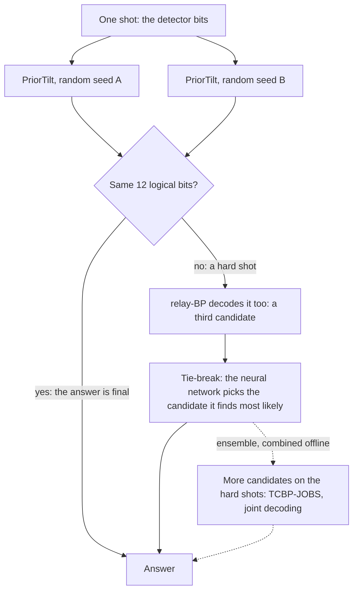
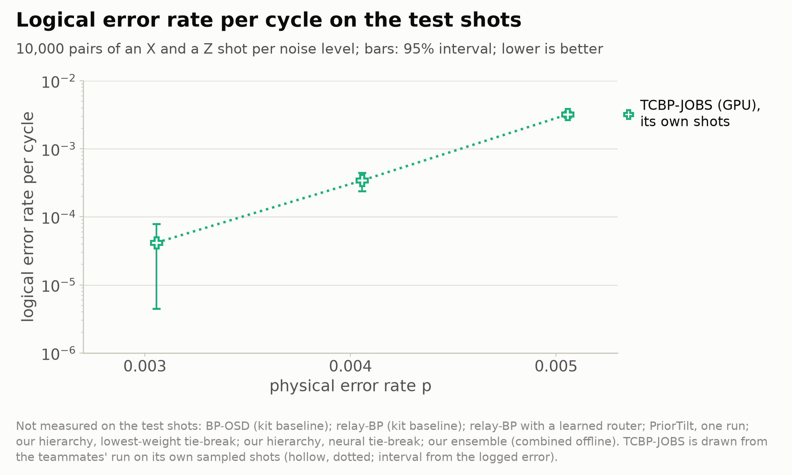
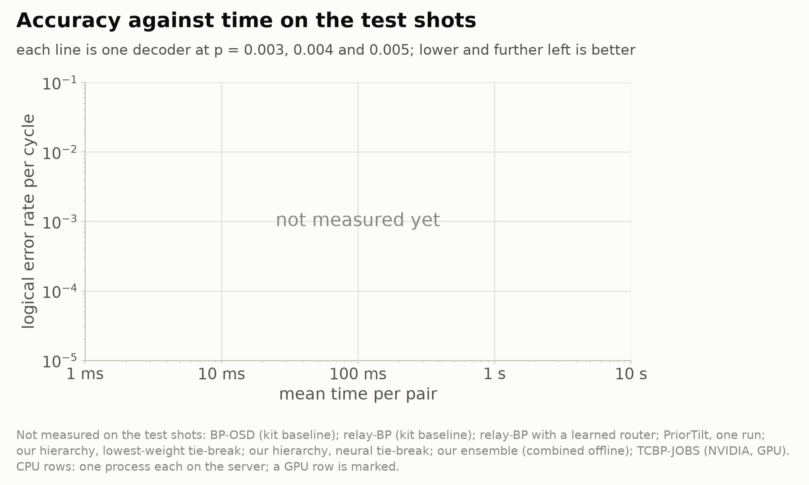

# A hierarchical decoder for the Gross code with a learned tie-breaker

Infleqtion Challenge 1 (ML-assisted decoding of the Gross code `[[144, 12, 12]]`), our part of the team's work.
The teammates' part, a learned router on relay-BP's first answer, is described in the top-level `README.md`.

**How to read this page.** Every table below is written by `python -m report.make_tables` and every figure by
`python -m report.make_plots`, from the result files copied into `report/data/` (`report/data/SOURCES.md` says where
each came from). A row that was not measured says "not measured". Numbers on the **test shots** and numbers on
**exploration shots** (the train and validation files, on which choices were made) are kept in separate tables and
are labelled wherever they appear. Much of the code was written with AI coding assistants under the team's direction,
as the challenge allows.

> **Status of this page:** a skeleton, pushed before the measurements on the test shots exist. Sections 4 and 8 fill
> in as the result files land; the text there says what is pending.

## 1. The question

A quantum memory measures parity checks over and over. A **decoder** reads which checks fired (the syndrome) and says
which of the 12 logical bits were flipped by errors. It fails when it gets any of the 12 bits wrong. The challenge
gives two decoders as baselines, BP-OSD and relay-BP, and asks whether machine learning can improve on them in
accuracy, in speed, or in the handling of atom loss.

Our question: **can a hierarchy of fast decoders, with a neural network that settles the hard cases, fail less often
than relay-BP without taking more time?** And, for atom loss: how much do the loss flags give back, and what is still
to gain?

The experiment is the kit's and is unchanged: X memory and Z memory of the Gross code, 12 noisy cycles, physical error
rate p = 0.003, 0.004 and 0.005. Shot k of X memory is paired with shot k of Z memory; a pair fails when either
fails; with failure fraction P over the pairs, the logical error rate per cycle is `1 - (1 - P)^(1/12)`. Every time
is per pair: one X decode plus one Z decode.

## 2. The approach in one picture



1. **Two fast decodes.** PriorTilt is a belief-propagation decoder published by IonQ for this code. When it gets
   stuck it nudges its inputs at random and tries again, so two runs with different random seeds can end on
   different answers.
2. **The agreement test.** If both runs predict the same 12 bits, that is the answer. This is the hierarchy's router,
   and nothing in it is learned.
3. **The hard shots.** Where the two runs differ, relay-BP decodes the shot as a third opinion, and a tie-break
   chooses among the candidates: a neural network (the learned part), or, without a network, the candidate with the
   most probable set of faults ("lowest weight").
4. **The ensemble** adds stronger members on the hard shots and lets the same network choose among all of them. It is
   combined offline from the members' saved answers; it is not one decoder timed in one process.

Why this shape: on the exploration shots at p = 0.004 the two fast decodes disagree on 214 of 50,000 shots (0.4%),
and those few shots hold 145 of the 208 failures of a single fast decode (exploration shots; the figure below and
`report/tables/exploration_p0.004.md`). The expensive stage runs only there.


## 3. What is learned, and what machine learning does here

| Part | Learned? | Whose work |
|---|---|---|
| PriorTilt's schedule (14 parameters per noise level) | fitted by its authors on their circuits; used unchanged | IonQ (arXiv:2611.13373) |
| "the two seeds disagree" as the test for a hard shot | no | ours |
| relay-BP as the third candidate | no: the kit's settings | the kit |
| the tie-break by lowest weight | no | ours |
| **the tie-break by the neural network** | **yes**: its weights are trained on shots drawn fresh from the kit's error model | ours |
| the loss-aware priors and the loss-time tracker (section 5) | the tracker is the learned part | ours |
| the router on relay-BP's first answer (a separate row of the table) | yes: a logistic model | teammates |

**The network.** A convolutional network that follows the code's own connections (each check touches six data
qubits, each data qubit six checks, the same weights at all 72 positions of the torus), after the published "Cascade"
recipe (arXiv:2604.08358), written by us from the paper's description and scaled down to one laptop GPU. It reads all
1,728 detector bits of a shot and gives 12 numbers, one per logical bit. One network per memory basis.

**Its role.** Alone, the network is a poor decoder: it gets many times more shots wrong than relay-BP (the learning
curves and `report/tables/networks.md`). It is not asked to decode. It is asked which of two or three given answers
is more likely, on the few shots where the fast decoders disagree. That is a much easier question, and one where the
classical score (lowest weight) is known to be weak.


<!-- BEGIN table:networks -->
<!-- END table:networks -->

## 4. Results on the test shots

The team's saved test files: 10,000 shots per basis and noise level (`data/p<p>/test_X.npz`, `test_Z.npz`), decoded
once with every setting frozen. Each row ran through the team's evaluator (`evaluation.evaluate`) in one process on
the team's server; "where it ran" names the device and what ran beside it.

<!-- BEGIN table:test_sweep -->
<!-- END table:test_sweep -->






**What the numbers say.** *Pending: this paragraph is written when the rows have landed. It will state, per noise
level, the paired count of our decoder against relay-BP, and where TCBP-JOBS stands against both.*

### The full rows, per noise level

<!-- BEGIN table:test_p0.003 -->
<!-- END table:test_p0.003 -->

<!-- BEGIN table:test_p0.004 -->
<!-- END table:test_p0.004 -->

<!-- BEGIN table:test_p0.005 -->
<!-- END table:test_p0.005 -->

### TCBP-JOBS, the GPU reference

TCBP-JOBS is NVIDIA's GPU decoder, which the teammates ran as an extra reference. **On its own sampled shots it is
more accurate than relay-BP at p = 0.004 and 0.005**, and on the exploration shots our three-candidate hierarchy sits
between the two (next table and the one after). Its row on the saved test shots is in the tables above when measured.

<!-- BEGIN table:tcbp_own_shots -->
<!-- END table:tcbp_own_shots -->

### Exploration shots: whose gain is whose

<!-- BEGIN table:exploration_p0.004 -->
<!-- END table:exploration_p0.004 -->

Read from this table, on exploration shots at p = 0.004:

- **PriorTilt is IonQ's decoder, not ours.** One run of it already fails less often than relay-BP, and by how much
  depends on its random seed (the two seeds in the table). That spread is itself a finding: a single run is not a
  stable number.
- **The hierarchy is ours:** two seeds, the agreement test, and relay-BP as a third candidate where they disagree.
- **The learned tie-break is ours:** it lowers the failures of the lowest-weight rule further, on X memory.
- These rules were tried and chosen on these same shots. The test table above is the number to quote.

### The teammates' earlier runs, as a cross-check

<!-- BEGIN table:earlier_runs -->
<!-- END table:earlier_runs -->

## 5. Atom loss

In a neutral-atom machine an atom can leave its trap. A **flag** (herald) is the measurement that tells us an atom is
gone. The challenge stresses this case.


<!-- BEGIN table:loss -->
<!-- END table:loss -->

- **A decoder that ignores loss is ruined by it; the flags give most of it back.** The table gives the paired counts
  at each loss rate.
- **Knowing when an atom was lost is worth more still.** The ORACLE rows are given the true loss round on purpose:
  they measure the ceiling for any method that estimates the loss time, and are not decoder results.
- **The loss-time tracker** is our attempt to reach that ceiling from the syndrome history alone. *Pending: its rows.*
- **What the model assumes.** After every CX gate each of its two atoms is lost with probability s. A lost check atom
  is flagged at its measurement and replaced; a lost data atom stays lost and is flagged only at the end. Flags are
  perfect. This is our simplified model, built from published figures (s = 2e-3 is about today's hardware by
  Infleqtion's paper arXiv:2408.08288). It is not Infleqtion's hardware model.

## 6. What did not work

*Pending: each item with its number and its file.*

## 7. Where it falls short

*Pending the test rows. The points already known from the exploration shots:*

- **TCBP-JOBS is more accurate at p = 0.004 and 0.005** than relay-BP and than our three-candidate hierarchy, as
  measured so far (section 4).
- **Agreeing but wrong.** On the exploration shots, 63 of the 162 shots the hierarchy still fails are shots where the
  two fast decodes agree on a wrong answer. No tie-break can fix those.
- **The slowest shots get slower.** A hard shot pays for three decoders one after the other.
- **Loss** is measured for X memory at p = 0.004 only, under our own loss model.

## 8. Resources

*Pending: CPU cores, GPU, memory, model sizes and training cost, from the result files.*

## 9. How to reproduce

`REPRODUCE.md` in this folder has every command from a fresh clone. The tables and figures of this page alone:

```sh
cd challenge-1-ml-decoder-kit
python -m report.make_tables      # report/tables/*.md and *.csv, and the tables inside this page
python -m report.make_plots       # report/figures/*.png and *.svg
```

## 10. Checks made on every run

<!-- BEGIN table:checks -->
<!-- END table:checks -->
