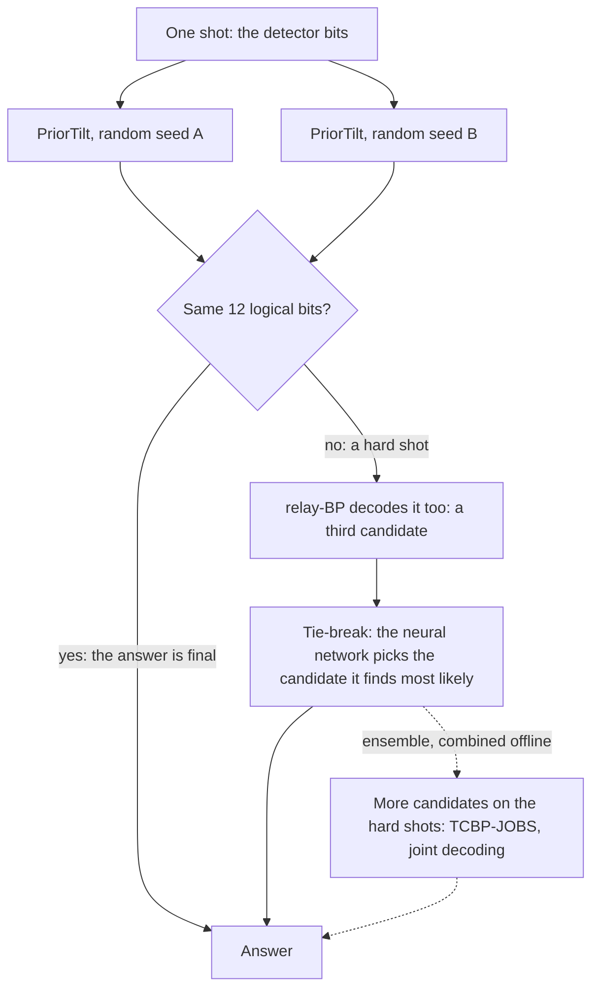
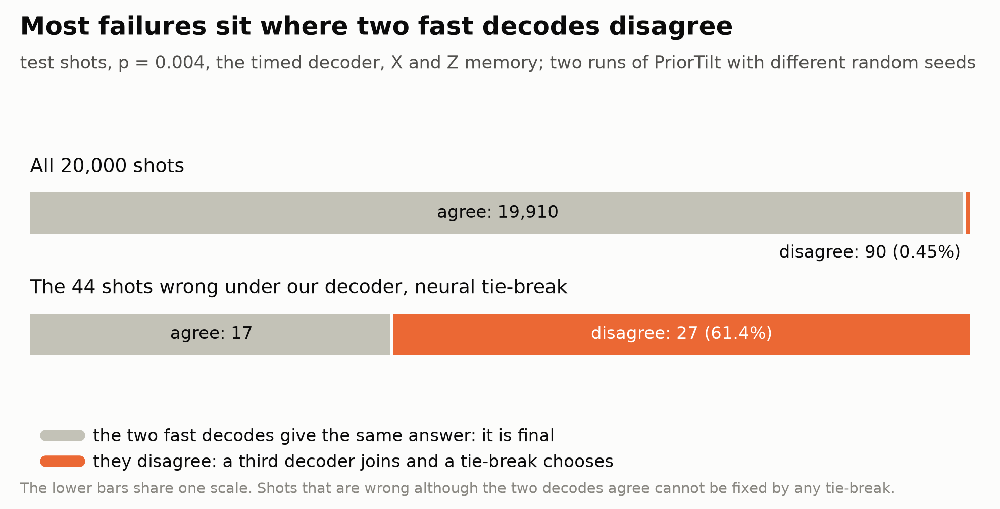

# A hierarchical decoder for the Gross code with a learned tie-breaker

Infleqtion Challenge 1 (ML-assisted decoding of the Gross code `[[144, 12, 12]]`), our part of the team's work.
The teammates' part, a learned router on relay-BP's first answer, is described in the top-level `README.md`.

**How to read this page.** Every table is written by `python -m report.make_tables` and every figure by
`python -m report.make_plots`, from the result files copied into `report/data/` (`report/data/SOURCES.md` says where
each came from). Every single number in the text is written by the same script and listed in `report/tables/facts.md`.
A row that was not measured says "not measured". Numbers on the **test shots** and numbers on **exploration shots**
(the train and validation files, on which choices were made) are kept in separate tables and are labelled wherever
they appear. The full tables are in `APPENDIX.md`. Much of the code was written with AI coding assistants under the
team's direction, as the challenge allows.

## 1. The question

A quantum memory measures parity checks over and over. A **decoder** reads which checks fired (the syndrome) and says
which of the 12 logical bits were flipped by errors. It fails when it gets any of the 12 bits wrong. The challenge
gives two decoders as baselines, BP-OSD and relay-BP, and asks whether machine learning can improve on them in
accuracy, in speed, or in the handling of atom loss.

Our question: **can a hierarchy of fast decoders, with a neural network that settles the hard cases, fail less often
than relay-BP without taking more time?** And for atom loss: how much do the loss flags give back, and what is still
to gain?

The experiment is the kit's, unchanged: X memory and Z memory of the Gross code, 12 noisy cycles, physical error
rate p = 0.003, 0.004 and 0.005. Shot k of X memory is paired with shot k of Z memory; a pair fails when either
fails; with failure fraction P over the pairs, the logical error rate per cycle is `1 - (1 - P)^(1/12)`. Every time
is per pair: one X decode plus one Z decode.

## 2. The approach in one picture



1. **Two fast decodes.** PriorTilt is a belief-propagation decoder published by IonQ for this code. When it gets
   stuck it nudges its inputs at random and tries again, so two runs with different random seeds can end on
   different answers.
2. **The agreement test.** If both runs predict the same 12 bits, that is the answer. This is the hierarchy's router,
   and nothing in it is learned.
3. **The hard shots.** Where the two runs differ, relay-BP decodes the shot as a third opinion, and a tie-break
   chooses among the candidates: a neural network (the learned part), or, without a network, the candidate with the
   most probable set of faults ("lowest weight").
4. **The ensemble** adds stronger members on the hard shots and lets the same network choose among all of them. It is
   combined offline from the members' saved answers; it is not one decoder timed in one process.

Why this shape: on the exploration shots at p = 0.004 the two fast decodes disagree on <!--f:expl_disagree-->214<!--/f--> of
<!--f:expl_shots-->50,000<!--/f--> shots (<!--f:expl_disagree_share-->0.4%<!--/f-->), and those few shots hold <!--f:expl_one_run_wrong_disagree-->145<!--/f--> of the
<!--f:expl_one_run_wrong-->208<!--/f--> failures of a single fast decode. The expensive stage runs only there.



## 3. What is learned, and what machine learning does here

| Part | Learned? | Whose work |
|---|---|---|
| PriorTilt's schedule (14 parameters per noise level) | fitted by its authors on their circuits; used unchanged | IonQ (arXiv:2611.13373) |
| "the two seeds disagree" as the test for a hard shot | no | ours |
| relay-BP as the third candidate | no: the kit's settings | the kit |
| the tie-break by lowest weight | no | ours |
| **the tie-break by the neural network** | **yes**: trained on shots drawn fresh from the kit's error model | ours |
| the loss-aware priors and the loss-time tracker (section 5) | the tracker is the learned part | ours |
| the router on relay-BP's first answer (a separate row of the table) | yes: a logistic model | teammates |

**The network.** A convolutional network that follows the code's own connections (each check touches six data
qubits, each data qubit six checks, the same weights at all 72 positions of the torus), after the published "Cascade"
recipe (arXiv:2604.08358), written by us from the paper's description and scaled down to one laptop GPU:
<!--f:net_parameters-->893,697<!--/f--> parameters per memory basis. It reads all 1,728 detector bits of a shot and gives 12 numbers, one
per logical bit.

**Its role.** Alone, the network is a poor decoder: at the last training report in our copy of its log it gets
<!--f:net_X_wrong4-->4.2%<!--/f--> of X shots wrong at p = 0.004, where relay-BP gets <!--f:expl_X_R-->122<!--/f--> of 25,000 wrong on the exploration shots. It is not asked to decode.
It is asked which of two or three given answers is more likely, on the few shots where the fast decoders disagree.
That is an easier question, and one where the classical score is weak: among 16 relay-BP candidates the right answer
is present on <!--f:cand_present-->114<!--/f--> of <!--f:cand_shots-->145<!--/f--> hard shots, and the lowest weight picks it on only <!--f:cand_lowest-->71<!--/f-->
(exploration shots; `APPENDIX.md`, "What we measured before building").


## 4. Results on the test shots

The team's saved test files: 10,000 shots per basis and noise level, decoded once with every setting frozen. A timed
row ran through the team's evaluator (`evaluation.evaluate`) in one process on the team's server. A row marked "from
per-shot files" is combined offline from saved answers and has no time measured in one process.

<!-- BEGIN table:test_sweep -->
<!-- END table:test_sweep -->


**What the numbers say.** <!--f:findings-->Our decoder's rows on the test shots are not measured yet. TCBP-JOBS, NVIDIA's GPU decoder, is not measured on the test shots yet; on the exploration shots at p = 0.004 it fails fewer pairs than our hierarchy (113 against 140 of 25,000).<!--/f--> The exact tests, the intervals, the median and 99th-percentile
times and what ran beside each row are in `APPENDIX.md`.

### Whose gain is whose

<!-- BEGIN table:test_ladder -->
<!-- END table:test_ladder -->

### The ablation: what the learned part adds

<!-- BEGIN table:test_ablation -->
<!-- END table:test_ablation -->

The sentence under "What the numbers say" is chosen by this table: it credits the network with a gain only if the
pooled exact test on the pairs that only one of the two rules fails is below 0.05. The network is never credited
with the gain of the hierarchy itself, which needs no learning of ours.

### On the exploration shots (not test shots)

At p = 0.004, on <!--f:expl_pairs-->25,000<!--/f--> pairs of the train and validation files: relay-BP fails <!--f:expl_pairs_R-->245<!--/f--> pairs, one
PriorTilt run <!--f:expl_pairs_P1-->207<!--/f--> or <!--f:expl_pairs_P2-->188<!--/f--> depending on its random seed, our hierarchy <!--f:expl_pairs_C-->140<!--/f--> with its
best tie-break that needs no learning, the lowest weight among the converged candidates (only relay-BP fails
<!--f:expl_pairs_C_only_relay-->128<!--/f--> pairs, only the hierarchy <!--f:expl_pairs_C_only_ours-->23<!--/f-->), and TCBP-JOBS <!--f:expl_pairs_T-->113<!--/f-->. On X memory, the
neural tie-break (the network at training step <!--f:expl_X_N_step-->100,000<!--/f-->) fails <!--f:expl_X_N-->59<!--/f--> of 25,000 shots where that classical
tie-break fails <!--f:expl_X_C-->67<!--/f--> (only the network rule fails <!--f:expl_X_N_vs_C_only_network-->7<!--/f--> shots, only the classical rule
<!--f:expl_X_N_vs_C_only_classical-->15<!--/f-->, exact p = <!--f:expl_X_N_vs_C_p-->0.13<!--/f-->). The rules were chosen on these shots, which flatters them;
the test table is the number to quote. Three things to take from it:

- **PriorTilt is IonQ's decoder, not ours.** One run of it already fails less often than relay-BP, and by how much
  depends on its random seed. A single run is not a stable number.
- **The hierarchy is ours:** two seeds, the agreement test, and relay-BP as a third candidate where they disagree.
- **TCBP-JOBS is ahead of our three-candidate hierarchy** on the same exploration shots. That is why the ensemble
  takes it as a member.

## 5. Atom loss

In a neutral-atom machine an atom can leave its trap. A **flag** (herald) is the measurement that tells us an atom is
gone. The challenge stresses this case.


X memory, p = 0.004, relay-BP at the kit's settings, at a loss rate of s = 0.001 per atom per gate (on average
<!--f:loss_lost_atoms-->10.0<!--/f--> lost data atoms per shot):

- **A decoder that ignores loss is ruined by it.** It fails <!--f:loss_blind_share-->57.7%<!--/f--> of shots (<!--f:loss_blind-->173 of 300<!--/f-->).
- **The flags give most of it back.** With priors raised where a flag fired, the published method, it fails
  <!--f:loss_aware_share-->4.4%<!--/f--> (<!--f:loss_aware-->176 of 4,000<!--/f-->): <!--f:loss_aware_ratio-->11.5<!--/f--> times fewer on the shots both decoded.
- **Knowing when an atom was lost is worth more still.** An ORACLE that is told the true round of each loss fails
  <!--f:loss_oracle_share-->2.7%<!--/f--> (<!--f:loss_oracle-->107 of 4,000<!--/f-->, the same shots): <!--f:loss_oracle_ratio-->1.64<!--/f--> times fewer than with the flags alone
  (<!--f:loss_oracle_ratio_interval-->1.42 to 1.94<!--/f-->). It is given the truth on purpose: a ceiling, not a decoder.
- **The loss-time tracker** is our attempt to reach that ceiling from the syndrome history alone: a lost data atom
  makes its six neighbouring checks fire at random from the moment it is lost. For every atom flagged at the end,
  the tracker weighs "still there" against "already gone" round by round over those checks, gives a probability
  for each possible loss time, and relay-BP gets its priors from that instead of an even spread (`loss_tracker/`). <!--f:trk_sentence-->On the tracker's own test shots (a new set of 4,000 shots at s = 0.001, the tracker frozen on validation shots beforehand), relay-BP given the tracker's estimate fails 147 of 4,000, against 196 of 4,000 for the flag-aware decoder that does not know the loss time, with exact location weights (only the flag-aware decoder fails 81 shots, only the tracker 32, sign test p = 5e-06; 1.33 times fewer failures with the tracker (1.18 to 1.51)), and 112 of 4,000 for the ORACLE. So the tracker recovers 58% (38% to 78%) of the oracle's gain. A replication on the team's server, on other shots, gives 49% (25% to 70%); both together, 54% (38% to 68%). Scored against the simulator's record of 39,909 lost data atoms, the tracker names the right round 51.4% of the time and is within one round 79.8% of the time. The result does not hang on which version was frozen: an earlier version of the tracker fails 144 of the same shots against the frozen one's 147 (only the frozen one fails 42, only the earlier one 39, p = 0.82).<!--/f--> It is measured at one noise point (p = 0.004,
  s = 0.001), and its model is fitted at that point.
- **What the model assumes.** After every CX gate each of its two atoms is lost with probability s. A lost check atom
  is flagged at its measurement and replaced; a lost data atom stays lost and is flagged only at the end. Flags are
  perfect, and losses are independent. This is our simplified model. It is not Infleqtion's hardware model. For
  scale: Infleqtion's paper arXiv:2408.08288 reports about 0.38% atom loss per CZ gate for a pair of atoms; split
  evenly between the two atoms, which is our reading and not a figure of the paper, that is about s = 2e-3, the top
  of the range studied here.

The table with every loss rate, both machines and the paired counts is in `APPENDIX.md`.

## 6. What did not work

Each with its count and its file in `APPENDIX.md`, "What we measured before building, and what did not work".

- **A plain convolutional network** (no structure of the code in it) learned only at noise far below the
  challenge's. The network that follows the code's connections learns at the challenge's noise, but only as a judge
  of candidates, not as a decoder.
- **Classic predecoders** (commit to the sure faults first, pass the rest to relay-BP) gave no gain in our tests.
- **Faster relay-BP schedules** as a cheap fallback cost accuracy; only "stop after three solutions instead of five"
  came free.
- **Joint decoding of X and Z checks** fixes most of relay-BP's failures but is far too slow to run on every shot.
- **Under loss,** exact weights for where a lost atom can have been gave no gain over the simple rule, and stopping
  relay-BP at its first solution cost failures.
- **Longer training of the network** improved it a lot as a decoder and only a little as a tie-breaker: the hard
  shots are hard for the network too.
- **Letting the network answer first** where it is confident, and the hierarchy elsewhere, gave no gain in accuracy
  at p = 0.005 on the exploration shots, with its threshold fitted on other shots; at the looser threshold it saved
  time at equal failures. It has no row on the test shots.

The laptop's early runs of plain networks at the challenge's noise are in the same table, from the laptop's own
record of them (`report/data/background/plain_cnn_runs/`).

## 7. Where it falls short

- **TCBP-JOBS.** <!--f:tcbp_statement-->TCBP-JOBS, NVIDIA's GPU decoder, is not measured on the test shots yet; on the exploration shots at p = 0.004 it fails fewer pairs than our hierarchy (113 against 140 of 25,000).<!--/f--> It needs a GPU; our hierarchy runs on one CPU core.
- **Agreeing but wrong.** On the exploration shots, <!--f:expl_left_agree-->63<!--/f--> of the <!--f:expl_left-->162<!--/f--> shots the hierarchy still fails
  are shots where the two fast decodes agree on a wrong answer. No tie-break can fix those; only a better test for a
  hard shot, or more members on every shot, can.
- **The slowest shots get slower.** A hard shot pays for three decoders one after the other; the 99th-percentile time
  in `APPENDIX.md` shows it.
- **Low noise.** At p = 0.003 every good decoder fails only a handful of pairs in 10,000, so the rows cannot be told
  apart there.
- **The network** is small and was trained for hours, not days; the Z network started later than the X network.
- **Loss** is measured for X memory at p = 0.004 only, under our own loss model.
- **A dependency with a licence.** PriorTilt is CC BY-NC-SA 4.0 (non-commercial); none of its code is in this
  repository.

## 8. Resources

<!-- BEGIN table:resources -->
<!-- END table:resources -->

- **Our decoder needs no GPU.** PriorTilt and relay-BP run on one CPU core; the network is called on the hard shots
  only.
- **Training cost.** `APPENDIX.md` ("The networks") gives, per network, the steps, the shots seen and the GPU hours.
  Training shots are drawn from the kit's error model on the GPU, so there is no training set on disk.
- **TCBP-JOBS** needs an NVIDIA GPU. Before it decodes, it fits a model per memory basis, which took
  <!--f:tcbp_fit3_s-->54.5 and 54.8<!--/f--> s at p = 0.003 and <!--f:tcbp_fit4_s-->120.2 and 121.6<!--/f--> s at p = 0.004 in the teammates' runs
  (`report/data/tcbp_own_shots/`).

## 9. How it was checked

- **By the scripts, on every run** (`APPENDIX.md`, section I): every row of a test table names the team's test files
  by sha256; each evaluator row is re-counted from its per-shot file; the rate per cycle is recomputed from the pairs;
  the times are per pair and recomputed from the per-shot timer.
- **By an independent review of `hierarchy/`** (a separate session that did not write it; verdict APPROVE, no
  blocking or major finding). It tested that the truth cannot reach a choice: with the truth shuffled between shots,
  the plugin and every offline rule returned exactly the same predictions. It also checked that nothing the decoder
  does for a shot is outside the evaluator's timer: building the decoders and loading the network are counted as
  set-up, apart from the per-shot time.

## 10. How to reproduce

`REPRODUCE.md` has every command from a fresh clone, and says what was run where. The tables and figures alone:

```sh
cd challenge-1-ml-decoder-kit
python -m report.make_tables      # report/tables/, and the tables and numbers inside REPORT.md, APPENDIX.md, SLIDES.md
python -m report.make_plots       # report/figures/
```
