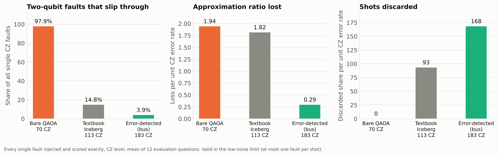
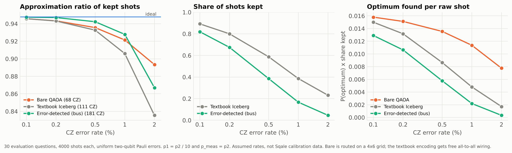

# Error-detected quantum context selection

MidQWest 2026, Infleqtion track, Challenge 2: "Give your LLM a quantum backend".

A small language model answers multi-hop questions from paragraphs chosen by QAOA. The
QAOA circuit runs in three tiers: ideal, bare on a noisy device, and inside the
`[[k+2, k, 2]]` Iceberg error-detecting code. The question we answer: how does each step
change selection quality and the model's final answers?

This repository is self-contained and independent of Challenge 1.

## What ran, and where

| Part | Status |
|---|---|
| Iceberg encoder, post-selection, fault analysis, noisy simulation | Built and verified here, then checked by an independent reviewer. |
| Full pipeline on 150 HotpotQA questions, offline stand-ins | Ran: TF-IDF scores, t5-base reader, local Pauli noise (`configs/offline.yaml`). |
| Full pipeline on 150 HotpotQA questions, plan's models | Ran: `Qwen/Qwen2.5-1.5B-Instruct` reader, `BAAI/bge-small-en-v1.5` scorer, local Pauli noise (`configs/main.yaml`, RTX 4070, about 10 minutes). |
| Physics figures (ARC) | Ran here. |
| Sqale compiler (`cq_compile` for `cq_sqale_qpu`) | Ran on real Superstaq. The compiled bus Iceberg circuit, simulated exactly, keeps 100% of shots without noise (`scripts/sqale_compile.py`). |
| Sqale execution (`cq_sqale_simulator`, `cq_sqale_qpu`, `submit_qubo`) | Not run: our account's role may compile but not submit jobs (HTTP 403 on every target). Code tested with a fake provider. |

The noise in every run is the local Pauli model, not Sqale's.

## Results with the plan's models (`configs/main.yaml`)

Same 150 questions, Qwen 2.5 1.5B Instruct at temperature 0, bge-small scores,
calibrated on the 50 calibration questions (hop 0, tau 0.6075, theta 0.25; mean 5.0
redundant edges per question). Full table: `results/main/results_table.md`.

| | Prediction | Result [95% CI] | Verdict |
|---|---|---|---|
| H1 | Exact selection beats all 10 paragraphs | −0.033 [−0.107, +0.040] | not supported |
| H2 | Ideal QAOA at p = 2 is close to exact | optimum on 150 of 150; EM difference 0 | supported |
| H3 | Error detection raises the approximation ratio | +0.0026 [+0.002, +0.003] | supported |
| H4 | The accuracy gain is smaller than the solver gain | solver +0.0026, accuracy 0.000 | supported |
| H5 | The vote beats the single best selection | +0.007 [−0.013, +0.033] | not supported |

| Lane | Exact match | Gold recall | Prompt tokens | Approx. ratio | Shots kept |
|---|---|---|---|---|---|
| 1a all 10 paragraphs | 0.400 [0.320, 0.480] | 1.000 | 1455 | | |
| 1b top 3 by similarity | 0.393 [0.320, 0.473] | 0.823 | 442 | | |
| 2a exact, 2b greedy, 2c annealing, rand, 3a/3b/3c QAOA, 4 routed | 0.367 [0.293, 0.447] | 0.773 | 428 | | |
| 3a ideal QAOA, p = 1 | | | | 0.869 | 100% |
| 3b bare, noisy | | | | 0.863 | 100% |
| 3c bus Iceberg, noisy | | | | 0.865 | 51% |
| rand uniform random | | | | 0.616 | 100% |
| oracle: only the 2 gold paragraphs (diagnostic, no hypothesis) | 0.553 [0.473, 0.633] | 1.000 | 307 | | |

The oracle lane (main 0.553, offline 0.460) shows how much better selection could do.
Reading exactly the right two paragraphs beats reading all ten by 15 points, while the
QUBO selection reads both gold paragraphs on 63% of questions (top-3: 70%). So the scorer,
not the solver, is the bottleneck: every solver already finds the QUBO's optimum.

At equal accepted shots (about 4,000 kept: `scripts/equal_kept_shots.py`,
`results/<run>/studies/equal_kept_shots.json`, 30 questions), error detection still raises
the approximation ratio by +0.0025 [+0.0016, +0.0033] (main) and +0.0069 [+0.0061, +0.0077]
(offline). That costs 2.0× and 2.7× the raw shots.

The verdicts are the same as offline. Qwen reads better than t5 (0.400 vs 0.373 with all
paragraphs), and plain top-3 now nearly matches reading everything. Error detection
recovers 42% of the approximation ratio that noise removed (offline: 58%). That is a
smaller gain, as expected from the much sparser redundancy graphs this scorer produces:
5.0 edges against 22.5 (see the edge sweep below).

**Sqale compiler check** (`scripts/sqale_compile.py`, `results/offline/sqale_compile/`).
36 circuits from the first 12 evaluation questions went through `cq_compile` for
`cq_sqale_qpu` in one call, for 0.5 credits. Each question gave a bare, a bus-Iceberg and
a textbook-Iceberg circuit. Every compiled circuit was then simulated exactly here.

| Mean of 12 questions | CZ before (RZZ = 2 CZ) | CZ after Sqale compile | Depth after | Noiseless check of the compiled circuit |
|---|---|---|---|---|
| Bare QAOA | 45.7 | 81.0 (×1.8, routing) | 202 | output TVD to original ≤ 8e-14 |
| Bus Iceberg (ours) | 182.8 | **181.8 (×0.99, unchanged)** | 427 | **100% of shots kept**, logical TVD ≤ 8e-14, 12 of 12 |
| Textbook Iceberg | 112.7 | 239.1 (×2.1, routing) | 507 | 100% kept, 12 of 12 |

"CZ before" counts each RZZ or RXX as 2 CZ and each CX as 1, so it compares with Sqale's
native CZ count. Sqale's compiler preserves the error-detection checks of both encodings.
It leaves the bus mapping's CZ count unchanged, and more than doubles the textbook
mapping's through routing. So the comparison flips: before compilation the bus circuit is
the more expensive protected circuit (183 against 113 CZ), and on the real compiler it is
the cheaper one (182 against 239). These counts agree with our local grid estimates (bare
69, bus 182, textbook 224; figure 4). These 12 questions use the offline run's (TF-IDF)
QUBOs, which have denser graphs than the main run's.

The sections below are the offline stand-in run.

## Results (offline stand-in run)

150 HotpotQA questions (hard, distractor setting), `configs/offline.yaml`. Reader: t5-base.
Scores: TF-IDF. Noise: local Pauli model, 0.5% per CZ, 0.05% per one-qubit gate, 0.5% per
readout. `tau`, `theta` and the second-hop weight were chosen on 50 separate calibration
questions. Intervals are 95% bootstrap over questions.

### The five pre-registered hypotheses (`HYPOTHESES.md`)

| | Prediction | Result | Verdict |
|---|---|---|---|
| H1 | Exact selection beats all 10 paragraphs on exact match | -0.053 [-0.133, +0.020] | not supported |
| H2 | Ideal QAOA at p = 2 is close to exact | finds the optimum on 150 of 150 questions; exact-match difference 0 | supported |
| H3 | Error detection raises the approximation ratio | +0.0074 [+0.0070, +0.0079] | supported |
| H4 | The accuracy gain is smaller than the solver gain | solver +0.0074, accuracy +0.000 | supported |
| H5 | The 3-selection vote beats the single best selection | +0.020 [-0.007, +0.053] | not supported |

### Accuracy and cost per lane

| Lane | Selector | Exact match | With vote | Gold recall | Paragraphs read | Prompt tokens |
|---|---|---|---|---|---|---|
| 1a | all 10 paragraphs | 0.373 [0.293, 0.453] | 0.373 | 1.000 | 10 | 1425 |
| 1b | top 3 by similarity | 0.313 [0.240, 0.387] | 0.313 | 0.757 | 3 | 363 |
| 2a | brute force (exact) | 0.320 [0.247, 0.393] | 0.340 | 0.680 | 2.73 | 335 |
| 2b | greedy | 0.320 | 0.327 | 0.670 | 2.67 | 330 |
| 2c | simulated annealing | 0.320 | 0.333 | 0.680 | 2.73 | 335 |
| 3a, 3b, 3c | QAOA: ideal, bare noisy, error-detected (4,000 shots) | 0.320 | 0.340 | 0.680 | 2.73 | 335 |
| rand | uniform random sampler, same repair and ranking | 0.320 | 0.340 | 0.680 | 2.73 | 335 |

Selection cuts the prompt from 1,425 to 335 tokens and the reader's time from 2.4 s to
0.7 s per question, but it does not beat reading everything: it loses a gold paragraph on
about half the questions. Full table with every lane, F1 and 64-shot variants:
`results/offline/results_table.md`.

### What the quantum tiers do to the samples

| Tier | Qubits | CZ gates | Shots kept | Approximation ratio | Valid samples | P(optimum) per kept shot |
|---|---|---|---|---|---|---|
| Uniform random (control) | | | 100% | 0.727 | 6% | 0.09% |
| Ideal QAOA, p = 1 | 10 | | 100% | 0.947 | 76% | 1.8% |
| Bare QAOA, noisy, grid-routed | 10 | 69 | 100% | 0.934 | 62% | 1.5% |
| Textbook Iceberg, noisy, free all-to-all wiring | 14 | 112 | 59% | 0.931 | 69% | 1.6% |
| Bus Iceberg, noisy, nearest neighbour | 18 | 182 | 38% | 0.941 | 72% | 1.7% |

Error detection with the bus mapping recovers 58% of the approximation ratio that noise
took away (0.934 to 0.941, ideal 0.947) and keeps 38% of the shots. The textbook mapping
ends up below the bare circuit even with wiring that Sqale does not have.



Every single CZ fault, scored exactly, mean of 12 evaluation questions:

| | CZ gates | Faults that slip through | Approx. ratio lost per unit CZ error | Phase (Z-type) faults that slip through |
|---|---|---|---|---|
| Bare | 70 | 97.9% | 1.94 | 95.2% |
| Textbook Iceberg | 113 | 14.8% | 1.82 | 0% |
| Bus Iceberg | 183 | 3.9% | 0.29 | 0% |

Phase errors on a CZ, the kind a stray-field shift of the Rydberg level produces, are
caught every time. In the bus circuit no single fault in state preparation (322 fault
cases), the S_X check (453) or readout (18) goes undetected.



| CZ error | 0.1% | 0.2% | 0.5% | 1% | 2% |
|---|---|---|---|---|---|
| Bare, approximation ratio | 0.9457 | 0.9433 | 0.9356 | 0.9214 | 0.8934 |
| Bus Iceberg, approximation ratio | 0.9475 | 0.9471 | 0.9423 | 0.9279 | 0.8670 |
| Bus Iceberg, shots kept | 82% | 68% | 38% | 17% | 5% |

30 questions, ideal 0.948. The error-detected tier wins up to 1% CZ error and loses at 2%,
where 95% of shots are discarded and two-fault events dominate. Per raw shot the bare
circuit finds the optimum more often at every noise level (figure, right panel): error
detection buys cleaner samples, not more of them.

The gain grows with circuit depth: +0.001 for questions with under 6 redundant edges,
+0.010 above 30 (`figures/offline/fig3_redundant_edges.png`).

Other figures: `fig1_accuracy_by_lane`, `fig2_noise_to_accuracy`, `fig4_two_qubit_gates`
(bare 46 CZ all-to-all and 70 on the grid; textbook 113 and 224 after routing; bus 183 with
no SWAPs), `fig5_roadmap`, and the four physics figures in `figures/physics/`.

## Quick start

```bash
conda create -n qctx python=3.12 -y     # optional; any Python 3.10+ environment works
conda activate qctx
pip install -e ".[dev]"                 # use pip even inside conda: qiskit-superstaq is not on conda-forge
python -m pytest -q -m "not slow"       # about a minute
python reproduce.py --config configs/smoke.yaml --quick    # full pipeline, 3 questions, stub reader
```

Expected test result: all pass, 2 skipped (`tests/test_app_lm.py`, `tests/test_app_scoring.py`)
until the offline t5 files are fetched. Confirmed on Windows 11 in a conda environment.
If collection fails with `No module named 'qiskit'`, the `pip install -e` step was skipped.

Reproduce the offline run (every number and figure above):

```bash
pip install -e ".[dev,onnx]"
python scripts/fetch_offline_models.py              # t5-base as ONNX from GitHub, about 1.1 GB, hash-checked
python reproduce.py --config configs/offline.yaml   # raw counts and answers are committed, so this replays in minutes
```

Run the plan's stack (your machine, Superstaq key, Hugging Face access):

```bash
pip install -e ".[dev,llm,superstaq]"
export SUPERSTAQ_API_KEY=                     # PowerShell: $env:SUPERSTAQ_API_KEY="..."
python scripts/check_superstaq.py --budget           # noiseless Iceberg check, noise-sim, cq_compile; logs credits per step
python scripts/prepare_data.py                       # official HotpotQA dev set (optional; a 150-question sample is committed)
python scripts/calibrate.py --config configs/main.yaml   # paste the recommended hop, tau, theta into the config
python reproduce.py --config configs/main.yaml
python -m qctx.demo --config configs/main.yaml       # one question, every lane side by side
```

Superstaq credits. The team run had 20 credits (a compile costs 0.5). So
`configs/main.yaml` sends only lanes 3d-b / 3d-c to the Sqale noisy simulator, on the
first `limit` questions. Lanes 3b / 3c run on all 150 questions with the local Pauli model,
and lane 2c anneals locally. `check_superstaq.py --budget` sends three billed calls (one
two-circuit job noiseless, one with noise-sim, one `cq_compile`). It records the balance
after each in `results/superstaq_check.json`, which shows whether billing is per job or
per circuit. Set `limit` from that. Without `--budget` the script also runs Bell tests and
an IBM compile.

Target access is set per account role. `cq_sqale_simulator` can appear in the target list
and still refuse jobs with `403: Your user role does not permit access to the provided
target`. That happened on our account, even on `ss_unconstrained_simulator`, which was
listed as accessible. `python scripts/check_superstaq.py --probe` tries one tiny job,
compile and QUBO call. On our account, only `cq_compile` succeeded, at 0.5 credits per
call. So `configs/main.yaml` leaves the execution lanes 3d-b / 3d-c off, and
`scripts/sqale_compile.py` uses the compiler instead. It sends the bare and Iceberg
circuits of the first `--n` questions to `cq_compile` in one call, saves the compiled
circuits (QPY), then simulates them exactly on our local simulator. That gives real Sqale
gate counts, and checks that the compiled Iceberg circuit still keeps 100% of shots
without noise. `--from-cache` redoes the analysis with no credits. Run
`python scripts/check_superstaq.py --targets` (free) to see which targets the account may
submit to or compile for. The script stops before submitting if the chosen target is not
accessible.

Notes on the language-model stack:

- **Models.** Reader `Qwen/Qwen2.5-1.5B-Instruct`, scorer `BAAI/bge-small-en-v1.5`. Why
  these: "Model choice" in `Wavedysfunction_Quantum_Accelerator_Benchmark_Plan.md`.
  Neither needs a Hugging Face account or token.
- **What `[llm]` installs.** `torch`, `transformers`, `sentence-transformers`, `accelerate`,
  `datasets`, `pandas`, `pyarrow` (also listed in `requirements-llm.txt`). Pip installs
  libraries only, not model weights. On Windows, plain `pip install torch` gives the CPU
  build. For an NVIDIA GPU, first run
  `pip install torch --index-url https://download.pytorch.org/whl/cu124`.
- **Model weights.** These download on first use (about 3 GB for the reader) into the
  Hugging Face cache, `~/.cache/huggingface/hub`, shared by every environment. Set `HF_HOME`
  to move it. Run `hf download Qwen/Qwen2.5-1.5B-Instruct` to fetch it ahead of time, then
  set `HF_HUB_OFFLINE=1` to run with no network. On Windows without Developer Mode, the cache
  copies files instead of symlinking them: it works, but uses more disk.
- **Reruns are cached.** Model answers go to `results/<run>/answer_cache.jsonl`, keyed by
  model name, question and selected paragraphs, so switching models never reuses old
  answers. Superstaq results go to `results/<run>/superstaq_cache/`, keyed by circuit,
  shots and target. Delete either file or folder to force fresh results.
- **Record what ran.** `results/<run>/config_used.json` stores the exact config. Also
  record `pip freeze`, the model's Hugging Face commit (the folder name under
  `snapshots/` in the cache), and CPU or GPU, because timings depend on them.
- **Our main run's hardware.** Windows 11 laptop, NVIDIA RTX 4070 Laptop GPU (8 GB),
  driver 560.94, which supports CUDA up to 12.6. So torch is the CUDA 12.6 build:
  `pip install "torch==2.14.1" --index-url https://download.pytorch.org/whl/cu126`. Pick
  the `cuXXX` that is at or below your driver's "CUDA Version" in `nvidia-smi`. With a GPU,
  `src/qctx/lm.py` runs the reader on CUDA in float16, otherwise on CPU in float32. The
  two can differ on a handful of answers, so compare runs on the same device and precision.

`check_superstaq.py` matters: it runs one encoded circuit on the noiseless Sqale
simulator and asserts that 100% of shots pass post-selection. That catches a bit-order or
compiler surprise before any budget is spent.

Three things to look at on the first Sqale run, because none of them could be tested here:

1. Noiseless kept share of the encoded circuit is 100% (the script asserts it).
2. `cq_compile` of the bus circuit comes back with about as many CZ gates as it went in
   with (129 to 132 for the 9-edge test instance, 182 on average for the evaluation set).
   Far more means the compiler re-routed it; pass `grid_shape` or check the placement.
   Far fewer means it optimised a check away.
3. The share of shots kept on `noise-sim` against the local model's prediction
   (`results/offline/studies/noise_sweep.json`). That tells you which CZ error rate the
   local model should use.

Demo questions depend on the reader. With `configs/main.yaml` (Qwen) the demo uses
`data/demo_main.jsonl`, each index checked live:

- **Index 0, selection helps.** "Which theme park hosts both the Back to the Future Ride
  and The Simpsons Ride?" All 10 paragraphs and top-3 are wrong. Top-3 falls for a
  "Springfield (Universal Studios Hollywood)" distractor. The QUBO and every QAOA tier read
  both gold paragraphs and answer "Universal Studios Florida" at 565 tokens instead of 1753.
- **Index 1, same answer at 7.6× fewer tokens.** Jack Elam: 236 tokens instead of 1786.
- **Index 2, the failure mode.** 5:15: selection drops "Quadrophenia (film)" and answers
  "Pete Townshend", while all 10 paragraphs gets "Franc Roddam".
- **Indexes 3 and 4** are backups.

With `configs/offline.yaml` (t5) the demo uses `data/demo.jsonl`: index 2 shows selection
helping, index 1 the same answer at a fifth of the tokens, index 0 the failure mode.

For a live run on Windows, use an idle GPU (each run takes 20–30 s, mostly model loading)
and set `PYTHONIOENCODING=utf-8`, `HF_HUB_OFFLINE=1`, and `2>$null` to hide loader
warnings.

## How it works

```
question + 10 paragraphs
   -> scores: relevance r_i, overlap s_ij                     src/qctx/scoring.py
   -> QUBO: weighted independent set                          src/qsel/qubo.py
   -> one of: brute force, greedy, annealing, QAOA ideal,
              QAOA bare, QAOA Iceberg-encoded                 src/qsel, src/iceberg
   -> repair, rank, keep the 3 best distinct selections       src/qsel/sampling.py
   -> language model answers from each, majority vote         src/qctx/lm.py, vote.py
```

**The problem.** Each paragraph gets a bit. Minimise
`-sum_i w_i x_i + P sum_{(i,j) in E} x_i x_j` with `w_i = r_i - theta`. `E` holds the
pairs with overlap above `tau`, and `P` is larger than any weight, so two redundant
paragraphs are never both worth taking. Two-qubit gates appear only on `E`.

**The tiers.** Angles are tuned once per question on the exact simulator and reused, so
the tiers differ only in noise and encoding.

| Tier | Circuit | Qubits for 10 paragraphs |
|---|---|---|
| Ideal | bare QAOA, exact statevector | 10 |
| Physical | bare QAOA, routed on the grid | 10 |
| Error-detected | QAOA in the Iceberg code, bus mapping | 18 (12 code + 6 bus ancillas) |

### The encoder

The Iceberg code stores `k` logical qubits in `k` data qubits plus two more, `t` and `b`.
Stabilizers are X on all code qubits and Z on all code qubits. Logical X on qubit `i` is
`X_t X_i`; logical Z is `Z_i Z_b`. A logical ZZ term is a plain `Z_i Z_j`.

`iceberg.encode(circuit)` has two styles.

`style="direct"` is the textbook mapping used on trapped ions: every single-paragraph term
is a gate between a data qubit and `b`, every mixer term a gate between `t` and a data
qubit. It has two problems on Sqale. The hubs `t` and `b` need SWAP chains on a grid. And
a single fault on a `(data, b)` gate can leave `X_i X_b`, which passes both checks and
flips every logical bit except `i`.

`style="bus"` (default) is our grid-native mapping. Nearest-neighbour gates only:

```
row 0   d  d  d  d  d  t      code qubits
row 1   c0 c1 c2 c3 c4 c5     bus ancillas
row 2   d  d  d  d  d  b      code qubits        fits a 3 x 6 patch of Sqale's 6 x 4 grid
```

- Start state: a GHZ chain snakes along row 0, crosses through `c5`, returns along row 2.
  `c0` records the parity of the chain's two ends as a flag.
- Single-paragraph terms: the bit of `b` is fanned out along the bus row. Each data qubit
  then needs only the bus qubit next to it: CNOT, RZ on the bus qubit, CNOT. The fan-out is
  undone.
- Mixer: the same in the X basis, fanned out from `t`.
- Pair terms: row neighbours get a direct gate. Others write their parity on the bus.
  Terms that share a qubit are emitted back to back so shared CNOTs cancel.
- S_X check: the bus row becomes a cat state, each bus qubit applies CNOTs to the code
  qubits above and below it, and the cat is decoded onto one bus qubit.
- Readout: logical bit `i` is `bit(d_i) XOR bit(b)`. A shot is kept only if the code bits
  have even parity and every bus qubit reads 0.

No data qubit ever shares a gate with `t` or `b` outside state preparation and the final
check, so one fault cannot create `X_i X_b`. A bus qubit flipped by a fault stays flipped
and discards the shot.

### What we checked about the encoder

| Claim | How it is checked | Test |
|---|---|---|
| Encoded and bare circuits give the same logical distribution, 100% of shots kept without noise | exact statevector, sizes 2 to 10, p = 1 and 2, odd sizes, scrambled measurement maps | `tests/test_iceberg_encode.py` |
| No single fault in state preparation, the S_X check or readout goes undetected | every Pauli after every gate and every readout flip, propagated exactly | `tests/test_iceberg_faults.py` |
| Each flag is needed | removing it produces undetected faults | same |
| The fast Pauli-frame analysis is exact | agrees with brute force on every single fault to 1e-9 | same |
| The frame sampler is right with many faults per shot | kept share and mean energy against exact density-matrix probabilities (Aer) | same, marked `slow` |
| An optimising compiler does not break it | Qiskit level 3 onto a grid: still exact, no SWAPs, same fault profile | `tests/test_iceberg_encode.py`, `test_iceberg_faults.py` |

`iceberg/frames.py` is what makes the 18-qubit noisy runs cheap. A Pauli fault passes
through a Clifford gate as another Pauli, and through a rotation unchanged except that it
flips the rotation's sign when the two anticommute. So a noisy shot equals the noiseless
*logical* circuit with some angles negated, plus bit flips at the end. We simulate 10
logical qubits, not 18 physical ones, and it is exact for Pauli noise.

## Four things the plan did not anticipate

**1. Paragraph similarity is the wrong notion of redundancy for multi-hop questions.**
The plan penalises selecting two similar paragraphs. In HotpotQA the two gold paragraphs
share the bridge entity, so they are among the most similar pairs: at the 90th percentile
of all pairs on the calibration set. Calibrating `tau` under the plan's definition gives
"no edges at all" as the best setting, which means no entangling gates and nothing for
QAOA to do. We changed one thing: overlap is computed on question-coverage profiles
(`overlap: coverage`), so two paragraphs are redundant when they answer the same part of
the question. Gold pairs then sit at the 11th percentile. We also added an optional
second-hop term to relevance (`hop`). Set `overlap: paragraph` and `hop: 0` to get the
plan's literal version. With a dense embedding model the picture may differ: run
`scripts/calibrate.py` first.

**2. 4,000 shots on 10 qubits cannot tell samplers apart downstream.** There are 1,024
selections. A uniformly random sampler with the same repair and ranking returns the exact
optimum on 150 of 150 questions at 4,000 shots, and on 91% at 64 shots (ideal QAOA: 84%,
because its samples are less diverse). So final-answer accuracy is identical across
tiers by construction. The honest solver metrics are the ones measured before repair:
mean approximation ratio, valid-sample rate, optimum probability. That is why H3 is
judged on mean approximation ratio, and why the `rand` control lane exists. Expect a
judge to raise this.

**3. The textbook Iceberg mapping hurts on problems with single-variable terms.** MaxCut
(He et al.) has only pair terms. Our QUBO has a weight per paragraph, and each becomes a
gate on `b`. One undetected fault there flips 9 of 10 logical bits. The bus mapping
removes that failure class: its worst harmful undetected single fault flips at most 2.

**4. Error detection pays in a window.** It needs enough noise to matter and few enough
faults that one-fault events dominate. For 10 paragraphs at p = 1 that window is roughly
0.1% to 1% CZ error. Outside it, run the bare circuit. The router (`src/qsel/router.py`)
encodes this as a floor on the predicted share of shots kept.

One more thing from the build. After the encoder passed our own tests, a separate agent
that had not seen the work checked it with its own simulator: about 1,000,000 single
faults over 300 circuits. It confirmed the claims in the table above and found two gaps,
both in the bus mapping and both now fixed:

- At two or more layers, a single Y fault on one bus qubit passed every check. Fix: a
  second witness copy before the S_X check.
- With one or two paragraphs the bus row was too short for that second copy. Fix: small
  problems are padded to four code-logical qubits.

`test_two_layer_gap_found_by_independent_review_is_closed` and
`test_small_problems_get_a_three_qubit_lane` reproduce both. After the fixes the reviewer
found nothing more at 3 to 12 paragraphs and one to three layers. Two-fault events are
not enumerated by anyone; the Monte-Carlo runs cover them statistically.

## Repository layout and interfaces

```
src/qsel/        QUBO, classical solvers, QAOA, angle tuning, backends, select(), router
src/iceberg/     encode (bus and direct), postselect, exhaustive fault analysis, frame simulator
src/qctx/        data, scoring, language models, vote, metrics, harness, studies, figures, demo
physics/         ARC scripts for the four physics figures
scripts/         prepare_data, calibrate, check_superstaq, fetch_offline_models
configs/         one YAML per experiment: smoke, offline, main
tests/           pytest; CI runs them and the smoke pipeline on every push
data/ scores/    150 evaluation, 50 calibration, 3 demo questions and their scores
results/ figures/ circuits/   committed outputs of the offline run
HYPOTHESES.md    the five predictions and how each is judged, written before the results
docs/            the team plan this implements (PDF)
review/          the independent reviewer's own scripts and logs (not collected by pytest)
```

The hand-over files named in the team plan:

| From | Hands over | Where |
|---|---|---|
| Teammate 1 | questions, scores, answers per lane | `data/questions.jsonl`, `scores/{qid}.npz` (`r`, `s`), `results/<run>/answers_{lane}.jsonl` |
| Teammate 2 | `build_qubo`, `qaoa_circuit`, tuned angles, `select(qid, tier, backend)`, circuit stats | `src/qsel`, `results/<run>/angles.json`, `circuits/stats.json` |
| Teammate 3 | `encode(circuit)`, `postselect(counts)`, harness, results, figures | `src/iceberg`, `src/qctx/harness.py`, `results/`, `figures/` |
| Teammates 4 and 5 | physics scripts and figures | `physics/`, `figures/physics/` |

Conventions agreed between QAOA and encoder: paragraph `i` is logical qubit `i` and
classical bit `i`; a measured 1 means selected; count keys follow Qiskit (bit 0 rightmost).
In an encoded circuit, classical bit `j` reads qubit `j`; data qubits come first, then `t`,
`b`, then ancillas.

```python
from qsel import build_qubo, qaoa_circuit, tune_angles, select
import iceberg

qubo = build_qubo(r, s, tau=0.57, theta=-0.5)
angles = tune_angles(qubo, p=1).angles
bare = qaoa_circuit(qubo, angles)
enc = iceberg.encode(bare)                         # 18 qubits, nearest-neighbour only
counts = backend.run([enc], shots=4000)[0]
logical_counts, stats = iceberg.postselect(counts, enc)
print(stats.kept_share)

result = select(qid, "iceberg", backend, qubo_params={"tau": 0.57, "theta": -0.5})
```

## Challenge requirements and stretch goals

| Item | Where |
|---|---|
| Existing or custom language model | `src/qctx/lm.py`: Hugging Face instruct model (`Qwen/Qwen2.5-1.5B-Instruct` in `configs/main.yaml`; code default 0.5B), Ollama, or the offline t5-base reader; temperature 0 |
| Part of the workflow where quantum could help | context selection as a QUBO, `src/qsel/qubo.py` |
| Backend that sends work to a simulator or hardware | `src/qsel/superstaq_backend.py`, `src/qsel/pauli_backend.py`, `src/qsel/backends.py` |
| At least one quantum technique | QAOA and Iceberg error detection |
| Full workflow, input to output | `reproduce.py`, `python -m qctx.demo` |
| Metrics: accuracy, time, resources | exact match, F1, gold recall, approximation ratio, feasibility, shots kept, diversity, latency per stage, qubits, CZ gates, prompt tokens: `results/<run>/summary.json` |
| Stretch: Superstaq compilation | `SuperstaqBackend.compile_stats` (`cq_compile`, `ibmq_compile`), figure 4 |
| Stretch: multiple platforms or simulators | exact simulator, local Pauli-noise simulator, Aer cross-check, Sqale simulator, Sqale QPU, IBM compile |
| Stretch: route between classical and quantum | `src/qsel/router.py`, lane 4 |
| Stretch: quantum output shapes later processing | QAOA picks what the model reads, and its sample distribution feeds the vote |
| Stretch: classical baseline | brute force, greedy, simulated annealing, top-k, and a uniform random sampler as control |

## Limits

- No quantum speedup is claimed. At 10 paragraphs brute force takes milliseconds.
- The local noise model is uniform Pauli noise with assumed rates. It is not Sqale.
- In the local model the textbook encoding gets free all-to-all wiring. That flatters it.
- The bus patch is 3 rows by `k/2 + 1` columns. On a 6 x 4 grid that caps it at 10
  paragraphs. Larger problems need a folded layout, which we have not built.
- Error detection discards shots. Every comparison reports the share kept and the
  equal-raw-shot view.
- The reader in the offline run is t5-base, not the 0.5 to 2B instruct model in the plan.

## Sources

- Self, Benedetti, Amaro, "Protecting expressive circuits with a quantum error detection code", Nature Physics (2024): the Iceberg code.
- He, Amaro, Shaydulin, Pistoia, "Performance of Quantum Approximate Optimization with Quantum Error Detection" (2024): Iceberg QAOA on trapped ions.
- Jin et al., "Iceberg Beyond the Tip: Co-Compilation of a Quantum Error Detection Code and a Quantum Algorithm" (2025).
- Bedalov et al. (Infleqtion), "Fault-Tolerant Operation and Materials Science with Neutral Atom Logical Qubits" (2024).
- Yang et al., "HotpotQA: A Dataset for Diverse, Explainable Multi-hop Question Answering" (2018), CC BY-SA 4.0. The committed questions are a sample of the dev distractor set taken from the HippoRAG repository.
- Sibalic et al., "ARC: An open-source library for calculating properties of alkali Rydberg atoms".
- Superstaq documentation, https://superstaq.readthedocs.io
- Infleqtion MidQWest 2026 challenge repository, https://github.com/Infleqtion/MidQWest-2026
- The team plan this implements: "Error-Detected Quantum Context Selection, MidQWest Challenge 2 Plan" (Nov 21, 2026), `docs/challenge2-plan.pdf`.
