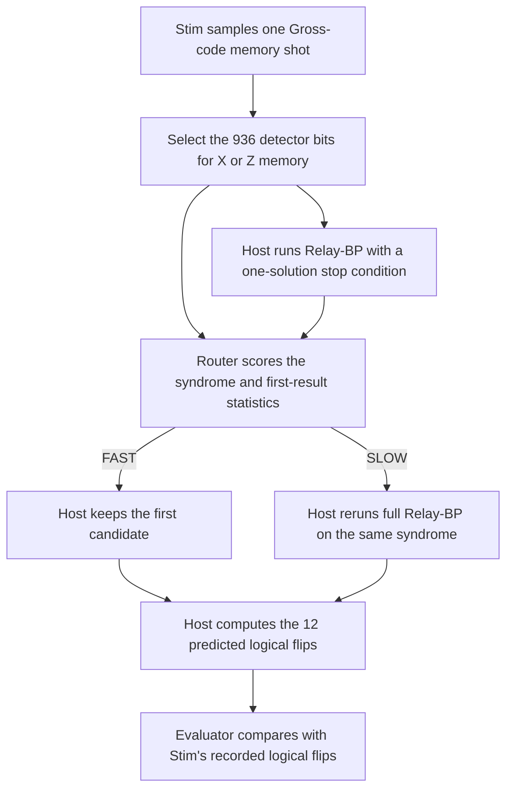

# FPGA Routing for the Gross Code

A quantum decoder looks at the warning signs left by errors and estimates how to correct them. In our backup decoder, software finds a first correction for every shot. A small model then decides whether to keep that correction or run a more expensive search. **The FPGA implements that decision.** It returns **FAST** to keep the first answer or **SLOW** to request a full Relay-BP run.

At the demo's noise setting, `p = 0.004`, the software policy reduced mean decode time from **131.27 to 124.09 ms per pair of memory tests**, a gain of **7.18 ms or 5.47%** versus full Relay-BP. Both runs failed on **84 of 10,000 pairs**. The slowest cases took longer with the router. In a separate test of the FPGA circuit, its simulated decisions agreed with Python on all **5,000** saved demo shots. The software timing comparison uses the Python router. [Mac comparison](../challenge-1-ml-decoder-kit/results/mac/gain_p0.004/comparison.json) · [RTL verification](../fpga_router/CHECK_OF_fpga_board.md)

## What the decoder is trying to fix

A normal bit stores a 0 or a 1. A **qubit** can also carry quantum information about combinations of those states. Noise can disturb that information while the hardware is storing or operating on it. A quantum error correcting code spreads one useful unit of information, called a **logical qubit**, across several physical qubits. Extra qubits measure checks on the data so a classical computer can look for errors while preserving the encoded information.

Think of a check as asking whether the sum of a group of bits is even or odd. If the answer changes unexpectedly, something affecting that group may have gone wrong. A single warning leaves several possibilities. Several overlapping checks, measured repeatedly, give the decoder enough clues to narrow them down. A **detector bit** is a 1 when an expected measurement relationship is broken. The pattern of detector bits is called the **syndrome**.

Infleqtion's first MidQWest challenge uses the **Gross code**, written `[[144, 12, 12]]`. Here 144 data qubits store 12 logical qubits. The final 12 is the *code distance*, the smallest number of data qubits an undetectable logical operation can act on in the ideal code. The kit's memory circuit also uses 144 check qubits. One run of the circuit is a **shot**. It prepares the memory, runs 12 noisy check cycles, and measures the data at the end. X and Z memory are two versions of that experiment which test different aspects of the stored state. [Challenge brief](https://github.com/Infleqtion/MidQWest-2026#challenge-1-ml-assisted-qec-decoding) · [Gross-code paper](https://doi.org/10.1038/s41586-024-07107-7) · [Kit circuits](../challenge-1-ml-decoder-kit/circuits/README.md)

We use **Stim**, a program that simulates those circuits and samples the noise. It saves the warning signs and the 12 actual logical flips for each shot. During a decode, the program sees the warning signs. The 12 predicted flips tell a controller which logical measurement results to reverse. The evaluator later compares them with the simulator's record. A shot fails if any of the 12 predictions is wrong. The benchmark uses the kit's circuit noise at `p = 0.003`, `0.004`, and `0.005`. These values describe noise on physical operations, while the logical error rate describes errors left in the encoded information after decoding. [Stim paper](https://arxiv.org/abs/2103.02202) · [Evaluation guide](../challenge-1-ml-decoder-kit/evaluation/README.md)

### What information goes into the decoder

Each shot contains 1,728 detector bits. For the kit's X or Z task, the decoder uses the 936 bits for that memory basis. They form 13 groups of 72, including the boundary checks. A model of the circuit noise describes 8,784 distinct fault effects for a basis. Each entry gives which detector bits a fault would flip, which logical bits it would flip, and its prior probability. The decoder uses that model to infer a combination of faults consistent with the observed checks. A syndrome can have more than one explanation, which is why a candidate can satisfy the checks and still get a logical bit wrong.

In the implementation, `H` maps a proposed fault vector `e` to the checks it would flip, and `L` maps it to the 12 logical flips. Arithmetic is modulo two, so two flips cancel. The target is `H e = syndrome`. The scored answer is `L e`. The FPGA receives the 936 bits because it calculates part of the router's features from them. The decoder's fault inference and logical answer remain with the host software. [Circuit and fault model](../challenge-1-ml-decoder-kit/circuit.py) · [Baseline scoring](../challenge-1-ml-decoder-kit/decoders.py)

## The traditional approach

The challenge kit supplies two classical decoders. Both use **belief propagation**, or BP. Each possible fault starts with an estimated likelihood. Checks send information about which faults would explain their warnings, then those faults send updated likelihoods back. Repeating this exchange is an *iteration*. A decoder **converges** when it finds a candidate that satisfies the observed checks.

| Kit baseline | How it works on each shot |
| --- | --- |
| **BP-OSD** | Runs up to 80 iterations of BP. If BP needs help, ordered statistics decoding uses the reliability estimates to search for a correction that fits the checks. The kit uses combination sweep of order 10. |
| **Full Relay-BP** | Starts with a leg of up to 80 iterations. Later legs carry information forward, vary how strongly they remember it, and each run for up to 60 iterations. The kit allows up to 300 later legs and stops after finding five converged candidates or reaching the cap. |

Full Relay-BP is our main reference because it is the exact decoder we call on the SLOW path. The baseline invokes its full search policy for every shot. Finding more candidates can improve the final answer. It also costs time when the first answer is already good. [Kit settings](../challenge-1-ml-decoder-kit/decoders.py) · [BP-OSD paper](https://arxiv.org/abs/2005.07016) · [Relay-BP paper](https://arxiv.org/abs/2506.01779)

## Our routing policy

We ask a smaller question after the first decode. Given the first answer and a few statistics about how it was found, is the extra search worth doing? The first and full decoders are both Relay-BP. Their search budgets differ.



The **router** is the only box implemented in the FPGA demo. The software benchmark runs the entire chart with the router in Python. The demo host replays saved syndrome bits and first-candidate statistics into the FPGA and checks the returned score and verdict. SLOW in the replay is a verified routing request. In the complete software pipeline it triggers a new full decode, which repeats work from the first run. That cost is included in the measured software latency. [Python policy](../challenge-1-ml-decoder-kit/evaluation/router.py) · [UART replay script](tools/board_demo.py)

### How the router decides

The software accepts any candidate that converges in **1 to 80 iterations**. This bypass handles candidates found in the first leg. On the remaining shots, a model estimates how likely the first candidate is to get a logical flip wrong. It looks at 17 input values, also called *features*.

| Features | What they tell the router |
| --- | --- |
| Iteration count | How long Relay-BP took to produce the candidate. |
| Convergence flag | Whether the returned candidate satisfies the observed checks. |
| Mean absolute posterior log-odds, clipped per fault at 100 | How strongly the decoder tends to favor either the presence or absence of a fault after seeing the checks. Larger magnitudes indicate stronger preferences. |
| Correction weight | How many fault effects the candidate includes. |
| 13 detector counts | How many warnings fired in each group of 72. The sequence captures how the warnings were distributed over time. |

The model is **logistic regression**, a learned weighted sum followed by a function that maps the sum to a score between zero and one. The training mean $\mu_i$ and scale $s_i$ put features with different units on comparable scales. The model learns weights $w_i$ and a bias $b$.

$$
z = b + \sum_{i=1}^{17} w_i \frac{x_i - \mu_i}{s_i},
\qquad r(x) = \frac{1}{1 + e^{-z}}.
$$

$r(x)$ estimates the risk that the first answer has a logical error. A shot that passes the first-leg bypass takes FAST. On every other shot, including candidates found in later legs and runs that reach the cap without converging, the rule is **SLOW if $r(x)$ is strictly greater than the cutoff**, and FAST otherwise. The full decoder supplies the second answer when requested. [Features and score function](../challenge-1-ml-decoder-kit/evaluation/router.py)

### What we trained and what the board loads

For each basis and noise setting, the kit has 20,000 training shots, 5,000 separate validation shots, and 10,000 test shots. We fit the model on the training shots that did not pass the first-leg bypass. Their labels come from comparing the first candidate's 12 predicted flips with Stim's record. We selected the highest cutoff that escalated every incorrect **hard** candidate in the validation set. Test shots were held out of both choices.

The board's model is the frozen **X-memory, `p = 0.004`** model from the backup pipeline. Its training file contains 2,760 hard shots, 120 with a wrong first answer. On its 5,000 demo validation shots, 4,309 take the bypass and 691 reach the learned decision. The model routes 683 to SLOW, including all 36 wrong hard candidates, and keeps eight more via FAST. In total, 4,317 of 5,000 shots take FAST, **86.34%**. The validation threshold is about **0.4251%** estimated risk. Three incorrect first answers took the bypass in this sample. The threshold was tuned on the hard validation shots, so the validation count describes that selection procedure and the replay workload. Accuracy comes from scoring the final answers on the held-out test shots. [Training code](../challenge-1-ml-decoder-kit/evaluation/router_train.py) · [Frozen X model](../challenge-1-ml-decoder-kit/results/router_p0.004/model_X.json) · [Export manifest](generated/manifest.json)

## How we integrated the router into the FPGA

An **FPGA** is a chip that can be configured to implement a digital circuit. Here the circuit is 17 multiplications, some additions, and a comparison. We chose that boundary because its inputs and outputs are small and the design can be tested against the existing Python router. A complete decoder would need circuitry for repeated message passing across the fault model, plus storage and control for the intermediate state.

### What was written and what was generated

The SystemVerilog is a **direct RTL port of the existing Python router**. RTL, or register transfer level, describes what values move between hardware registers and what logic computes on them each clock. Codex wrote the router and packet parser against the existing feature order and decision rule. The serial receiver and transmitter came from the earlier Verilog prototype. Python exports the trained constants and test data, and the synthesis tools turn the SystemVerilog into FPGA logic.

| File | Role in the integration |
| --- | --- |
| [Software `router.py`](../challenge-1-ml-decoder-kit/evaluation/router.py) | Defines the feature extraction, risk score, bypass, and when the host reruns Relay-BP. |
| [`tools/board_demo.py`](tools/board_demo.py) | Checks model and shot provenance, quantizes the model, packs saved shots, generates reference replies, and tests the board over serial. |
| [`generated/router_params.svh`](generated/router_params.svh) | Stores the compiled weights, bias, cutoff, and score scale for one selected model. |
| [`router_frontend.sv`](rtl/router_frontend.sv) | Turns the detector bits and four supplied statistics into the 17 features. |
| [`router_core.sv`](rtl/router_core.sv) | Computes the integer score and applies the cutoff and first-leg bypass. |
| [`router_top.sv`](rtl/router_top.sv) | Connects the frontend and core to the serial link and displays activity on the LEDs. |
| [`vivado/`](vivado) | Maps signals to Urbana pins, implements the design, and loads the compiled configuration onto the chip. |

### Why the hardware does integer arithmetic

The subtraction and division in the Python score can be done once when we export the model. Each adjusted weight is $a_i = w_i/s_i$. The new bias is $b'=b-\sum_i a_i\mu_i$. That makes the sum on the FPGA $b'+\sum_i a_i x_i$ before rounding. Because the sigmoid is increasing, the hardware can compare that sum with the log-odds cutoff $\ln(\tau/(1-\tau))$ for risk threshold $\tau$. At the demo's threshold this cutoff is about **−5.4563**. This keeps division and exponentiation out of the circuit.

We store features as unsigned 16-bit integers and weights as signed 24-bit integers. The posterior statistic keeps its fractional part by traveling as `round(256 × value)`, conventionally called Q8.8. The exporter divides that feature's weight by 256 to compensate. For the loaded model the weights, bias, and cutoff use a scale of $2^{20}$. The core calculates `score = BIAS + sum(integer_weight × integer_feature)` in a signed **56-bit integer**. Dividing it by $2^{20}$ gives an approximation of $z$. A wide sum leaves room for the products and the bias. The board returns SLOW when the bypass does not apply and the integer score exceeds **−5,721,342**. Rounding can move a shot near the cutoff, which is why each new model export is checked against the Python rule. [Fixed-point export](tools/board_demo.py) · [Generated coefficients](generated/router_params.svh)

### From a saved shot to an LED

1. **Prepare the request on the host.** The exporter reads the original Stim shot and the saved first-candidate feature file. It checks that they match the frozen model's recorded data and basis. The host selects the 936 detector bits and packs them with four Relay-BP statistics.
2. **Receive 124 bytes over USB serial.** UART is a two-wire serial interface. The board's USB bridge gives the host a serial port, so no custom data cable is required. The design uses 115,200 baud with eight data bits, one stop bit, and no parity. A pause of 20 ms clears an incomplete packet. The host waits for the reply before sending the next shot.
3. **Build the 17 features.** The frontend counts the 1 bits as the 117 syndrome bytes arrive. Every nine bytes represents one time slice. The last seven bytes carry the four software statistics.
4. **Score it in four stages.** Register the 17 products, combine them into groups, sum the groups with the bias, then register the score and the decision. A valid bit and the bypass bit move through the stages with the arithmetic. The separate stages keep each clock's work smaller and give the decision a fixed number of clocks.
5. **Send the reply and update the LEDs.** The reply is seven bytes of signed score, least significant byte first, followed by one verdict byte (`0` for FAST, `1` for SLOW). LED0 shows the last verdict, LED1 is off, and LEDs 2 through 15 count completed results in binary, wrapping at 16,384. The exporter computes the reference replies in Python. The host checks every byte of the returned reply against that reference. [Top level and packet flow](rtl/router_top.sv) · [UART testbench](tb/tb_uart.sv)

| Request bytes | Meaning |
| --- | --- |
| 0–116 | 936 detector bits in basis order, low bit first within each byte. |
| 117–118 | Iterations, unsigned 16-bit integer. |
| 119 | Convergence flag, 0 or 1. |
| 120–121 | Clipped mean absolute posterior log-odds, scaled by 256. |
| 122–123 | Correction weight, unsigned 16-bit integer. |

The multibyte fields are **little endian**, meaning the least significant byte comes first. The host holds the expected replies. The FPGA calculates both output fields from the received packet and the compiled weights. Three examples from the saved replay show how the scores map to decisions.

| Replay shot index | First result | Model risk | Integer score | Verdict |
| --- | --- | ---: | ---: | --- |
| 0 | Converged in 33 iterations | 0.9192% | −4,907,047 | FAST via the first-leg bypass |
| 3 | Converged in 133 iterations | 1.3782% | −4,477,575 | SLOW because it exceeds the cutoff |
| 120 | Converged in 163 iterations | 0.3964% | −5,794,569 | FAST because it is below the cutoff |

The bypass takes precedence, which explains why shot 0 takes FAST despite a displayed score above the cutoff. Its probability in the table is what the model would produce. The deployed Python policy accepts it directly. [Replay data and model identity](generated/manifest.json)

## What the hardware tests established

| Check | Result |
| --- | --- |
| Python floating-point verdict vs integer reference | **0 routing mismatches over 5,000 shots**. Both escalated 683. |
| SystemVerilog core simulation | **5,000 of 5,000** integer scores and verdicts matched the reference. |
| Serial simulation | All bytes matched on the original 32-shot test and an independent **5,000-shot** UART run. The test also verified recovery after abandoning a partial packet. |
| Clock count in simulation | **5 clocks** from the last byte becoming available at the UART receiver to a valid verdict. **8 clocks** from that byte to the first bit of the UART reply. |
| Debian Vivado implementation | Commit `a9478de2` records bitstream generation after correcting the LED pins. The repository contains the Vivado clock metadata and scripts. Routed slack, final utilization reports, and a physical board serial transcript still need to be collected from the build and run. |

See the [independent check](../fpga_router/CHECK_OF_fpga_board.md), [full UART simulation and synthesis log](../fpga_router/logs/check_fpga_board_uart5000_and_yosys.log), and [clock-count simulation log](../fpga_router/logs/check_fpga_board_latency.log). The [Debian build commit](https://github.com/Trade42/HackMidwest/commit/a9478de24f5c26d4d8a967138faddd287b6a722f) updates [the constraints](vivado/urbana_router.xdc).

The Urbana target is an AMD Spartan-7 **XC7S50-CSGA324-1** with a 100 MHz board clock. One cycle at that rate is 10 ns. The core's four registered stages give a nominal **40 ns** budget from the frontend's registered feature handoff. The simulated 5 and 8 clock counts correspond to **50 ns to the verdict** and **80 ns to the start of the reply** at 100 MHz. The wire time is much larger. Each byte takes ten serial bits including framing, so the request takes **10.76 ms** and the reply takes **0.69 ms**, about **11.46 ms** total at the specified baud rate before USB and host overhead. The clock counts cover the FPGA decision and reply start. The software timing includes the decoder calls. [Urbana reference manual](https://www.realdigital.org/doc/496fed57c6b275735fe24c85de5718c2) · [Clock-count test](../fpga_router/check_fpga_board/tb_latency.sv)

Yosys mapped the whole design, including the serial interface and LEDs, to these resources. A **LUT** implements a small logic function, a **flip-flop** holds one bit across clock edges, and a **DSP slice** is a dedicated arithmetic block. The counts estimate the hardware needed to make and communicate the routing decision.

| Resource | Yosys mapped cells | XC7S50 capacity | Approximate share |
| --- | ---: | ---: | ---: |
| LUTs | 983 | 32,600 | 3.02% |
| Flip-flops | 688 | 65,200 | 1.06% |
| DSP slices | 17 | 120 | 14.17% |
| 36 Kb block RAM | 0 | 75 | 0% |

The mapping also used 96 four-bit carry-chain cells for arithmetic. These counts are from logic synthesis. Vivado's place-and-route reports establish the final resource use and timing for its generated bitstream. [Yosys log](../fpga_router/logs/check_fpga_board_uart5000_and_yosys.log) · [AMD device data sheet](https://docs.amd.com/api/khub/documents/2LByHkO~nSZXcei2D55fTg/content)

## Traditional and routed decoding results

These are **software measurements on the Mac**, with 10,000 held-out X shots and 10,000 held-out Z shots at each noise rate. Every decoder at a given rate reads the same saved inputs. The evaluator pairs each X shot with the Z shot at the same index. The pair fails if either shot fails, and its decode time is the sum of the two times. The time includes the full timed decode path, including the router and any full rerun. Setup, model training, and the FPGA replay are outside that timer. [Evaluator](../challenge-1-ml-decoder-kit/evaluation/evaluate.py)

- **Failed pairs** is the actual count out of 10,000. It answers how many pairs had a wrong logical prediction over the whole memory experiment.
- **Logical error rate per cycle** converts the whole experiment's failure fraction $P$ to the kit's per-cycle rate $1-(1-P)^{1/12}$. This table shows that rate as a percentage. For example, 84 failed pairs is 0.84% of pairs, equivalent under the kit's convention to 0.070271% per cycle.
- **Mean latency** is the average time per pair. **P99** is the time at or below which about 99% of pairs finish. P99 shows how expensive the slowest cases can be.

| Physical noise $p$ | Software decoder | Failed pairs | Logical error per cycle | Mean ms per pair | P99 ms per pair |
| ---: | --- | ---: | ---: | ---: | ---: |
| 0.003 | BP-OSD | 56 | 0.046787% | 61.14 | 374.09 |
| 0.003 | Full Relay-BP | 6 | 0.005001% | 35.55 | 242.62 |
| 0.003 | Relay-BP with learned routing | 7 | 0.005835% | 15.76 | 245.80 |
| 0.004 | BP-OSD | 480 | 0.409080% | 144.38 | 439.16 |
| 0.004 | Full Relay-BP | 84 | 0.070271% | 131.27 | 2,214.69 |
| 0.004 | Relay-BP with learned routing | 84 | 0.070271% | 124.09 | 2,662.50 |
| 0.005 | BP-OSD | 2,424 | 2.286779% | 261.09 | 494.26 |
| 0.005 | Full Relay-BP | 846 | 0.733912% | 590.01 | 3,087.55 |
| 0.005 | Relay-BP with learned routing | 813 | 0.704140% | 767.90 | 5,030.93 |

Mac data for [0.003](../challenge-1-ml-decoder-kit/results/mac/eval_p0.003/summary.csv), [0.004](../challenge-1-ml-decoder-kit/results/mac/eval_p0.004/summary.csv), and [0.005](../challenge-1-ml-decoder-kit/results/mac/eval_p0.005/summary.csv). The learned rows and matching datasets are in the paired comparisons below.

### Absolute and percent gain versus full Relay-BP

The absolute reduction is the baseline value minus the routed result. Percent reduction divides that difference by the baseline and multiplies by 100. A negative reduction means the rate or time went up. The table uses unrounded data to calculate the changes. A **percentage point** is an absolute difference between two percentages.

| $p$ | Failed pairs saved | Logical reduction in percentage points | Relative logical reduction | Mean latency saved | P99 latency saved |
| ---: | ---: | ---: | ---: | ---: | ---: |
| 0.003 | −1 | −0.000834 | −16.67% | 19.80 ms (55.68%) | −3.18 ms (−1.31%) |
| 0.004 | 0 | 0 | 0% | 7.18 ms (5.47%) | −447.81 ms (−20.22%) |
| 0.005 | 33 | 0.029772 | 4.06% | −177.89 ms (−30.15%) | −1,943.38 ms (−62.94%) |

The mean improved at `p = 0.003` and `0.004`. P99 increased at all three rates. As noise increased, the policy asked for a full rerun more often. On the test shots it escalated **2.88%**, **12.96%**, and **35.67%** of basis shots, respectively. Every escalated shot pays for its first result and the full rerun. That is consistent with the worsening tail and the mean time increase at `p = 0.005`. These timings come from separate runs on the same Mac, where load can vary. [0.003 paired audit](../challenge-1-ml-decoder-kit/results/mac/gain_p0.003/comparison.json) · [0.004 paired audit](../challenge-1-ml-decoder-kit/results/mac/gain_p0.004/comparison.json) · [0.005 paired audit](../challenge-1-ml-decoder-kit/results/mac/gain_p0.005/comparison.json)

At `p = 0.004` the totals are equal, but 36 pairs failed only with full Relay-BP and 36 failed only with the router. The paired 95% interval for mean time reduction is **2.02% to 8.96%**. The intervals for logical rate reduction include zero at all three rates. At `p = 0.005`, the observed 33 fewer failures come with a logical rate reduction interval of **−1.00% to 9.09%**. The evidence supports a time saving at the lower noise levels with an accuracy tradeoff that remains uncertain, and a substantial timing penalty at the highest noise level. [Paired comparison method](../challenge-1-ml-decoder-kit/evaluation/compare_gain.py)

### What changes against BP-OSD and a simple routing rule

The two kit baselines have different accuracy and timing profiles. Compared with **BP-OSD** on the same held-out shots, the learned Relay-BP pipeline had the following changes. This comparison includes the choice of Relay-BP as the underlying decoder.

| $p$ | Failed pairs saved | Relative logical rate reduction | Mean latency saved |
| ---: | ---: | ---: | ---: |
| 0.003 | 49 | 87.53% | 45.38 ms (74.23%) |
| 0.004 | 396 | 82.82% | 20.29 ms (14.06%) |
| 0.005 | 1,611 | 69.21% | −506.81 ms (−194.11%) |

At `p = 0.004`, always keeping the first answer gave **122 failed pairs at 36.52 ms mean**. The simple rule that accepts first-leg convergence and reruns every other shot gave **98 failures at 96.26 ms mean**. The learned policy gave **84 failures at 124.09 ms mean**. Against the simple rule, that is **14 fewer failed pairs**, a **14.34%** relative reduction in logical error rate, and **27.82 ms more time per pair on average**, or **28.90% longer**. The control is a useful comparison because much of the work avoidance is already possible with the first-leg bypass. Full Relay-BP maintains state across calls, so a fallback session that sees only escalated shots can return different candidates from a session that sees every shot. These are measured pipeline outcomes. [Control results](../challenge-1-ml-decoder-kit/results/mac/eval_p0.004/summary.csv) · [Router results](../challenge-1-ml-decoder-kit/results/mac/router_eval_p0.004/summary.csv)

## Where this prototype fits in the team project

The Urbana demo loads the **backup pipeline's first-solution router**. The main team decoder runs PriorTilt twice with different random seeds, accepts when their predictions agree, and uses Relay-BP and a tie-break rule when they disagree. For example, at `p = 0.004` the team's one-process neural tie-break pipeline had **44 failed pairs versus 83** for its full Relay-BP reference and averaged **216 versus 319 ms per pair** on the team's server. That is 39 fewer failed pairs and about 103 ms or 32% lower mean time for that software pipeline. The board demo runs the backup policy described above. Its verdict and resource numbers apply to that design. [Main team results](https://github.com/Trade42/HackMidwest/blob/6f4ba547/challenge-1-ml-decoder-kit/report/tables/test_sweep.md)

The earlier [`fpga_router/`](../fpga_router/README.txt) is a second design with 16 features, a different packet layout, and its own trained and stand-in weight sets. [`fpga_network/`](../fpga_network/README.md) explores the team's neural tie-break circuit. Their resource counts and bit widths describe those implementations. The current Urbana image is also specific to the kit's no-loss noise model. The challenge's atom-loss work uses different software experiments, and the current packet carries no loss flags.

Swapping to a model built on the same inputs, encodings, and bypass rule requires an export of its weights and cutoff, new reference data, parity checks, and a new bitstream. Moving to a different policy such as PriorTilt agreement requires the corresponding candidate results in the host packet and a circuit to implement that decision. The UART and board setup provide a starting point for both.

## Run the demo on Urbana

1. **Get the source on Debian.** Fetch the repository's `fpga` branch. Use the `fpga_board/` package and its supplied `generated/` data. The separate [board guide](README.md) has regeneration and simulation commands.
2. **Build the circuit.** Load your Vivado environment, then run the build command below from `fpga_board/`. It targets `xc7s50csga324-1`, reads the 10 ns clock constraint, synthesizes the design, places and routes it, and writes `build/router_top.bit` after its setup slack check. Use `build/timing_route.rpt`, `utilization_route.rpt`, and `drc.rpt` for the routed result. The repo also has the [Debian Rosetta build variant](vivado/build_rosetta.tcl), which skips the routed checkpoint write.
3. **Connect and program the board.** Use the micro-USB programming port. Set J16 to USB power and remove J14 for direct JTAG configuration. JTAG is the connection Vivado uses to put the bitstream on the FPGA. Run the programming command below. The configuration is loaded into the FPGA's volatile memory, so programming over JTAG must be repeated after a power cycle. The current [pin map](vivado/urbana_router.xdc) uses **N15** for the clock, **B16** to receive UART from the host, **A16** to transmit, and **C17/B18** for LEDs 8 and 9. Those LED assignments match the board vendor's master file. [Urbana manual](https://www.realdigital.org/doc/496fed57c6b275735fe24c85de5718c2) · [Vendor constraints](https://www.realdigital.org/downloads/1f07b1146ec59e165634a5b6c782a17d.txt)
4. **Replay the first 100 shots.** Find the board's USB UART in `/dev/serial/by-id/` and use its path in place of `/dev/ttyUSB0` below. The script shows score and routing decisions for the first 20 if `--verbose` is set. Expect **100 replies, 17 SLOW, and zero mismatches** for this model and data. LED0 lights when the most recent decision is SLOW. The binary count on the other LEDs shows that packets are being processed. Debian serial access normally uses the `dialout` group.
5. **Show what the measurement means.** Point to shot 0 and shot 3 in the output for a FAST and SLOW example. Show the board's mismatch count and the Vivado reports if available. Then show the table of full decoder results so the audience can see the measured time tradeoff. The serial script prints the UART round-trip time during the run.

```bash
git fetch origin fpga
git switch fpga
git pull --ff-only origin fpga
cd fpga_board
vivado -mode batch -source vivado/build.tcl -nojournal -nolog
vivado -mode batch -source vivado/program.tcl -nojournal -nolog
ls -l /dev/serial/by-id/
python3 -m venv .venv
. .venv/bin/activate
python -m pip install pyserial
python tools/board_demo.py send --port /dev/ttyUSB0 --dir generated --limit 100 --verbose
```

The full validation replay uses `--limit 5000` and has 683 expected SLOW replies. To reproduce the software comparisons from the saved runs, invoke `evaluation.compare_gain` in the kit's Python environment with the paired baseline and routed result directories for each rate. The [evaluation instructions](../challenge-1-ml-decoder-kit/evaluation/README.md) cover training and generating new test runs. The [FPGA guide](README.md) covers re-exporting the constants and repeating the reference and RTL simulations.

### A short explanation for judges

> Every quantum memory shot gives us a pattern of warnings. Our software decoder proposes a first correction. We trained a small model to decide whether that answer is worth keeping or whether to ask for a longer search. This FPGA takes the warning bits and first-decode statistics and makes that FAST or SLOW decision. On our `p = 0.004` software test, the routing policy saved 7.18 milliseconds per X/Z pair on average with the same count of failed pairs. The board demo checks that a small circuit can make the same decision, using the trained model.
