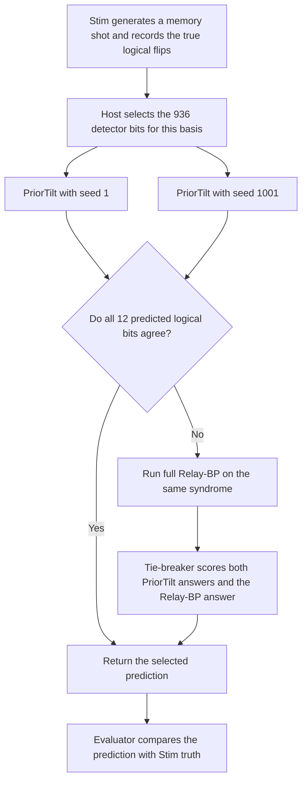

# The Main Branch Router for the Gross Code

The main decoder runs a fast decoder twice on the same quantum memory shot. If the two runs predict the same 12 logical bits, it keeps their answer. If they disagree on even one bit, it runs Relay-BP for a third opinion and chooses among the three answers. **The router is the agreement check.** The neural network is a separate step that ranks candidates after the router asks for more work. [Main hierarchy implementation](https://github.com/Trade42/HackMidwest/blob/main/challenge-1-ml-decoder-kit/hierarchy/plugin.py)

At `p = 0.004`, on the same 10,000 test pairs on the ICRN server, the main hierarchy failed on **44 pairs versus 87 for the backup router**. That is **43 fewer failures** and a **49.53% reduction in logical error rate per cycle**. Mean decode time fell from **315.46 to 216.46 ms per pair**, a saving of **99.01 ms or 31.38%**. These are CPU measurements with the main hierarchy's two fast decodes run one after the other. The published agreement gate runs in software. The Urbana board package demonstrates the backup policy. [Server comparison data](https://github.com/Trade42/HackMidwest/blob/main/challenge-1-ml-decoder-kit/report/tables/test_all.csv) · [Backup FPGA demo](FPGA_DEMO.md)

## What problem the decoder solves

A quantum memory stores information in **qubits**. Physical qubits are susceptible to noise, so an error correcting code spreads useful information across many of them. A **logical qubit** is a unit of information stored by the code. The Gross code uses 144 data qubits to store 12 logical qubits. Its memory experiment also uses 144 extra qubits to measure checks on the data. [Gross-code paper](https://doi.org/10.1038/s41586-024-07107-7) · [Challenge kit circuits](../challenge-1-ml-decoder-kit/circuits/README.md)

A check is like asking whether a group of bits adds up to an even or an odd number. An unexpected change in the answer can tell you something happened to that group. It usually takes readings from other groups to tell what happened. A **detector bit** marks an unexpected relationship between measurements. The pattern of these warnings is a **syndrome**. Different errors can leave the same warnings, so the decoder uses estimated fault probabilities as well as the syndrome to propose a correction.

One run of the memory experiment is called a **shot**. The kit runs 12 noisy check cycles, then measures the stored information. **X memory** and **Z memory** are two versions of that experiment that test different aspects of the stored state. The Stim simulator saves 1,728 detector bits and 12 actual logical flips for each shot. Each classical decoder reads the 936 detector bits for the chosen memory basis. It reasons over 8,784 possible fault effects and predicts the 12 logical flips that matter to the experiment. The evaluator compares that prediction with the simulator's saved answer. A shot fails if any of the 12 bits is wrong. [Stim paper](https://arxiv.org/abs/2103.02202) · [Circuit and fault model](../challenge-1-ml-decoder-kit/circuit.py) · [Infleqtion challenge](https://github.com/Infleqtion/MidQWest-2026#challenge-1-ml-assisted-qec-decoding)

## How the traditional decoders work

The challenge supplies two software baselines. Both use **belief propagation**, abbreviated BP. Each possible fault starts with a prior probability. The decoder sends likelihood estimates back and forth between the faults and the checks they affect. Each exchange is an iteration. A candidate **converges** when it fits all the observed checks. It can still have the wrong logical effect because more than one correction can fit the checks.

| Baseline | What it does on a shot |
| --- | --- |
| **BP-OSD** | Runs up to 80 iterations of BP. When needed, ordered statistics decoding uses the reliability estimates to search for a correction that satisfies the checks. The kit uses a combination sweep of order 10. |
| **Full Relay-BP** | Runs BP in groups of iterations called legs. It carries estimates from one leg to the next, changing how strongly it remembers them. The first leg allows up to 80 iterations and up to 300 later legs allow 60 each. The run stops when it has found five converged candidates or reached its budget. |

Full Relay-BP applies that search policy to every shot. The main hierarchy uses that same decoder only when the two fast answers disagree. This makes full Relay-BP the most direct baseline for evaluating what the hierarchy saves. [Kit settings](../challenge-1-ml-decoder-kit/decoders.py) · [BP-OSD paper](https://arxiv.org/abs/2005.07016) · [Relay-BP paper](https://arxiv.org/abs/2506.01779)

## The main pipeline from shot to decision



1. **Get two opinions quickly.** PriorTilt is an existing decoder from IonQ. It is a variant of BP that nudges the prior estimates for a small subset of faults while decoding. Different random seeds can produce different nudges, especially when the ordinary message passing is struggling. The team uses PriorTilt's published schedule for each noise rate and runs two instances with seeds `1` and `1001`. Each instance sees the same syndrome and produces 12 predicted logical flips. [PriorTilt paper](https://arxiv.org/abs/2611.13373) · [Stages and settings](https://github.com/Trade42/HackMidwest/blob/main/challenge-1-ml-decoder-kit/hierarchy/stages.py)
2. **Accept when they agree.** The router compares all 12 bits. If both candidates say `000100000001`, for example, the host returns that prediction. If one says `000100000011` instead, the host escalates. The implementation compares the logical predictions even when the underlying fault vectors differ. Agreement can happen on an incorrect answer, so the evaluation scores all shots, including those accepted immediately. [Agreement check](https://github.com/Trade42/HackMidwest/blob/main/challenge-1-ml-decoder-kit/hierarchy/plugin.py)
3. **Ask for a third answer on disagreements.** The host runs the full Relay-BP configuration on the same syndrome. By this point it has two PriorTilt predictions and one Relay-BP prediction. The tie-breaker can select any of the three. Relay-BP provides another opinion even when the final choice is one of the original answers. [Candidate selection](https://github.com/Trade42/HackMidwest/blob/main/challenge-1-ml-decoder-kit/hierarchy/rules.py)
4. **Score the final prediction.** The evaluator checks the choice against the simulator's actual logical flips. The decoders, agreement check, and tie-breaker make their choices using the shot and the candidates they produced. The simulator truth is available to training and evaluation. [Evaluator](../challenge-1-ml-decoder-kit/evaluation/evaluate.py)

The gate is the hardware equivalent of asking whether any corresponding bits differ. With 12-bit predictions $a$ and $b$, the escalation rule is

$$
\mathrm{escalate} = \bigvee_{i=1}^{12}(a_i \oplus b_i).
$$

$\oplus$ is exclusive OR. It produces 1 when its two input bits differ. The outer OR turns on escalation if any comparison reports a difference. The software makes this decision with an array equality test.

### Where machine learning contributes

The benchmark's learned tie-breaker is a neural network that follows the connections of the Gross code. On a disputed shot it reads **all 1,728 detector bits** and outputs 12 numbers, called **logits**. A positive logit favors a flip of that logical bit. A negative one favors no flip. The network produces a score for each existing candidate by adding up how well the candidate's bits fit those logits. The host returns the highest scoring candidate's 12 bits.

For a candidate $c$ and logits $\ell$, the score is

$$
S(c) = \sum_{i=1}^{12} \log\!\left(\sigma\left((2c_i-1)\ell_i\right)\right),
\qquad \sigma(x) = \frac{1}{1+e^{-x}}.
$$

This adds evidence in favor of each bit in the candidate. It is a ranking rule built from individual bit scores. The team trained one network for each basis on fresh samples drawn from the kit's model of faults, using the simulated logical flips to teach it which predictions were correct. For Z memory, the network was trained on a different set of logical operators covering the same information. The implementation converts each candidate's bits into the network's coordinates before scoring and returns the original kit bits of the winner. Both checkpoints were fixed before the main test run. The X checkpoint is from step 120,000, and the Z checkpoint is from step 100,000. [Training code](https://github.com/Trade42/HackMidwest/blob/main/challenge-1-ml-decoder-kit/neural/train.py) · [Score and coordinate conversion](https://github.com/Trade42/HackMidwest/blob/main/challenge-1-ml-decoder-kit/hierarchy/rules.py) · [Checkpoint provenance](https://github.com/Trade42/HackMidwest/blob/main/challenge-1-ml-decoder-kit/report/REPRODUCE.md)

The code also supports a classical tie-breaker. It prefers the most probable correction among the converged candidates, based on the kit's fault probabilities. If none converged, it scores all three by that rule. This variant keeps the same routing gate and lets the team measure how much the neural ranking adds. [Classical and neural rules](https://github.com/Trade42/HackMidwest/blob/main/challenge-1-ml-decoder-kit/hierarchy/rules.py)

## Why the design is different from the backup

| Design choice | Backup shown on Urbana | Main hierarchy |
| --- | --- | --- |
| Work on every shot | Relay-BP up to its first solution. | Two PriorTilt runs with different seeds. |
| How it decides to do more | Takes a converged first leg immediately. Otherwise scores 17 features with a trained logistic model. | Compares the two 12-bit predictions. One differing bit is enough to escalate. |
| Work after escalation | Reruns Relay-BP under its full search policy and uses that result. | Runs full Relay-BP as a third candidate and chooses among all three. |
| What learns from data | The risk estimate that controls the routing decision. | A neural ranking of candidates after the routing decision. |

Two fast runs cost more than one. The reason to pay that extra cost is that **disagreement tells us which shots need attention**. At `p = 0.004`, the main runs agreed on 19,910 of the 20,000 individual X and Z shots. Only 90 needed the extra decoder and tie-breaker. On those 90, the neural tie-breaker picked Relay-BP 56 times and one of the PriorTilt answers 34 times. Routing gives the host options on disputed shots while keeping the common case short. There were still 17 wrong basis predictions on the agreement path at this noise rate. [Shot-level gate traces](https://github.com/Trade42/HackMidwest/tree/main/challenge-1-ml-decoder-kit/report/data/test/eval_p0.004_hierarchy)

| Physical noise $p$ | Backup escalations out of 20,000 basis shots | Main escalations out of 20,000 basis shots | Fewer full Relay-BP calls |
| ---: | ---: | ---: | ---: |
| 0.003 | 570 (2.85%) | 2 (0.01%) | 568 |
| 0.004 | 2,575 (12.88%) | 90 (0.45%) | 2,485 |
| 0.005 | 7,124 (35.62%) | 609 (3.05%) | 6,515 |

At `p = 0.004`, 2,485 fewer calls means **96.50% fewer fallbacks** than the backup on those shots. That percentage measures how often the full decoder is invoked. The latency gain also depends on the cost of both PriorTilt runs and what happens on the remaining fallbacks. The decoders keep their random state between shots. Relay-BP in the hierarchy sees only the disputed shots, so it can produce different corrections from a full Relay-BP baseline that sees every shot. [Server run summaries](https://github.com/Trade42/HackMidwest/tree/main/challenge-1-ml-decoder-kit/report/data/test)

## What was measured

At each noise rate the ICRN benchmark runs every row on the same 10,000 saved X shots and 10,000 saved Z shots. It pairs shots by position in the two files. A pair fails if either test fails. Its decode time is the sum of the X and Z decode times. The reported time includes the whole software decode for a pair, including the fast runs, routing, candidate selection, and any fallback that runs. Training and startup are outside that time. See the report for matching dataset hashes, per-shot data, and which runs shared the server. [Reproduction guide](https://github.com/Trade42/HackMidwest/blob/main/challenge-1-ml-decoder-kit/report/REPRODUCE.md) · [Test table](https://github.com/Trade42/HackMidwest/blob/main/challenge-1-ml-decoder-kit/report/tables/test_all.csv)

- **Failed pairs** is the measured count out of 10,000.
- **Logical error rate per cycle** converts the pair failure fraction $P$ to $1-(1-P)^{1/12}$. The table shows that rate as a percent. The kit uses it to compare errors per check cycle.
- **Mean time** is the average elapsed time per pair. **P99** is the time at or below which approximately 99% of pairs finish. P99 helps show the effect of the expensive cases.

The baseline, backup, and main rows below use the team's published server results. The backup was measured again on ICRN so both approaches use the same saved shots and server. This table uses the sequential CPU run for the main hierarchy.

| $p$ | Decoder | Failed pairs | Logical error per cycle | Mean ms per pair | P99 ms per pair |
| ---: | --- | ---: | ---: | ---: | ---: |
| 0.003 | BP-OSD | 60 | 0.050138% | 131.05 | 800.19 |
| 0.003 | Full Relay-BP | 5 | 0.004168% | 85.33 | 556.52 |
| 0.003 | Backup learned router | 6 | 0.005001% | 40.97 | 604.41 |
| 0.003 | Main hierarchy | 3 | 0.002500% | 45.74 | 394.92 |
| 0.004 | BP-OSD | 472 | 0.402108% | 301.67 | 862.91 |
| 0.004 | Full Relay-BP | 83 | 0.069431% | 319.46 | 5,514.22 |
| 0.004 | Backup learned router | 87 | 0.072791% | 315.46 | 6,864.97 |
| 0.004 | Main hierarchy | 44 | 0.036741% | 216.46 | 2,063.88 |
| 0.005 | BP-OSD | 2,433 | 2.296457% | 581.38 | 1,093.15 |
| 0.005 | Full Relay-BP | 845 | 0.733008% | 1,470.86 | 8,270.04 |
| 0.005 | Backup learned router | 807 | 0.698737% | 1,927.93 | 12,707.81 |
| 0.005 | Main hierarchy | 479 | 0.408208% | 824.58 | 9,884.83 |

### How much the main hierarchy gains

An absolute saving is the baseline number minus the main result. A percent saving is that difference divided by the baseline, multiplied by 100. A percentage point (pp) is the absolute difference between two percentages. A negative time saving means the main run took longer. The calculations use the full precision of the saved rows.

| Reference | $p$ | Fewer failed pairs | Logical rate reduction | Mean time saved | P99 time saved |
| --- | ---: | ---: | ---: | ---: | ---: |
| Full Relay-BP | 0.003 | 2 | 0.001667 pp (40.01%) | 39.59 ms (46.40%) | 161.60 ms (29.04%) |
| Full Relay-BP | 0.004 | 39 | 0.032690 pp (47.08%) | 103.00 ms (32.24%) | 3,450.34 ms (62.57%) |
| Full Relay-BP | 0.005 | 366 | 0.324800 pp (44.31%) | 646.28 ms (43.94%) | −1,614.80 ms (−19.53%) |
| BP-OSD | 0.003 | 57 | 0.047638 pp (95.01%) | 85.32 ms (65.10%) | 405.27 ms (50.65%) |
| BP-OSD | 0.004 | 428 | 0.365367 pp (90.86%) | 85.21 ms (28.25%) | −1,200.97 ms (−139.18%) |
| BP-OSD | 0.005 | 1,954 | 1.888249 pp (82.22%) | −243.20 ms (−41.83%) | −8,791.68 ms (−804.25%) |
| Backup learned router | 0.003 | 3 | 0.002501 pp (50.01%) | −4.77 ms (−11.64%) | 209.49 ms (34.66%) |
| Backup learned router | 0.004 | 43 | 0.036050 pp (49.53%) | 99.01 ms (31.38%) | 4,801.09 ms (69.94%) |
| Backup learned router | 0.005 | 328 | 0.290529 pp (41.58%) | 1,103.35 ms (57.23%) | 2,822.98 ms (22.21%) |

For example, versus full Relay-BP at `p = 0.004`, the rate per cycle fell from 0.069431% to 0.036741%. That is an absolute drop of **0.032690 percentage points** and a relative drop of **47.08%**. The mean saving was **103.00 ms per pair**. The paired comparison found 54 pairs that failed only with full Relay-BP and 15 that failed only with the main hierarchy. At `p = 0.003` the difference was two failures, so that row offers much weaker evidence about accuracy. At `p = 0.005` the main hierarchy improves average time versus full Relay-BP while its slowest cases take longer. [Paired comparisons](https://github.com/Trade42/HackMidwest/blob/main/challenge-1-ml-decoder-kit/report/tables/test_comparisons.md)

### Where the gain comes from

PriorTilt is already useful on its own. At `p = 0.004`, one run failed on **74 pairs** and averaged **87.35 ms**. The full hierarchy cut that to **44 failures**, but took **216.46 ms**. The team also scored alternate choices with a fixed set of saved candidates across all three noise rates. In that comparison full Relay-BP failed on 889 pairs, one PriorTilt run failed on 672, and the hierarchy with the learned tie-breaker failed on 544. About **63%** of the drop from 889 to 544 was already present with the change to PriorTilt. The rest was measured after adding the gate and the tie-breaker. These are offline counts on fixed candidates, while the latency table comes from running the full decoder. [Attribution study](https://github.com/Trade42/HackMidwest/blob/main/challenge-1-ml-decoder-kit/report/REPORT.md#whose-gain-is-whose)

The neural rule's incremental advantage remains uncertain. At `p = 0.004` the timed runs failed on 44 pairs with the neural ranking and 52 with the classical rule. The paired test gave a p-value of 0.15. A later test at `p = 0.005`, run after the main results were seen, found 479 failures with the neural ranking and 481 with the classical rule. In the offline comparison across three rates the classical rule failed on 525 pairs and the learned one failed on 544, again with a paired p-value of 0.15. The strongest claim is that the **full hierarchy** reduced logical failures and mean time versus the kit's Relay-BP baseline at the two higher noise rates. [Timed and offline comparisons](https://github.com/Trade42/HackMidwest/blob/main/challenge-1-ml-decoder-kit/report/REPORT.md) · [Later classical comparison](https://github.com/Trade42/HackMidwest/blob/main/challenge-1-ml-decoder-kit/report/tables/test_sweep.md)

There is also a two-core CPU variant. A helper process runs the second PriorTilt instance while the main process runs the first. The host still waits for both before choosing a path. The two modes gave identical predictions on the test shots. At `p = 0.004`, two cores reduced the mean from **216.46 to 150.27 ms**, saving **66.19 ms (30.58%)** of elapsed time. That gain comes from overlapping CPU work. The one-core neural run used about 782 MB of peak process memory at this rate versus about 284 MB for full Relay-BP. The measured value includes the Python runtime and loaded shot data. The report's memory readings cover the parent process. [Parallel implementation](https://github.com/Trade42/HackMidwest/blob/main/challenge-1-ml-decoder-kit/hierarchy/stages.py) · [Resource table](https://github.com/Trade42/HackMidwest/blob/main/challenge-1-ml-decoder-kit/report/tables/resources.md)

## Exactly where the FPGA fits

An **FPGA**, or field-programmable gate array, is a chip that can be configured to implement a digital circuit. There are three relevant pieces of work in the repository. Each demonstrates a different part of the system.

| Implementation | What it does | Evidence |
| --- | --- | --- |
| **Main agreement router** | `hierarchy/plugin.py` compares the two PriorTilt predictions and controls the Python decoder. Both PriorTilt instances, the fallback, and the tie-breaker run on the CPU in the published results. | The held-out software benchmark and per-shot decision traces are on `main`. |
| **Urbana backup router** | `fpga_board/` on `fpga` runs the backup's 17-feature risk score and first-leg bypass in SystemVerilog. Its input packet carries detector bits and Relay-BP statistics. | The validated replay uses the backup model. The older 16-feature `fpga_router/` on `main` is a separate weighted sum prototype with stand-in weights. |
| **Neural tie-break hardware study** | `fpga_network/` on `fpga` explores computing the network's logits with fixed-point arithmetic. This is the expensive network that could run once a disagreement has already occurred. | It has RTL simulations and synthesis estimates for the arithmetic engine. The engine takes weights and other memory contents through its ports. The study did not build the Urbana memory controller or run the engine on a board. |

See the [main implementation](https://github.com/Trade42/HackMidwest/blob/main/challenge-1-ml-decoder-kit/hierarchy/plugin.py), [main report's hardware section](https://github.com/Trade42/HackMidwest/blob/main/challenge-1-ml-decoder-kit/report/REPORT.md#8-resources), [earlier Verilog prototype](https://github.com/Trade42/HackMidwest/blob/main/fpga_router/README.txt), and [FPGA network study](../fpga_network/README.md).

The network study used a **32-lane arithmetic engine** to move through the model a layer at a time. Its integer reference and RTL agreed on the tested whole network outputs. The simulated engine needed about **22.7 million clocks** for one network evaluation. That would be about **227 ms** at an assumed 100 MHz. Yosys mapped the engine to **8,463 LUTs, 2,809 flip-flops, and 73 DSP slices**, excluding the memory system. At 12 bits per weight, about 894,000 weights require roughly **10.7 million bits**, greater than the chip's 2.76 million bits of on-chip block memory. Those estimates explain why the study would need external DDR3 memory for a full board implementation. They describe the neural evaluator on disputed shots. The two-input agreement gate has a different cost and has no measured FPGA timing in the main results. [Sizing and RTL evidence](../fpga_network/README.md)

### What an Urbana demo of the main gate would require

The main gate has a simple hardware interface. The CPU would send **two 12-bit predictions**. A circuit on the FPGA would compare them with exclusive OR and return a single escalation bit. The host would keep an agreed answer or run the full fallback and tie-breaker. This would reuse the Urbana clock, USB serial connection, and LED indicators, with a new packet format and an equality comparator for the decision module.

An implementation could replay predicted pairs exported from the same main test shots and compare every FPGA verdict with the `agreed_X` and `agreed_Z` flags in the software traces. A live integration would replace only the equality check in the host loop and include the time to send and receive each verdict. The check is small enough that USB round-trip time could dominate it. With the existing files, show the main gate from its software traces and use the Urbana run as a demonstration of the backup router. [Main test traces](https://github.com/Trade42/HackMidwest/tree/main/challenge-1-ml-decoder-kit/report/data/test/eval_p0.004_hierarchy) · [Urbana build and demo guide](README.md)

## Reproduce and present the main result

The published main branch retains the backup files under `evaluation/router.py`. The main hierarchy is called through `hierarchy.plugin:make_decoder`. The report's reproduction script fetches pinned dependencies and checkpoints and checks their identity. From the kit directory on the published `main` branch, use the following commands in the order shown.

```bash
report/reproduce_ours.sh env
report/reproduce_ours.sh checkpoints
report/reproduce_ours.sh smoke
report/reproduce_ours.sh row 0.004 hierarchy
```

The smoke test is a small integration check. The `row` command runs the held-out benchmark and can take substantially longer. The reproduction guide also lists `bposd`, `relay-bp`, `router`, and `hierarchy-parallel` rows and shows how to regenerate the report from existing results without running the decoders again. The reported sweep uses the kit's simulated circuit noise. Atom loss and loss-aware decoding are a separate set of experiments in the submission. [Reproduction guide](https://github.com/Trade42/HackMidwest/blob/main/challenge-1-ml-decoder-kit/report/REPRODUCE.md) · [Team report](https://github.com/Trade42/HackMidwest/blob/main/challenge-1-ml-decoder-kit/report/REPORT.md)

For a judge, start with two strings of 12 bits. Show one pair that agrees and one with a single differing bit. In the saved `p = 0.004` X trace, shot at index 0 took the agreement path and the shot at index 579 called for Relay-BP and selected it. Then show the server row. The main router asked for the expensive extra decode on 90 of 20,000 basis shots. The whole hierarchy reduced failures from 83 to 44 and cut average pair time from 319.46 to 216.46 ms versus full Relay-BP. The hardware study explores where that pipeline could run on an FPGA, while those reductions were measured in software. [Example trace](https://github.com/Trade42/HackMidwest/tree/main/challenge-1-ml-decoder-kit/report/data/test/eval_p0.004_hierarchy)
