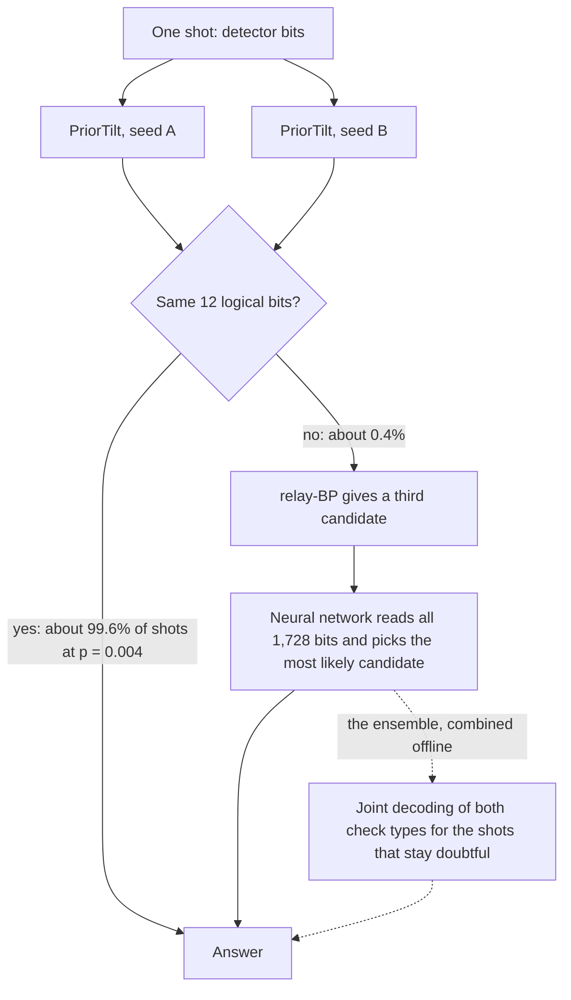

# Information: what we are building, why, and where everything is

Last updated: 2026-11-22 16:40 UTC (the predecoder, its TCBP version, the side folders brought in). This file is the
overview of our part of the team's work on Infleqtion's Challenge 1 (ML-assisted decoding of the Gross code).
It came in from the branch `integration`, our one working branch, which holds everything in the
submission; section 12 lists what is on `main` and the two branches still kept apart.

Read this first, then the README of the folder you care about. Every number below names where
it was measured. **Section 1a holds the results on the team's held-out test shots, from the one
run of the frozen decoder on the team's server; its tables are copied from
`challenge-1-ml-decoder-kit/report/`, where a script makes every table from committed files.
From section 2 on, unless a line says otherwise, numbers are on exploration shots (the train and
validation files), measured while we were building.**

## 1. In one paragraph

We built a hierarchical decoder for the Gross code `[[144, 12, 12]]`. A fast decoder (IonQ's
PriorTilt) runs twice with different random seeds. When its two answers agree, that answer is
final. When they disagree (about 0.45% of shots at p = 0.004), relay-BP joins and a
neural network that follows the code's structure picks the most likely of the three answers. On
the team's held-out test shots (10,000 pairs per noise level, timed on the team's server, one
CPU core), it fails fewer pairs than relay-BP at p = 0.004 (44 against 83) and p = 0.005 (479
against 845), in 0.68 and 0.56 of relay-BP's time, and as many within the error at p = 0.003 (3
against 5) in 0.54 of its time; with the two fast decodes side by side on two cores the times are
0.34, 0.47 and 0.41 of relay-BP's. NVIDIA's GPU decoder TCBP-JOBS, which teammates ran as an extra
reference, is level with it at p = 0.003 and 0.004 and ahead at p = 0.005 (360 against 479). An
ensemble whose rule was frozen before the test run (take the answer where both PriorTilt runs and
TCBP-JOBS agree; otherwise decode both check types jointly), combined offline from the saved
answers, fails 16 pairs against TCBP-JOBS's 41 at p = 0.004 (exact p = 4e-7); at p = 0.005 it
equals TCBP-JOBS, because joint decoding was not run there. As a tie-breaker the network is no
better than the best hand-written rule (544 against 525 failed pairs over the three noise levels
in one offline decode, exact p = 0.15; 47 against 56 on the timed rows at p = 0.003 and 0.004,
p = 0.11), so the gain over relay-BP is PriorTilt's and the hierarchy's. Beside it we
studied atom loss, the part the challenge stresses: relay-BP with the loss flags fails 4.4% of
shots where a loss-blind one fails 57.7%, and our loss-time tracker, which estimates from the
syndrome when each atom was lost, recovers 58% (38% to 78%) of what knowing the true loss time
would add.

**Since the main run: a learned predecoder, and its TCBP version** (each run after the main test results were seen,
and labelled so in the report). The same structured network gets a small head that turns each shot's syndrome into
per-shot error probabilities (priors), handed to a standard decoder in place of the kit's fixed ones.
With relay-BP (the predecoder; its knobs fitted on train shots and checked on validation before one registered run
per test file) it fails 151 X shots of 10,000 at p = 0.005 against 433 for relay-BP with the kit's priors, and on
the pair score 281 failed pairs against TCBP-JOBS's 360 (exact p = 7.6e-6). With TCBP-JOBS in place of relay-BP
(the TCBP version; designed after the test results were seen; its two knobs fitted on train at p = 0.005 and frozen
before validation, where it failed 33 against 91; then one registered run per test file) it fails **72 X shots
against TCBP-JOBS's 186 at p = 0.005** (22 against 136 discordant, exact p = 2.9e-21), 4 against 20 at p = 0.004
(p = 0.0004) and 0 against 1 at p = 0.003. It costs about 56 ms per shot on the A100 (network 9.4 ms, a per-shot
decoder build 42.6 ms, the decode 3.8 ms; not a clean timing), against about 9 ms for TCBP-JOBS alone and about
760 ms for relay-BP's timed row. TCBP-JOBS's own model fit varies from run to run (91, 96 and 100 failures on the
same 5,000 validation shots); on the test shots the same-run control failed exactly the stored file's 186 shots.

## 1a. Results on the held-out test shots

The one run on the test shots (2026-11-22, 10:23 to 13:05 UTC, on the team's server; the
GPU rows on its idle A100; the p = 0.003 baselines re-timed in a quiet window afterwards, with the
same answers on every shot): every decoder decoded the same saved test shots once, with every
setting frozen before. Copied from `challenge-1-ml-decoder-kit/report/tables/test_sweep.md` at
`integration` 9a6907a5:

| Decoder | p = 0.003 | p = 0.004 | p = 0.005 |
|---|---|---|---|
| BP-OSD (kit baseline) | 5.01e-04 ± 6.5e-05 · 60 pairs · 131 ms | 4.02e-03 ± 1.8e-04 · 472 pairs · 302 ms | 2.30e-02 ± 4.6e-04 · 2433 pairs · 581 ms |
| relay-BP (kit baseline) | 4.17e-05 ± 1.9e-05 · 5 pairs · 85.3 ms | 6.94e-04 ± 7.6e-05 · 83 pairs · 319 ms | 7.33e-03 ± 2.5e-04 · 845 pairs · 1,471 ms |
| relay-BP with a learned router | 5.00e-05 ± 2.0e-05 · 6 pairs · 41.0 ms | 7.28e-04 ± 7.8e-05 · 87 pairs · 315 ms | 6.99e-03 ± 2.5e-04 · 807 pairs · 1,928 ms |
| PriorTilt, one run | 3.33e-05 ± 1.7e-05 · 4 pairs · 22.7 ms | 6.19e-04 ± 7.2e-05 · 74 pairs · 87.3 ms | 5.15e-03 ± 2.1e-04 · 601 pairs · 264 ms |
| our hierarchy, lowest-weight tie-break | 2.50e-05 ± 1.4e-05 · 3 pairs · offline, no time | 4.76e-04 ± 6.3e-05 · 57 pairs · offline, no time | 4.50e-03 ± 2.0e-04 · 527 pairs · offline, no time |
| our hierarchy, classical tie-break (lowest weight among the converged candidates) | 3.33e-05 ± 1.7e-05 · 4 pairs · 46.3 ms | 4.34e-04 ± 6.0e-05 · 52 pairs · 218 ms | 3.99e-03 ± 1.8e-04 · 469 pairs · offline, no time |
| our hierarchy, neural tie-break | 2.50e-05 ± 1.4e-05 · 3 pairs · 45.7 ms | 3.67e-04 ± 5.5e-05 · 44 pairs · 216 ms | 4.08e-03 ± 1.9e-04 · 479 pairs · 825 ms |
| our hierarchy, neural tie-break, the two fast decodes side by side on two cores | 2.50e-05 ± 1.4e-05 · 3 pairs · 28.9 ms | 3.67e-04 ± 5.5e-05 · 44 pairs · 150 ms | 4.08e-03 ± 1.9e-04 · 479 pairs · 608 ms |
| our ensemble (combined offline) | 1.67e-05 ± 1.2e-05 · 2 pairs · offline, no time | 1.33e-04 ± 3.3e-05 · 16 pairs · offline, no time | 3.05e-03 ± 1.6e-04 · 360 pairs · offline, no time; fails exactly TCBP-JOBS's shots |
| TCBP-JOBS (NVIDIA, GPU) | 2.50e-05 ± 1.4e-05 · 3 pairs · 3.9 ms | 3.42e-04 ± 5.3e-05 · 41 pairs · 7.8 ms | 3.05e-03 ± 1.6e-04 · 360 pairs · 16.9 ms |

Each cell: logical error rate per cycle ± the kit's error · failed pairs of 10,000 · mean time per pair. "Offline" marks a row combined from saved per-shot answers, with no time measured in one process. Test shots; `report/tables/test_p<p>.md` has the intervals, the paired counts and where each row ran.

- **Times** are per pair (one X shot plus one Z shot), each row in one process on one CPU core
  unless the row says otherwise; TCBP-JOBS runs on a GPU, one shot at a time.
- **Two relay-BP numbers.** The timed relay-BP row (one decoder for all shots) and the relay-BP
  inside the offline rows (a fresh decoder every 500 shots) fail different shots: at p = 0.005,
  845 against 794 pairs. Relay-BP is randomized, so each run draws differently. Every comparison
  in the report stays inside one of the two (`report/tables/checks.md`).
- **The ensemble's rule is ours; its members are NVIDIA's, IonQ's and the kit's.** It has no time
  measured as one decoder: joint decoding took about 24 s a shot on the 93 disputed shots at
  p = 0.004 (0.47% of its 20,000) and about 5 s on the 5 at p = 0.003; it was not run at p = 0.005.

Whose gain is whose (copied from `report/tables/test_ladder_short.md`):

**Whose gain is whose, on the test shots**: failed pairs of 10,000 per noise level, every rung scored on the same per-shot answers (one offline decode: relay-BP and PriorTilt under two seeds on every shot, a fresh decoder per 500 shots; not the timed rows above). `APPENDIX.md` B has each rung's paired test against the rung before it and against relay-BP.

| Rung | Whose work | p = 0.003 | p = 0.004 | p = 0.005 | All three p |
|---|---|---|---|---|---|
| relay-BP (kit baseline), a fresh decoder per 500 shots (the ensemble's member) | the kit | 5 | 90 | 794 | 889 |
| PriorTilt, one run (seed A) | IonQ | 6 | 71 | 595 | 672 |
| our hierarchy, lowest-weight tie-break (nothing learned by us) | ours | 3 | 57 | 527 | 587 |
| our hierarchy, lowest weight among the converged candidates (nothing learned by us) | ours | 3 | 53 | 469 | 525 |
| our hierarchy, neural tie-break | ours | 4 | 50 | 490 | 544 |
| ORACLE: a perfect tie-break on the same candidates (a ceiling, not a decoder) | nobody: needs the truth | 3 | 40 | 386 | 429 |
| TCBP-JOBS (NVIDIA, GPU), for reference | NVIDIA | 3 | 41 | 360 | 404 |

**After the main run** (X failures of 10,000 test shots unless marked; every row run after the main test results
were seen; `report/tables/master_comparison.md` holds every method with its label and folder):

| Decoder | p = 0.003 | p = 0.004 | p = 0.005 | Label |
|---|---|---|---|---|
| relay-BP with the kit's priors, same runs (the predecoder's control) | 7 | 39 | 433 (Z 398) | registered |
| the predecoder: relay-BP with the head's priors | 2 | 15 | 151 (Z 132; pairs 281) | registered extension |
| the predecoder, falling back to TCBP-JOBS where relay-BP did not converge | 1 | 10 | 107 (Z 100; pairs 206) | designed after the first test result |
| TCBP-JOBS alone (stored test files) | 1 | 20 | 186 (Z 177; pairs 360) | reference |
| **the TCBP version: TCBP-JOBS with the head's priors** | **0** | **4** | **72** | designed after the test results were seen; registered runs |


## 2. The challenge

From the organisers' statement (`README.md` at the top of the repository):

- **Task:** build an ML-assisted decoder that improves on BP-OSD and relay-BP for the Gross
  code, in accuracy, speed, or the handling of atom loss. Hierarchical decoding is named as one
  approach. The stated goal is to beat the baseline "particularly when loss information is
  available".
- **Required experiment:** a sweep of our decoder over the physical error rates 0.003, 0.004
  and 0.005, against both baselines, on the same test data and noise.
- **Required metrics:** logical error rate, decoding latency and resource requirements, with a
  discussion of where the approach works and where it falls short.
- **Deliverables:** a working decoder, the code that makes the data, a script that reproduces
  the evaluation, at least one plot, and a short presentation.
- **Stretch goals:** a trained router, a second code, sliding windows, scaling with distance,
  hardware cost.

## 3. The experiment and the baselines

Defined by the kit (`challenge-1-ml-decoder-kit/README.md`):

- **Memory experiment.** 144 data qubits hold 12 logical qubits. X memory prepares |+>, runs 12
  noisy rounds of checks, and measures. Z memory is the same with |0>.
- **What a decoder sees.** One shot gives 1,728 detector bits. The baselines decode X memory
  from the 936 bits on X checks, a problem with 8,784 possible error mechanisms. Using all
  1,728 bits ("joint decoding") gives a problem with about 68,000 mechanisms.
- **Failure.** A shot fails when any of the 12 logical bits is predicted wrong. Shot k of X is
  paired with shot k of Z, and the pair fails when either fails.
- **Rate.** With failure fraction P over the pairs, the rate per cycle is `1 - (1 - P)^(1/12)`.
- **Noise.** One strength p on every operation. Each decoder gets the exact error model.

Baselines, 10,000 shots per basis (the kit's README, the organisers' reference run). **Times in
this table are per pair: one X shot plus one Z shot.** The tables of section 5 give times per
shot of one basis, so a time there is about half of a per-pair time; do not compare the two
directly. The final table uses per pair throughout, as the team's evaluator does.

| p | Decoder | Failures X, Z | Rate per cycle | Mean time per pair |
|---|---|---|---|---|
| 0.003 | BP-OSD | 26, 30 | 4.7e-4 | 0.14 s |
| 0.003 | relay-BP | 3, 2 (43, 54 of 100,000) | 4.2e-5 (8.0e-5) | 0.10 s |
| 0.004 | BP-OSD | 253, 269 | 4.4e-3 | 0.33 s |
| 0.004 | relay-BP | 45, 60 | 8.7e-4 | 0.38 s |
| 0.005 | BP-OSD | 1302, 1286 | 2.3e-2 | 0.59 s |
| 0.005 | relay-BP | 411, 414 | 6.9e-3 | 1.7 s |

Relay-BP is the stronger of the two baselines the challenge names. A third reference, run by
teammates on a GPU, is NVIDIA's TCBP-JOBS (`tcbp_jobs_baseline.py`, logs in `results/` on
`main`; its own sampled shots, 10,000 pairs each):

| p | TCBP-JOBS failures X, Z | Rate per cycle | Against relay-BP |
|---|---|---|---|
| 0.003 | 2, 3 | 4.2e-5 | equal |
| 0.004 | 18, 23 | 3.4e-4 | 2.5 times lower |
| 0.005 | 192, 188 | 3.2e-3 | 2.2 times lower |

- **TCBP-JOBS is therefore the real bar at p = 0.004 and 0.005.**
- Its logged times (4.3 ms, 42.9 ms and 81.7 ms per pair) were not comparable: the runs at
  p = 0.004 and 0.005 shared the GPU with one of our trainings. **Re-run on the team's test shots
  on the idle server GPU, one shot at a time:** 3 / 41 / 360 failed pairs at 3.9 / 7.8 / 16.9 ms
  per pair (section 1a).
- The table above comes from its own sampled shots, not from the team's saved test files.

## 4. Who does what

- **Teammates** own the shared evaluation: the saved shot files for all three noise levels
  (`data/p0.003`, `data/p0.004`, `data/p0.005`: train 20,000, validation 5,000 and test 10,000
  shots per basis), the evaluator that scores any decoder on them (`evaluation/`), the baseline
  rows, the TCBP-JOBS baseline, and a trained router on relay-BP's first answer
  (`evaluation/router*.py`, `results/router_p0.00x/`). They push to `main`.
  - Their router on the p = 0.003 test shots (`results/icrn/`): 6 failed pairs against
    relay-BP's 5, at 47 ms against 86 ms per pair. That is relay-BP's accuracy in 45% less time
    (re-timed in the quiet window: 41.0 ms against 85.3 ms, section 1a).
- **This document covers our line:** the hierarchical decoder, the neural network, the loss
  study, and the measurements that decided the design. Our decoder plugs into the team's
  evaluator, so every row of the final table comes from the same saved test shots.

## 5. The pipeline



1. **Stage 1, fast: PriorTilt twice.** PriorTilt is IonQ's belief-propagation decoder with 14
   fitted parameters, published for this code and noise in November 2026. We feed it the kit's
   own check matrix and priors. Alone it fails 15% fewer shots than relay-BP at p = 0.004 at
   about a third of the time. We run it twice with different seeds.
2. **The agreement test.** If both runs predict the same 12 logical bits, the answer is final.
   The two runs differ on 0.40% of X shots, and those shots hold most of the failures.
3. **Stage 2, on disagreement only: relay-BP and a learned tie-breaker.** The kit's relay-BP
   gives a third candidate. The neural network of section 6 reads the shot's full syndrome and
   scores each candidate; the most likely one wins. Without a network the rule is "lowest
   weight".
4. **Stage 3, in the offline ensemble only: joint decoding.** Decoding both check types together fixes about 9 in 10
   of relay-BP's failures, but costs about 70 to 100 times the time, and run on every shot its own mistakes cancel
   most of the gain at p = 0.004. The ensemble sends it only the shots where the two PriorTilt runs and TCBP-JOBS do
   not all agree: 5 of the test shots at p = 0.003 and 93 at p = 0.004 (section 1a). It was not run at p = 0.005, and
   it is not part of the timed decoder.

**What is learned:** PriorTilt's parameters (fitted by its authors), the neural tie-breaker (trained by us) and the
loss tracker's model (`loss_tracker/`). **What is not:** the agreement test, relay-BP, the ensemble's rule, and the scoring.

Measured on the team's p = 0.004 train and validation files (laptop CPU; times were taken
beside a GPU training, so compare them with each other only):

| Rule | Shots | Failures | Mean time per shot |
|---|---|---|---|
| relay-BP, the kit's settings | 50,000 (X and Z) | 245 | 169 ms |
| PriorTilt once, first seed / second seed | 50,000 | 208 / 189 | 54 ms |
| PriorTilt twice, relay-BP on disagreement, lowest weight | 50,000 | **162 (34% fewer than relay-BP)** | 124 ms |
| relay-BP | 25,000 (X only) | 122 | 167 ms |
| PriorTilt once, first seed / second seed | 25,000 (X only) | 102 / 82 | 52 ms |
| the same rule with lowest weight | 25,000 (X only) | 77 | 118 ms |
| **the same rule with the network as tie-breaker** (step 50,000 of its training) | 25,000 (X only) | **63 (48% fewer than relay-BP)** | 118 ms |
| a perfect tie-breaker on the same candidates | 25,000 (X only) | 50 | |

**How much of the gain is ours.** Be exact about this when presenting:

- **PriorTilt is IonQ's decoder, not ours.** One run of it already fails 15% to 23% fewer shots
  than relay-BP, depending on its random seed (208 or 189 against 245). That seed-to-seed spread
  is itself a finding: a single run is not a stable number.
- **The hierarchy is ours:** two seeds, the agreement test, relay-BP as a third candidate where
  they disagree. It takes the average single run (198.5) to 162, 18% fewer, and removes the
  dependence on the seed.
- **The learned tie-breaker is ours:** on X memory it takes the lowest-weight rule's 77 failures
  to 63, another 18% fewer.
- Several rules were tried on these same shots before these were kept, which flatters them
  slightly. The run on the test shots, with the rule frozen, is the number to quote.

- The paired comparison of PriorTilt against relay-BP: 127 shots only relay-BP fails, 90 only
  PriorTilt fails, p = 0.014.
- Some X shots have two agreeing wrong answers. No tie-breaker fixes those; only a better filter
  or stage 3 can.
- The network gains slowly as a tie-breaker (66, 65 and 63 failures at steps 30,000, 40,000 and
  50,000) while improving a lot on its own. The hard shots are hard for it too.
- **Measured since, on the test shots (section 1a):** this decoder at p = 0.003, 0.004 and 0.005, with an X and a Z
  network, through the team's evaluator, in one run with every setting frozen.
- First number at p = 0.005 (20,000 X shots made on the laptop): PriorTilt alone fails 612
  against relay-BP's 883, 31% fewer, at 201 ms against 937 ms per shot.

**Where this stands against TCBP-JOBS** (written before the test run; section 1a has the
test numbers). On the practice shots at p = 0.004 the hierarchy was below relay-BP and above
TCBP-JOBS, and even a perfect tie-breaker over its three candidates would at best about equal TCBP-JOBS (50 against
53 failed X shots of 25,000; on the test shots 40 against 41 failed pairs at p = 0.004, and behind it at p = 0.005,
386 against 360).
So we built an ensemble: stronger members where the fast ones disagree (joint decoding,
TCBP-JOBS itself) under a fixed rule. On the test shots at p = 0.004 it fails 16 pairs against
TCBP-JOBS's 41. The evidence that led there: with 16 relay-BP candidates per shot the right
answer is among them in 79% of relay-BP's converged-wrong failures, while "lowest weight" picks
it in only 49% (section 8).

Code: `challenge-1-ml-decoder-kit/hierarchy/` (`candidates.py`, `select.py`, `rules.py`, `stages.py`, and the
evaluator plugin `plugin.py`). Its README has the install and the commands.

## 6. The neural network

Folder `challenge-1-ml-decoder-kit/neural/`. Its README explains the design in plain words and
lists every measured number.

- **Recipe.** A convolutional network after the "Cascade" decoder (arXiv:2604.08358), the one
  published neural recipe that works on this code, scaled down to one laptop GPU. No code was
  copied; the authors released none.
- **Three ingredients.** Layers that pass information along the code's own connections (each
  check touches 6 data qubits, each data qubit 6 checks, the same weights at all 72 positions
  of the torus). Pooling on the logical operators, so the output is the 12 logical bits. A
  curriculum that starts training at low noise and climbs.
- **Input and output.** All 1,728 detector bits in, 12 logical bits out. One network per
  memory basis. The logits give a confidence.
- **Training data.** Shots drawn fresh from the kit's error model at every step, so no shot is
  seen twice and there is no dataset to memorise. Scores come from the kit's Stim shots.
- **Size and speed.** Width 128, depth 8, 0.89 M parameters, about 725 shots per second on an
  RTX 4060.
- **Z memory needed a fix.** Five of the kit's Z logical operators are heavy (24 to 38 qubits)
  and learn badly. The network is trained on 12 lighter operators from which the kit's 12 bits
  follow exactly (checked on Stim records). The X network's weights, mirrored, give Z a head
  start: before any Z training it already gets 97.8% of shots right at p = 0.001.

X network, width 128, scored on the team's Stim shot files (train plus validation, 25,000 shots
per noise level):

| Training step | p = 0.003 | p = 0.004 | p = 0.005 |
|---|---|---|---|
| 30,000 (of a planned 230,000; the run ended at 120,000) | 8.3% of shots wrong (other files) | 26.9% | 55.9% (other files) |
| 40,000 | 6.1% | 21.7% | 48.4% |

- Alone it is far from relay-BP (0.5% at p = 0.004). Its use is the tie-breaker of section 5.
- Its most confident quarter of shots is about as clean as the classical decoders (3 failures
  in 6,250 shots at p = 0.004, where relay-BP has 3).
- The X run ended at step 120,000, and the Z run, started from the mirrored X weights, at step 100,000. Those two
  networks are the ones in the decoder (`report/reproduce_ours.sh checkpoints` fetches them and checks their sha256).

An earlier plain CNN (`ml_decoder/`, pull request #1) is the stepping stone: a first stage with
a confidence threshold in front of relay-BP. Its default size learned nothing in 50 minutes;
a small one learned the low noise levels only. See section 9.

## 7. Atom loss

Folder `challenge-1-ml-decoder-kit/loss/`; `RESULTS.md` there is the full record.

- **Model (our assumption, stated as such).** Simulated with Clifft's `noncomp` module on the
  kit's circuit. After every CX each of its two atoms is lost with probability s. A lost check
  atom is flagged at its measurement and replaced. A lost data atom stays lost and is flagged
  only at the end. Flags are perfect. s = 2e-3 is about today's hardware by Infleqtion's own
  paper (arXiv:2408.08288); lower values are targets. This is not "Infleqtion's noise model":
  it is a model built from their published figures.
- **How a loss reaches the decoder.** A map from each possible loss to the columns of the
  decoding problem it can flip, checked against the simulator. A third of the data-atom losses
  land on a column the starter script never raises.
- **Flag-aware decoding** raises the priors of those columns for flagged atoms, spreading a
  data atom's loss evenly over all possible times (the published method).

X memory, p = 0.004, s = 1e-3 per atom per CX, relay-BP at the kit's settings, Clifft shots
(about 10 lost data atoms per shot):

| Decoder | Shots | Failures |
|---|---|---|
| loss-blind (ignores the flags) | 300 (a first, small run) | 173 (57.7%) |
| flag-aware, uniform guess over the loss time | 4,000 | 176 (4.40%) |
| flag-aware with exact location weights | 4,000 | 189 (no gain) |
| flag-aware, stopping relay-BP at its first solution | 4,000 | 200 (14% more) |
| **ORACLE: told the true loss round** (a ceiling, not a decoder) | 4,000 | **107 (2.67%)** |

- The oracle fails 1.64 times less often than the flag-aware decoder (paired 94 against 25
  shots, interval 1.42 to 1.94). So the timing of a loss is worth knowing.
- At s = 2e-3, about today's hardware: the loss-blind decoder fails 148 of 150 shots, the
  flag-aware one 173 of 750 (23.1%).
- **The loss-time tracker (done, `loss_tracker/`).** A lost data atom makes its six neighbouring checks fire at
  random from the moment it is lost. A hidden Markov model over that history, then a small network, estimates the
  loss round and feeds it to relay-BP as per-shot priors. On its own test shots (4,000 new shots at s = 1e-3, the
  tracker frozen on validation shots beforehand), relay-BP with the tracker's estimate fails 147, against 196 for the
  flag-aware decoder with exact location weights (sign test p = 5e-6) and 112 for the ORACLE: it recovers 58%
  (38% to 78%) of the oracle's gain.

## 8. Measurements that decided the design

Folder `challenge-1-ml-decoder-kit/analysis/`; `RESULTS.md` there has the tables and commands.

| Question | Answer | Where |
|---|---|---|
| How does relay-BP fail at p = 0.004? | 245 failures in 50,000 shots: 100 did not converge, 145 converged to a wrong answer. 224 of them are among the 14% of shots whose first leg does not converge. | `analysis/`, G1 |
| What fixes those failures? | A re-run with other random draws: 108 of 245. BP-OSD: 79. Tesseract: 80. Joint decoding: about 9 in 10. | G2 |
| Is the right answer among relay-BP's candidates? | With 16 candidates per shot it is there in 114 of the 145 converged-wrong failures (79%). The lowest weight picks it in 71 (49%), a vote in 69. Weight is the wrong score; a learned one has room. | G2 |
| Joint decoding at p = 0.003 | Fixes 43 of relay-BP's 44 failures, breaks 0 of 300 control shots, about 9 s against 0.13 s per shot. | G2 |
| Joint decoding at p = 0.004 | Fixes 89 of 100 failures, breaks 1 of 200 controls, 135 s per failed shot and 31 s per control shot on our slow PC. | G2 |
| Can relay-BP's schedule be faster for free? | Stopping after 3 solutions instead of 5 costs nothing measurable (42 against 51 failed pairs) at 1.44 times fewer iterations. Legs of 30 iterations cost accuracy badly (93 to 108). | G3, 16 schedules |
| Does a Stim seed give the same shots on every machine? | No. Paired comparisons need saved shot files. | `ml_decoder/stim_seed_check.py` |
| Do two machines decode the same shots the same way? | Yes: our PC, a laptop (Windows) and a Linux server agree shot for shot on relay-BP and PriorTilt. | G3 machine check; `hierarchy/` |

The relay-BP authors' own data agree on joint decoding: about 2.5 times fewer failures at
p = 0.003, 1.3 times at 0.004, worse at 0.005, at about 100 times the time
(https://github.com/trmue/relay, `examples/data`).

## 9. What we tried that did not work

Each is kept with its numbers, as the challenge asks where an approach falls short.

- **The default plain CNN** (5.6 M parameters, batch 2,048): after 50 minutes it equalled the
  always-0 guess at every noise level.
- **A small plain CNN** learned low noise only: after 117 M shots, 90.6% of shots still wrong
  at p = 0.003. Plain CNNs stall without the code's structure.
- **A faster relay-BP schedule as the fallback** (40 / 30 / stop at 1): 49 failures against 20
  on 5,000 shots.
- **Classic predecoders** (commit to errors early, pass the rest on): no gain in our tests.
  NVIDIA's released Ising predecoders are for surface and colour codes and cannot read this
  code's syndrome.
- **Exact location weights for loss:** no gain over the simple map (189 against 176).
- **Stopping relay-BP at the first solution under loss:** 14% more failures.
- **Longer training as a tie-breaker:** only 66, 65 and 63 failures at steps 30,000, 40,000 and
  50,000, while the network alone improved from 27% to 16% of shots wrong.

## 10. Result sets for the submission

| Set | Noise | Compared | State |
|---|---|---|---|
| A (required) | the kit's circuits at p = 0.003, 0.004, 0.005 | our hierarchy against BP-OSD and relay-BP on the team's test shots; PriorTilt once, the teammates' router, TCBP-JOBS and our ensemble as extra rows | **done**: section 1a and `report/REPORT.md` |
| B | A plus atom loss | loss-blind, flag-aware, ours with the tracker, and the true loss time (ORACLE) | done at one loss rate (`loss/`, `loss_tracker/`) |
| C | a neutral-atom-style model from Infleqtion's published figures | each decoder with generic and with matching priors | done on the branch `infleqtion-noise` (not merged; a demo) |
| D | decode at one p with priors for another | every decoder | not done |
| E | what did not work | section 9 and the report's own section | done |

## 11. Rules we hold ourselves to

- Final numbers come from the kit's Stim shots in saved files, the same files for every decoder.
- Three splits with different seeds. Everything is chosen on train and validation shots. The
  test shots are decoded once, at the end. Our tools refuse `test_*` and `go_*` files by name.
- The truth (the observables, the true loss times) reaches training and scoring only, never a
  decoder at decode time. Oracle rows are labelled ORACLE.
- "Better" means paired counts on the same shots, with a test or an interval.
- Every latency names its machine and what the timer wraps; every stage of a hierarchy counts.
- A result that looks too good is treated as a bug until shown otherwise.
- All of our submitted work came through one branch, `integration`, where each task owns its own folder. An
  independent review re-ran `hierarchy/`, `loss_tracker/` and `ml_decoder/`, and re-derived every test-shot table of
  `report/` from its per-shot files; for `neural/`, `loss/` and `analysis/` it checked only that each quoted number
  comes from a committed file.

## 12. Where everything is

Branches of this repository:

| Branch | What it holds | State |
|---|---|---|
| `main` | the kit, and the teammates' evaluator, shot files, router and baselines | shared by the team |
| **`integration`** | **all of our submitted work, this file and the report** | our one working branch; merged into `main` by pull requests #2, #3 and #5 to #10 |
| `server-logs` | logs and result files pushed from the GPU server: the test run's per-shot files under `files/clean/`, the final Z network under `files/ckpt/` | data only, never merged |
| `laptop-artifacts` | the laptop's per-shot decode files, network checkpoints (the final X network: `cascade_X_s1/checkpoint_final_step120000.pt`) and scores | data only, never merged |

The five older task branches (`MLDecoder`, `gates`, `loss-gates`, `cascade`, `hierarchy`) are
merged into `integration` (`MLDecoder` also into `main`, pull request #1). `MLDecoder`, `gates`
and `loss-gates` stay on the remote because the team's top `README.md` links to them;
`hierarchy` is also still on the remote, fully merged; `cascade` is deleted.

Brought into `main` after the main run, each as its own folder (pull requests #3 to #10, on the team's word):
`predecoder` and `predecoder-tcbp` (folder `predecoder/`: the predecoder and its TCBP version), `learned-selector`
(folder `selector/`: a small model choosing among the ensemble's members at p = 0.005; ahead on validation, level
with TCBP-JOBS on the test shots, 353 against 360, p = 0.41) and `infleqtion-noise` (folder `neutral_atom_noise/`:
our noise model built from Infleqtion's published figures, not Infleqtion's own model, with the TCBP pipeline tried
on it as exploration). Their branches stay on the remote.

Branches still kept apart:

| Branch | What it holds |
|---|---|
| `fpga` | the tie-break network as a simulated FPGA design: with 12-bit weights and values it gets as many of 5,000 validation shots wrong as at 16 bits (239), and none of its 99 tie-break choices changes; but its 10.7 Mb of weights do not fit the team's board (2.76 Mb of block RAM); and a check of the teammate's board demo. A teammate's pull request (#4) proposes it for `main` |
| `network-first` | the network decides the X shots it is confident on, the hierarchy the rest: at p = 0.004, on 80,000 fresh X exploration shots, level in accuracy (229 against 237 failures, p = 0.28) at about 70% of the frozen rule's mean time on our PC; no test-shot result |

Folders (inside `challenge-1-ml-decoder-kit/` unless noted):

| Folder | Read first |
|---|---|
| `hierarchy/` | `README.md` |
| `neural/` | `README.md` |
| `loss/` | `RESULTS.md` |
| `analysis/` | `RESULTS.md` |
| `ml_decoder/` | `README.md` |
| `report/` | `REPORT.md`, then `REPRODUCE.md` |
| `loss_tracker/` | `RESULTS.md` |
| `predecoder/` | `README.md` (the predecoder), then `README_tcbp.md` (its TCBP version) |
| `selector/` | `README.md` |
| `neutral_atom_noise/` | `README.md`, then `RESULTS.md` |
| `server-jobs/` (top level) | `README.md`: the job scripts the team's server ran, kept as the record |
| `evaluation/`, `data/`, `results/` | `evaluation/README.md` (the teammates') |
| `fpga_router/` (top level) | `README.txt`: Verilog for a router's decision, simulated with stand-in weights; a stretch goal |

Main commands, all from `challenge-1-ml-decoder-kit/` with Python 3.12 and the kit's
`requirements.txt` (each folder's README has the full list):

```sh
# the three candidates of every shot of a noise level, and the rules that need no network
python -m hierarchy.candidates --data data/p0.004 --out runs/cand_p0.004 --processes 12
# score the rules again, with the network's per-shot logits
python -m hierarchy.select --candidates runs/cand_p0.004/validation_X.chunks.npz
# train the X network, then the Z network from it
# these train new networks; the frozen ones (X step 120,000, Z step 100,000) come from report/reproduce_ours.sh checkpoints
python -m neural.train --out runs/cascade_X_s1 --seed 1 --steps 230000
python -m neural.train --basis Z --logicals light --init-from runs/cascade_X_s1/checkpoint.pt --out runs/cascade_Z_s1 --seed 1 --steps-start 1000 --steps-anneal 6000 --steps 230000
# score a network on saved Stim shots, and save its per-shot logits
python -m neural.evaluate_stim --checkpoint runs/cascade_X_s1/checkpoint.pt --data data/p0.004/validation_X.npz --save runs/eval/val_X
```

Machines: a 16-thread PC for the CPU studies, a laptop with an RTX 4060 (8 GB) for the X
network and CPU decoding, and a university notebook server (an A100 slice of 20 GB, 12 CPUs)
for the Z network, the test run and large decoding runs. Much of the code was written
with AI coding assistants under our direction, which the challenge allows; this file and the
READMEs are how we keep being able to explain it.

## 13. What is next

Done for the submission: the evaluator plugin, both networks, the one run on the test shots beside every baseline
row, the ensemble, the loss-time tracker, the predecoder and its TCBP version with their registered test runs, the
report with its plots and its table of every method, the reproduce script and the slides. Left:

1. Retrain the network's small head for each new noise picture (the Z head took about 25 minutes on a laptop GPU):
   on the neutral-atom model TCBP-JOBS fails 25 of 2,000 shots with the true noise's priors and 209 with the
   kit-trained head's, so most of the gap is the head's to close.
2. The TCBP version with atom loss: it already builds one decoder per shot from per-shot priors, so the loss flags
   (or the loss tracker's estimate) can enter at no extra cost; its network was trained without loss.
3. A faster per-shot build for the TCBP version (42.6 of its 56 ms), and joint decoding at p = 0.005.
4. Stretch: the FPGA router on the board, a second code.

## 14. Plain-words glossary

- **Gross code `[[144, 12, 12]]`:** 144 physical qubits protect 12 logical qubits; any 5
  errors can be corrected (distance 12).
- **Check, syndrome, detector:** a check measures a parity of 6 data qubits each round. A
  detector is the comparison of a check with itself one round earlier; it fires when something
  changed. The pattern of fired detectors is the syndrome.
- **Decoder:** the program that reads the syndrome and says which logical bits flipped.
- **Logical error rate:** how often the decoder's answer is wrong, here per cycle.
- **Belief propagation (BP):** a fast message-passing decoder. It often fails to settle on
  these codes.
- **BP-OSD:** BP followed by a slower algebraic clean-up. The older baseline.
- **Relay-BP:** many BP runs in a chain with changed memory strengths, stopping after a few
  solutions and keeping the lightest. The strong baseline.
- **PriorTilt:** BP with a few fitted parameters and a random stage, from IonQ.
- **Joint decoding:** decoding X and Z checks together. More accurate at low noise, far slower.
- **Hierarchical decoding:** a fast decoder for the easy shots, a stronger one for the hard
  ones, and a rule (a router) that tells them apart.
- **Atom loss, herald:** in neutral-atom machines an atom can leave its trap. A herald, or
  flag, is the measurement telling us an atom is gone.
- **Oracle:** a test that is given the truth on purpose, to measure the best any method could do.

## 15. Sources

What we build on directly. The figures we quote from papers were read by a research pass and
are not all checked against the papers by us: check the source before quoting one.

| Source | What we use it for |
|---|---|
| Bravyi et al., "High-threshold and low-overhead fault-tolerant quantum memory", Nature 627, 778 (2024) | the Gross code and its syndrome circuit (through the kit) |
| The relay-BP paper, arXiv:2506.01779; code and data at https://github.com/trmue/relay; PyPI `relay-bp` 0.2.2 | the strong baseline, its settings, and the authors' published failure counts for split and joint decoding |
| Ye and Delfosse (IonQ), PriorTilt, arXiv:2611.13373; https://github.com/ionq-publications/PriorTiltDecoder at commit `8eefd37` | stage 1 of the hierarchy. Licence CC BY-NC-SA 4.0: used as a dependency, none of its code is in this repository |
| Gu, Bonilla Ataides, Lukin, Yelin, "Scalable Neural Decoders for Practical Fault-Tolerant Quantum Computation" (the "Cascade" decoder), arXiv:2604.08358 | the recipe of the neural network (no code released; ours is written from the paper's description) |
| NVIDIA TCBP-JOBS (run by teammates, `tcbp_jobs_baseline.py`) | the GPU reference row |
| arXiv:2609.37629 and arXiv:2601.17757 | evidence that disagreement between decoders predicts failure far better than syndrome weight |
| Murri, "Maximally-Matched Mixture Decoding for Correlated Atom Loss in Quantum LDPC Codes", arXiv:2610.38283 | loss on the Gross code with relay-BP: the uniform mixture over loss times, and the tracker named as future work |
| Baranes et al., "Leveraging Qubit Loss Detection in Fault Tolerant Quantum Algorithms"; Liu et al., "Low-Overhead Surface Code with Delayed Atom-Loss Detection via Pauli Envelope", arXiv:2603.04156; Suchara, Cross, Gambetta, "Leakage Suppression in the Toric Code" | the recipe for loss-aware priors |
| Varbanov et al., "Leakage detection for a transmon-based surface code", arXiv:2002.07119 | the hidden Markov model that the loss tracker adapts |
| Wang et al., "AI-Enabled Qubit Loss Detection and Replenishment Strategy for Atom Array Quantum Computing", arXiv:2604.14269 | a network that locates lost qubits from the syndrome |
| Radnaev et al., arXiv:2408.08288; arXiv:2412.07670; Rines et al., arXiv:2509.13247 | Infleqtion's measured loss and error rates, and their five-level circuit model |
| Stim (https://github.com/quantumlib/stim); Clifft v0.13.0 (https://github.com/unitaryfoundation/clifft, arXiv:2604.27058); `ldpc` (BP-OSD); qLDPC (https://github.com/qLDPCOrg/qLDPC) | simulators and decoder libraries |
| NVIDIA Ising decoding (https://github.com/NVIDIA/ising-decoding) | read for the predecoder idea; its models do not apply to this code |

## 16. The complete reading list

Every source the four literature surveys cite, transcribed from our notes: decoders for these
codes, machine-learning decoders, loss and leakage, and Infleqtion's hardware. The surveys were a
research pass, and each entry keeps that pass's own caveats (for example "figure only" or
"abstract only"). Nothing here was added from memory. Check a paper before quoting a number
from it.

### Decoders for bivariate bicycle codes (non-ML)

- Müller, Alexander, Beverland, Bühler, Johnson, Maurer, Vandeth, "Improved belief propagation is sufficient for real-time decoding of quantum memory" (2025). arXiv:2506.01779. It defines relay-BP and gives its knobs and gross-code numbers. Relay-BP is already our first decoding stage. (split-mode per-cycle values figure only)
- Min Ye, Nicolas Delfosse, "PriorTilt: Decoding quantum LDPC codes with sparse perturbations of belief propagation priors" (2026). arXiv:2611.13373. PriorTilt is BP with 14 fitted parameters. It is 1.7 to 4.3 times below relay-BP-1 over p=0.001 to 0.005. (single-source preprint, authors' own baselines)
- Aghababaie Beni, Higgott, Shutty, "Tesseract: A Search-Based Decoder for Quantum Error Correction" (v2, 2025). arXiv:2503.10988. Tesseract, an A* search decoder, is the near-optimal reference at p <= 0.001. It is too slow as a stage. (SI1000 noise only; values figure only)
- Ye, Wecker, Delfosse, "Beam search decoder for quantum LDPC codes" (PRX Quantum 7, 033002 (2026) per the repository). arXiv:2512.07057. It branches on the least reliable variable and re-runs warm-started BP. Its worst case is bounded. (absolute rates figure only)
- Maan, Garcia-Herrero, Paler, Savin, "Decoding Correlated Errors in Quantum LDPC Codes" (Nature Communications (2026)). arXiv:2510.14060. GARI rewrites the correlated graph and runs 24 serial min-sum decoders. It reaches (6.70 +- 1.93)e-9 per round at p=0.001. (values at p=0.002 to 0.006 figure only)
- Xie, Yoshioka, Tsubouchi, Li, "Simple, Efficient, and Generic Post-Selection Decoding for qLDPC codes" (2026). arXiv:2601.17757. With argument reweighting, relay-BP at p=0.001 goes from 2.20e-7 to 1.60e-8 per 12 rounds at rejection rate 1.83e-6. (no result at p >= 0.002)
- Wang, Li, Mueller, "Fully Parallelized BP Decoding for Quantum LDPC Codes Can Outperform BP-OSD" (HPCA 2026). arXiv:2507.00254. It describes BP-SF. Its table shows BP-OSD-CS10 at p=0.003 going from 2.89e-4 at 100 BP iterations to 1.84e-4 at 10,000.
- Wang, Zhao, Li, Mueller, "GPU-Based Parallel BP Decoding for Quantum LDPC Memory" (2026). arXiv:2610.13879. It runs BP-SF on a GPU, also on XYZ and GARI graphs. One basis gives 4.38e-6 per round at p=0.002. (single-source preprint, authors' own baselines)
- Hillmann, Berent, Quintavalle, Eisert, Wille, Roffe, "Localized statistics decoding for quantum low-density parity-check codes" (Nature Communications 16, 8214 (2025)). arXiv:2406.18655. BP+LSD is comparable to BP+OSD-CS7 on the gross code. Its cluster statistics can serve as a confidence score. (figure only; timing appendices not read)
- Lee, English, Bartlett, "Efficient Post-Selection for General Quantum LDPC Codes". arXiv:2510.05795. LSD cluster statistics give an abort score. At p=0.003 with 19% aborts, logical error falls about three orders of magnitude.
- Gong, Cammerer, Renes, "Toward Low-latency Iterative Decoding of QLDPC Codes Under Circuit-Level Noise". arXiv:2403.18901. GDG is guided-decimation BP in a sliding window. Its worst case is about 3 ms per (3,1) window. (accuracy figure only)
- Cai, Jarkas, Zhao, Gross, "Dithered Belief Propagation for Real-Time Quantum Memory Decoding" (QCE 2026). arXiv:2611.07144. XYZ-qDither-BP-1 gives (7.15 +- 0.5)e-6 at p=0.003, equal to relay-BP. There is no code, so we take ideas only. (single-source preprint, authors' own baselines)
- Koutsioumpas, Sayginel, Webster, Browne, "Automorphism Ensemble Decoding of Quantum LDPC Codes" (2025). arXiv:2503.01738. It runs BP ensembles on automorphism-permuted syndromes. The gross-code circuit Tanner graph has an automorphism group of order 72. (values figure only)
- Wolanski, Barber, "Ambiguity Clustering: an accurate and efficient decoder for qLDPC codes" (v2, 2025). arXiv:2406.14527. It has the fullest published table for p=0.003 to 0.006, with (7.4 +- 0.4)e-3 at 0.005.
- Ott, Hetényi, Beverland, "Decision-tree decoders for general quantum LDPC codes" (2025). arXiv:2502.16408. BP-DTD is below BP-OSD-CS10 on the gross code. It has no code and longer tails at higher p. (figure only)
- Zhao, Duckering, Gu, Maskara, Zhou, "Towards Ultra-High-Rate Quantum Error Correction with Reconfigurable Atom Arrays" (2026). arXiv:2604.16209. It uses a hierarchy of BP, then relay-BP, then exact integer programming. A shot moves up only on non-convergence. (appendices with tier parameters not read)
- Haggai Landa, "Low-weight quantum syndrome errors in belief propagation decoding". arXiv:2603.19126. It constructs 2,664 weight-four fault combinations per cycle on which relay-BP converges very slowly. Adding them as columns speeds convergence. (values figure only)
- Maurer, Bühler, Kröner, Haverkamp, Müller, Vandeth, Johnson, "Real-time decoding of the gross code memory with FPGAs". arXiv:2510.21600. Relay-BP on an FPGA takes 24 ns per BP iteration. Mean decoding is under 1 microsecond per cycle below p=0.003.
- deMarti iOlius, Etxezarreta Martinez, Roffe, Etxezarreta Martinez, "An almost-linear time decoding algorithm for quantum LDPC codes under circuit-level noise" (npj Quantum Information (2026)). arXiv:2409.01440. BP+OTF matches BP+OSD-0 with more than 10 times lower mean time at p=0.003 and 0.004. (figure only; timing appendices not read)
- deMarti iOlius, Etxezarreta Martinez, "The closed-branch decoder for quantum LDPC codes". arXiv:2402.01532. The closed-branch decoder is a tree search over error chains with two caps. It degrades for larger codes.
- Bravyi et al., "High-threshold and low-overhead fault-tolerant quantum memory" (Nature 627, 778 (2024)). arXiv:2308.07915. This is the gross code paper and BP-OSD baseline: 2e-7 per cycle at p=0.001. Its uniform noise model is ours. (BP-OSD settings from secondary citations; rates above p=0.001 figure only)
- Maida Wang, Peter V. Coveney, "Adaptive decoding of quantum LDPC codes through decoder disagreement" (2026). arXiv:2609.37629. It routes shots by BP versus OSD-0 disagreement. That signal has AUROC 0.94 to 0.96 on the gross code.
- Toshio, Kishi, Fujisaki, Oshima, Sato, Fujii, "Decoder Switching: Breaking the Speed-Accuracy Tradeoff in Real-Time Quantum Error Correction". arXiv:2510.25222. It gives the rule for passing shots from a weak soft-output decoder to a strong one, for surface codes only.
- Maurya, Maurer, Bühler, Vandeth, Beverland, (title not given in our notes). arXiv:2511.21660. It finds filtered OSD and FPGA union-find both slower and less accurate than relay. It calls relay-BP's latency long-tailed.
- Yao, Abu Laban, Häger, Graell i Amat, Pfister, "Belief Propagation Decoding of Quantum LDPC Codes with Guided Decimation". arXiv:2312.10950. It describes BP with guided decimation (BPGD). The abstract names no circuit-level result.
- Kuo and Lai, "Exploiting Degeneracy in Belief Propagation Decoding of Quantum Codes" (npj Quantum Information 8, 111 (2022)). arXiv:2104.13659. Memory BP is quaternary BP with a memory term. It has code-capacity results only. Relay-BP is its descendant.
- Tang et al., (title not given in our notes). arXiv:2611.16271. This hierarchical decoding review surveys decoder-level and code-level hierarchies. It has no new numbers. (abstract only)
- Dangi and Chatterjee, (title not given in our notes). arXiv:2611.10796. Under spatially correlated noise with unchanged marginals, relay-BP and beam search lose orders of magnitude. Correct priors matter. (single-source preprint, authors' own baselines)
- Markidis, Pennati, Peng, "Engineering Low-Latency, High-Throughput Quantum Decoders on NVIDIA GPUs". arXiv:2610.28867. It runs relay-BP plus OSD-0 entirely on the GPU. INT8 messages halve amortized time on a BB code at p=0.003.
- Yun Shang, (title not given in our notes). arXiv:2610.24503. This logical-space theory of OSD splits list-decoder failures into missed class and wrong representative. It has no circuit-level result.
- Mert Gökduman, Cyril Guyot, Henry D. Pfister, "Chromatic Block-Gibbs p-Bit Decoding of QLDPC Codes" (2026). arXiv:2610.17520. This parallel Gibbs-sampling decoder is not ML. It reports 1.7e-7 at p=0.3% on the gross code and plots Cascade. (does not say whether reference curves were re-run or copied)
- Yous, Garcia Herrero, Flanagan, (title not given in our notes). arXiv:2609.10056. BP gating before Tesseract gives 5 to 15 times fewer expanded nodes at unchanged accuracy. There is no code.
- Krishnamoorthy et al., (title not given in our notes). arXiv:2608.25545. Certified decoding estimates each logical class's probability by annealed importance sampling. It takes 52 s per decode on [[72,12,6]].
- Tandler, Bezner, ten Brink, "Auxiliary Nodes for BP Decoding of Quantum LDPC Codes". arXiv:2607.12187. This framework contains 4-cycle removal and subcode ensembles. The abstract has no numbers, and there is no code.
- Leverrier and Urbanke, (title not given in our notes). arXiv:2606.20513. The Frontier decoder is pruned dynamic programming over logical cosets. It claims state-of-the-art gross-code accuracy at p=0.001. (abstract only)
- Banfi, Ferrari, Favano, Tarable, Barletta, (title not given in our notes). arXiv:2605.25777. Best-first OSD matches BP+OSD on BB codes with 1/100 of the queries. It has no accuracy gain and no code.
- Pakhunov, (title not given in our notes). arXiv:2604.11352. Greedy peeling is a 5-page analytical note. Its claims match BP, not relay-BP.
- Anton Pakhunov, "Belief Propagation Convergence Prediction for Bivariate Bicycle Quantum Error Correction Codes" (2026). arXiv:2604.07995. Syndrome weight divisible by 3 predicts BP convergence with AUC 0.995 at p=0.001. The noise is phenomenological, 5 rounds.
- Grbic, Aghababaie Beni, Shutty, "Accelerating the Tesseract Decoder for Quantum Error Correction". arXiv:2602.02985. This acceleration paper gives up to 5.2 times, on distance 6 and 10 BB codes only.
- Valentini, Forlivesi, Talarico, Chiani, (title not given in our notes). arXiv:2511.13281. Restart Belief is branch-and-bound BP. It has code-capacity results only.
- Fan et al., (title not given in our notes). arXiv:2509.01892. Local syndrome hints make BP-OSD about 10x and Relay-BP over 2x faster on the gross code at low p. (abstract only)
- Wu, Li, Chang, Puri, Zhong, (title not given in our notes). arXiv:2508.04969. MWPF / HyperBlossom has code-capacity BB results only. It is 1.6 times below BP-OSD on [[90,8,10]].
- Kung, Kuo, Lai, (title not given in our notes). arXiv:2412.21118. ADOSD with reliable subset reduction removes reliable variables before OSD. Its circuit-level results are for surface codes only.
- Shutty, Newman, Villalonga, "Efficient near-optimal decoding of the surface code through ensembling". arXiv:2401.12434. On the surface code, ensemble consensus is the confidence measure. A small ensemble flags shots for a large one.
- du Crest, Mhalla, Savin, (title not given in our notes) (2022). No arXiv id in our notes. It is the stabilizer inactivation paper named in the TCBP+JOBS paper. (cited only)
- Yin et al., (title not given in our notes) (2024). No arXiv id in our notes. It is the SymBreak paper named in the TCBP+JOBS paper. (cited only)
- Zhou et al., (title not given in our notes) (MICRO 2025). No arXiv id in our notes. It is the Vegapunk paper. (cited only; not read)

### Machine-learning decoders

- Ben Howe, Satvik Maurya, Jan Olle, Ivan Basov, Muyuan Li, Justin G. Lietz, Kevin Young, Krysta M. Svore, "TCBP-JOBS: GPU-Accelerated Quantum Error Correction Decoding and Noise Learning with Near-Optimal Accuracy" (NVIDIA Research 2026). No arXiv id found; PDF https://d1qx31qr3h6wln.cloudfront.net/publications/TCBP_JOBS_Paper.pdf and page https://research.nvidia.com/publication/_tcbpjobs-gpu-accelerated-quantum-error-correction-decoding-and-noise-learning-near. A 529-weight model orders OSD columns and JOBS searches jittered orderings. OSD-0 failures fall from 30.8% to 8.2%. (published numbers are SI1000 noise and joint XYZ only)
- Andi Gu, J. Pablo Bonilla Ataides, Mikhail D. Lukin, Susanne F. Yelin, "Scalable Neural Decoders for Practical Fault-Tolerant Quantum Computation" (2026). arXiv:2604.08358. Cascade is an equivariant CNN with a curriculum. On the gross code it is about 17x below Relay at p=0.1%. (values at p = 0.2% to 0.5% figure only)
- Gengyuan Hu, Wanli Ouyang, Chao-Yang Lu, Chen Lin, Han-Sen Zhong, "Efficient and Universal Neural-Network Decoder for Stabilizer-Based Quantum Error Correction" (2025). arXiv:2502.19971. GraphQEC reports 9.55e-5 against BP-OSD 1.74e-3 at p=0.005 on the gross code. Training took over a month on 64 GPUs. (BP-OSD settings and Table 1 normalisation not verified)
- John Blue, Harshil Avlani, Zhiyang He, Liu Ziyin, Isaac L. Chuang, "Machine Learning Decoding of Circuit-Level Noise for Bivariate Bicycle Codes" (Quantum 10, 2149 (2026)). arXiv:2504.13043. This recurrent transformer only matches BP-OSD on the gross code at p=0.3% to 0.7%. It needed a multi-stage curriculum. (absolute values figure only; journal reference from a secondary source)
- Bausch et al., "Learning to Decode the Surface Code with a Recurrent, Transformer-Based Neural Network" (Nature 635, 834 (2024)). arXiv:2310.05900. AlphaQubit decodes the surface code at distance 3 and 5 on hardware data. Leakage flags as inputs increase its lead.
- Zejun Liu, Anqi Gong, Bryan K. Clark, "Decoding quantum low density parity check codes with diffusion" (2025). arXiv:2509.22347. This masked diffusion decoder ties BP-OSD at p=0.001 on the gross code. Training took about 10 days on an A100. (numbers figure only)
- Arshpreet Singh Maan, Alexandru Paler, "Machine Learning Message-Passing for the Scalable Decoding of QLDPC Codes" (npj Quantum Information 2025). arXiv:2408.07038. Astra is a GNN on the Tanner graph. It is tested under code-capacity depolarizing noise only. (journal reference from a secondary source)
- Anil Bilgin, Wanda Hou, Pranav Srinivas Murali, Yi-Zhuang You, "Distilling Knowledge from Search" (2026). arXiv:2610.41398. GraphMP is a message-passing network distilled from search. It has code-capacity and 5-round phenomenological results only.
- Tobias Haug, Askery Canabarro, Leandro Aolita, "Machine-learned syndrome post-selection for reliable quantum error correction" (2026). arXiv:2607.19563. A learned abort score from syndromes performs comparably to syndrome-weight filtering on the gross code. This is a negative result.
- (authors not given), "A scalable and real-time neural decoder for topological quantum codes". arXiv:2512.07737. AlphaQubit 2 decodes surface and colour codes under SI1000 noise. It decodes no qLDPC code.
- Xiangjun Mi, Frank Mueller, "Toward Uncertainty-Aware and Generalizable Neural Decoding for Quantum LDPC Codes" (2025). arXiv:2510.06257. QuBA is a Bayesian attention GNN on the Tanner graph. It uses code-capacity noise with perfect syndromes.
- Anqi Gong, Sebastian Cammerer, Joseph M. Renes, "Graph Neural Networks for Enhanced Decoding of Quantum LDPC Codes" (ISIT 2024). arXiv:2310.17758. A feedback GNN with 3,923 parameters rewrites priors between BP runs. It is tested under code-capacity depolarizing noise only.
- Federico Alberto Astolfi, Guido Pupillo, "A Code-Agnostic Graph Neural Network Decoder from the Detection Error Model" (2026). arXiv:2610.01683. POLYMECHANON is a GNN on the tripartite DEM graph. The abstract has no BB code and no gross-code result. (abstract only)
- Moradi, Kim, Chou, "Learning-Based List Sequential BP Decoding of Quantum LDPC Codes". arXiv:2606.20926. It adds a list search to the learned BP schedule. The abstract has no numbers. (abstract only)
- Yan, Li, Du, "Rethink the Role of Neural Decoders in Quantum Error Correction" (ICML 2026). arXiv:2605.12046. On the surface code up to d=9, performance depends more on data scale than on architecture. Inductive bias is essential. (abstract only)
- Moradi, Nourozi, Habib, Mitchell, "Learning to Decode Quantum LDPC Codes Via Belief Propagation". arXiv:2603.10192. A tabular Q-learning policy picks the next variable node to update in BP. It is tested under code-capacity noise only.
- (authors not given), "Sequential BP-based Decoding of QLDPC Codes". arXiv:2602.13420. It is the fixed-schedule precursor of the reinforcement-learned BP schedules. (secondary source only; not opened)
- (authors not given), (title not given in our notes). arXiv:2601.09921. It is a neural parallel-window framework for surface codes, from the same line of work as Zhang et al. (secondary source only; not opened)
- Ameya S. Bhave, Navnil Choudhury, Kanad Basu, (title not given in our notes) (2025). arXiv:2511.01741. HyperNQ is a hypergraph neural network decoder. The abstract does not state the noise model or the codes. (abstract only)
- Bonilla Ataides, Gu, Yelin, Lukin, "Neural Decoders for Universal Quantum Algorithms". arXiv:2509.11370. It is an attention decoder for surface and colour-code circuits. It reports gains from loss-resolving readout. (abstract only)
- Zhang et al., "Learning Neural Decoding with Parallelism and Self-Coordination for Quantum Error Correction". arXiv:2509.03815. A recurrent transformer is trained so that neighbouring windows agree. The setting is the surface code. (abstract only)
- Vukan Ninkovic, Ognjen Kundacina, Dejan Vukobratovic, Christian Häger, Alexandre Graell i Amat, "Decoding Quantum LDPC Codes Using Graph Neural Networks" (GLOBECOM 2024). arXiv:2408.05170. It is a 6-layer attention GNN on the Tanner graph. It assumes independent X/Z flips with perfect syndromes.
- Sisi Miao, Alexander Schnerring, Haizheng Li, Laurent Schmalen, (title not given in our notes) (IEEE Access 13, 25637, 2025). arXiv:2308.08208. This second neural BP paper with overcomplete check matrices uses quaternary BP. It has code-capacity depolarizing noise only.
- Sisi Miao, Alexander Schnerring, Haizheng Li, Laurent Schmalen, (title not given in our notes) (ITW 2023). arXiv:2212.10245. It is neural BP on overcomplete check matrices with trainable per-edge weights. It has code-capacity depolarizing noise only.
- Ye-Hua Liu, David Poulin, "Neural Belief-Propagation Decoders for Quantum Error-Correcting Codes" (Phys. Rev. Lett. 122, 200501 (2019)). arXiv:1811.07835. It unrolls BP as a network with trainable weights and a degeneracy-aware loss. The abstract gives no numbers. (abstract only)
- Christina S. Gong, "Neural Network Belief Propagation and Ordered Statistics Decoding for Quantum Error Correction Codes" (Harvard bachelor's thesis, May 2025). No arXiv id in our notes. Neural BP plus OSD reaches a threshold on the rotated surface code. A threshold for BB codes is difficult. (secondary source only; record page timed out)
- (authors not given), (title not given in our notes) (NeurIPS 2026 poster). No arXiv id in our notes. QEC Model Zoo is a benchmark for repetition and surface-code neural decoders. It has no qLDPC content. (secondary source only)
- Moradi et al., (title not given in our notes) (2026). No arXiv id in our notes. These are two further papers on low-latency and hardware-efficient RL scheduling. The TCBP paper cites them. (arXiv ids not found; not opened)

### Atom loss, leakage and erasure

- G. Baranes, M. Cain, J. P. Bonilla Ataides, D. Bluvstein, J. Sinclair, V. Vuletic, H. Zhou, M. D. Lukin, "Leveraging Qubit Loss Detection in Fault Tolerant Quantum Algorithms" (Phys. Rev. X 16, 011002 (2026)). arXiv:2502.20558. Its delayed-erasure decoder mixes loss-circuit DEMs over possible loss locations for each shot. This is our model and current approach. (Table 1 values not attributed to columns)
- Jacob W. Murri, "Maximally-Matched Mixture Decoding for Correlated Atom Loss in Quantum LDPC Codes" (2026). arXiv:2610.38283. It decodes delayed Gross-code loss with relay-BP. One end herald gives only 3-5x over loss-unaware at 8-12 rounds.
- P. Liu, S. J. S. Tan, E. Huang, U. A. Acar, H. Zhou, C. Zhao, "Low-Overhead Surface Code with Delayed Atom-Loss Detection via Pauli Envelope" (2026). arXiv:2603.04156. The Pauli envelope says which single-qubit Paulis cover a lost atom. Exclusivity raises the loss distance from d/2 to d.
- Wang et al., "AI-Enabled Qubit Loss Detection and Replenishment Strategy for Atom Array Quantum Computing" (2026). arXiv:2604.14269. A spatiotemporal GNN locates lost data qubits with no herald. It has recall 0.732 and precision 0.874 after 10 rounds. (logical accuracies figure only)
- Varbanov et al., "Leakage detection for a transmon-based surface code" (npj QI 2020). arXiv:2002.07119. A two-state HMM per qubit reads the neighbouring defects. It follows leakage with about one cycle of delay.
- Perrin, Roger, Pupillo, "Correlated Atom Loss as a Resource for Quantum Error Correction" (2026). arXiv:2603.24237. It gets posteriors over loss mechanisms from herald correlations. At fully correlated loss the threshold rises from 3.2% to 4%.
- Bluvstein et al., "Architectural mechanisms of a universal fault-tolerant quantum computer" (2025). arXiv:2506.20661. Loss is seen at the final measurement. Lost data atoms make neighbouring stabilisers flicker. ML with loss information decodes best.
- Perrin, Jandura, Pupillo, "Quantum Error Correction resilient against Atom Loss" (Quantum 9, 1884 (2025)). arXiv:2412.07841. Its loss-aware decoder weights and sums the DEMs of potential loss locations per shot. Loss-detection units herald every cycle.
- Gu, Vaknin, Retzker, Kubica, (title not given in our notes) (PRX Quantum 6, 040354 (2025)). arXiv:2408.00829. It checks for erasure every 1, 2 or 4 gates and converts outcomes into depolarising channels. Liu calls it Marginal-Matching. (read from a rough PDF extraction; equations reconstructed)
- Suchara, Cross, Gambetta, "Leakage Suppression in the Toric Code" (QIC 15, 997 (2015)). arXiv:1410.8562. It is the origin of the uniform loss-time guess (i/n) and of the XOR rule for combining priors.
- Bhave et al., "BiBiEQ: Bivariate Bicycle Codes on Erasure Qubits" (2026). arXiv:2602.07578. It ports Gu et al. to BB codes. Keeping first-hit correlation beats independent marginals by up to 88% (median).
- Pandey, "Fair Decoder Baselines ... for Bivariate Bicycle Codes on the Quantum Erasure Channel" (2026). arXiv:2603.19062. It covers code capacity only. The BP-OSD pseudo-threshold for the Gross code is at erasure rate 0.370.
- Kuo, Ouyang, "Degenerate quantum erasure decoding" (npj QI 2026). arXiv:2411.13509. Plain BP stalls on stopping sets under erasure. They use BP with memory or a gradient-descent flip step.
- Chow et al., "Circuit-based leakage-to-erasure conversion in a neutral atom quantum processor" (PRX Quantum 5, 040343 (2024)). arXiv:2405.10434. A loss-detection unit on cesium detects atom loss with about 93.4% accuracy. There is no decoder.
- Sahay et al., "High threshold codes for neutral atom qubits with biased erasure errors" (PRX 13, 041013 (2023)). arXiv:2302.03063. It studies biased erasure with the XZZX code. Thresholds at R_e=0.98 are 4.3% unbiased and 8.2% biased.
- Wu, Kolkowitz, Puri, Thompson, "Erasure conversion for fault-tolerant quantum computing in alkaline earth Rydberg atom arrays" (Nat. Commun. 13, 4657 (2022)). arXiv:2201.03540. It covers erasure conversion for Yb. With 98% of errors converted to erasures the threshold rises from 0.937% to 4.15%.
- Sharma et al., "Loss-correcting fault-tolerant quantum computing architecture for neutral atoms" (2026). arXiv:2609.10079. It implements the Baranes decoder with SWAP extraction and gives a per-operation loss model. It has no new decoding rule.
- Ludmir et al., (title not given in our notes). arXiv:2608.17023. It compiles the Gross code for neutral atoms. It has no loss decoding.
- (authors not given), (title not given in our notes). arXiv:2604.27058. It is the paper of the Clifft simulator. Clifft's noncomp model has five levels: g, e, leak_g, leak_e, lost.
- Evered et al., "High-fidelity entangling gates and nonlocal circuits with neutral atoms". arXiv:2604.25987. This Harvard Rb measurement gives a CZ error from atom loss of 0.087(5)%. It indicates correlated loss of both atoms.
- Pecorari, Brennen, Kondov, Pupillo, "Loss-biased fault-tolerant quantum error correction" (2026). arXiv:2604.21876. The hardware idea is to ionise leftover Rydberg population so that errors become loss. There is no decoder.
- Zhang et al., (title not given in our notes). arXiv:2506.13724. It is an experiment on mid-circuit erasure detection, not a decoding paper. (numbers not extracted)
- Yu et al., "Locating Rydberg Decay Error in SWAP-Leakage Reduction Circuit Protocol" (PRA 2026). arXiv:2503.01649. Its located decoder has threshold 2.33% per CNOT when leakage and loss are detectable. (abstract only)
- Pecorari, Pupillo, "Quantum LDPC codes for erasure-biased atomic quantum processors" (PRA 2025). arXiv:2502.20189. It decodes erasure with BP+OSD on La-cross and BB codes. BB thresholds saturate at about 1.1-1.2% for R_e > 0.10. (how erasure locations reach BP+OSD not stated)
- Yao, Gokduman, Pfister, "Cluster Decomposition for Improved Erasure Decoding of Quantum LDPC Codes". arXiv:2412.08817. Its cluster decoder does peeling, then Gaussian elimination on a tree of clusters. It is a code-capacity erasure decoder. (abstract only)
- Reichardt et al., (title not given in our notes). arXiv:2411.11822. In this Yb experiment errors are converted to loss and imaged. It corrects on average 1.8 lost atoms in 48. (abstract only)
- Yu et al., "Taming Rydberg Decay with Measurement-based Quantum Computation" (PRL 2026). arXiv:2411.04664. A detected leak happened at one of four CZ sites with about equal probability. Pure-decay threshold is 3.65% per CZ.
- Chang et al., (title not given in our notes). arXiv:2408.00842. It has erasure checks with late detection and imperfect spatial resolution. Weighted union-find is calibrated for the delay.
- Kobayashi, Nagayama, (title not given in our notes). arXiv:2404.12656. It uses code deformation to move a logical qubit off an array with accumulated erasures. (abstract only)
- Ali et al., (title not given in our notes). arXiv:2403.00706. A recurrent network takes leakage flags as inputs. Soft information lowers the logical error by 6.8% (MWPM) and 5% (network).
- Gu, Retzker, Kubica, (title not given in our notes). arXiv:2312.14060. It is the companion framework paper on erasure qubits with erasure checks and resets. (verified to exist, not read)
- Vittal, Das, Qureshi, "ERASER". arXiv:2309.13143. It guesses which qubits leaked from patterns of failed parity checks and applies leakage reduction only there. (abstract only)
- Ma et al., (title not given in our notes). arXiv:2305.05493. It is an experiment on mid-circuit erasure detection, not a decoding paper. (numbers not extracted)
- Scholl et al., (title not given in our notes). arXiv:2305.03406. It is an experiment on mid-circuit erasure detection, not a decoding paper. (numbers not extracted)
- Miao et al., (title not given in our notes). arXiv:2211.04728. It is a Google paper on hardware leakage removal, not on decoding.
- Kubica et al., (title not given in our notes). arXiv:2208.05461. It is a framework paper on erasure qubits with erasure checks and resets. (verified to exist, not read)
- Connolly et al., (title not given in our notes) (Quantum 8, 1450 (2024)). arXiv:2208.01002. It uses peeling plus vertical-horizontal post-processing for hypergraph product codes. It is a code-capacity erasure decoder. (abstract only)
- Cong et al., (title not given in our notes). arXiv:2105.13501. It converts Rydberg leakage to Pauli errors by hardware protocols. (abstract only)
- McEwen et al., (title not given in our notes). arXiv:2102.06131. It is a Google paper on hardware leakage removal, not on decoding.
- Bultink et al., (title not given in our notes) (Sci. Adv. 2020). arXiv:1905.12731. It is the first HMM leakage detection from parity outcomes, on two data transmons and 26 rounds. (secondary source only)
- Delfosse, Zemor, (title not given in our notes). arXiv:1703.01517. It gives linear-time maximum-likelihood erasure decoding for surface codes, at code capacity only. (abstract only)
- Barrett, Stace, (title not given in our notes). arXiv:1005.2456. Our notes cite it with Stace, Barrett, Doherty as the origin of superchecks for heralded loss.
- Stace, Barrett, Doherty, (title not given in our notes). arXiv:0904.3556. It is the origin of superchecks: with heralded loss, multiply the checks around a lost qubit.

### Infleqtion hardware and noise models

- A. G. Radnaev and 57 others, "A universal neutral-atom quantum computer with individual optical addressing and non-destructive readout" (PRX Quantum 6, 030334 (2025)). arXiv:2408.08288. It is the best single source of hardware numbers. CZ fidelity is 99.35(4)%, with about 0.38% loss per pair.
- R. Rines and 37 others, "Demonstration of a Logical Architecture Uniting Motion and In-Place Entanglement" (2025). arXiv:2509.13247. It covers the 114-qubit machine. Its Sqalesim model has 0.73% phase error per CZ and 0.5% loss from state 1. (HTML truncated; read from PDF text, tables checked against LaTeX source)
- M. J. Bedalov and 29 others, "Fault-Tolerant Operation and Materials Science with Neutral Atom Logical Qubits" (npj Quantum Inf. 11, 193 (2025)). arXiv:2412.07670. Its Table II is the first full noise model: 0.35% phase error per CZ and 0.5% loss from state 1. (HTML truncated; read from PDF text, tables checked against LaTeX source; journal page not opened)
- J. Scott, H. M. Lim, U. Singla, Q. Meece, C. Fang, J. T. Choy, S. Kolkowitz, T. M. Graham, M. Saffman, "Laser cooling and qubit measurements on a forbidden transition in neutral Cs atoms" (Phys. Rev. Lett. 135, 223403 (2025)). arXiv:2507.01720. Detection fidelity is 0.9993(4) with retention 0.9954(5) in 200 ms. The projection is about 0.9995 in about 60 µs.
- C. Poole, T. M. Graham, M. A. Perlin, M. Otten, M. Saffman, "Architecture for fast implementation of qLDPC codes with optimized Rydberg gates" (Phys. Rev. A 111, 022433 (2025)). arXiv:2404.18809. In theory, CZ fidelity is 0.9990 to 0.9999 for the Gross code's 17 gate distances. Cycle time is 1.28 ms.
- J. Miles, M. T. Lichtman and 21 others, "Qubit syndrome measurements with a high fidelity Rb-Cs Rydberg gate" (Phys. Rev. Lett. 137, 100601 (2026)). arXiv:2603.13492. The Rb-Cs CZ fidelity is 0.975(2) with loss counted. Syndrome measurement fidelity is 0.937(8) and 0.929(9). (main text and parts of the supplement read; journal reference not checked)
- Graham et al., "Mid-circuit measurements on a single species neutral alkali atom quantum processor" (PRX 13, 041051 (2023)). arXiv:2303.10051. It has the only measured mid-circuit numbers in this family. Data-qubit process fidelity is 97.0(5)% per mid-circuit measurement.
- Saffman, "Neutral atom quantum computing". arXiv:2608.30783. This review says leakage and loss are common in neutral atoms. It has no new rates.
- Menssen, Wang, Gullans and many others, "Strategic Plan for Neutral Atom Quantum Computation". arXiv:2607.21554. This white paper says a significant fraction of alkali-atom errors is atom loss, detectable as delayed erasure. (searched for loss and erasure terms only)
- Norrell et al., "Entangling gate performance and fidelity limits with neutral atom Förster resonances". arXiv:2605.19245. It is a gate theory paper. (abstract only)
- Mazzetti, Sethi, Rines, Gokhale, Baker, "Logical Compilation for Multi-Qubit Iceberg Patches". arXiv:2604.09956. Its Stim model has p1 = 1×10⁻³, p2 = 5×10⁻³, pm = 2×10⁻² and movement noise. It has no loss.
- Campbell, Rines, Omole, Oberoi, Goiporia, Roy, Cline, Jones, Tomesh, "Resource Estimation via Efficient Compilation of Key Quantum Primitives". arXiv:2604.01376. It gives surface-code resource estimates with error rate p=0.001. It has no noise channels and no loss rate. (searched for loss and noise terms only)
- Yang, Chadwick, Teo, Viszlai, Chong, "Spacetime-Efficient and Hardware-Compatible Complex Quantum Logic Units in qLDPC Codes". arXiv:2602.14273. It has the hypergraph-product simplex codes behind the [[98,18,4]] press item. The threshold is 0.78%, with no loss.
- Mude, Phuttitarn, Maurya, Sinha, Saffman, Tannu, "Enabling Fast and Accurate Neutral Atom Readout through Image Denoising". arXiv:2510.25982. It simulates a d=12 bivariate bicycle code in Stim with readout of 1.5, 4 and 10 ms, without loss. (T1, T2 and gate error values not stated in the HTML text)
- Saffman, "Quantum computing with atomic qubit arrays: confronting the cost of connectivity". arXiv:2505.11218. This review says integrating loss detection and atom replacement into the error correction cycle remains an outstanding challenge.
- Petrosyan, Norrell, Poole, Saffman, "Fast measurements and multiqubit gates in dual species atomic arrays" (PRA 110, 042404 (2024)). arXiv:2406.07356. It proposes syndrome measurement fidelity of F>0.9999 in less than 5 µs. It is theory only. (abstract and introduction only)
- Viszlai et al., "qSIEVE: Efficient qLDPC Memory via Systolic Movement in Atom Arrays" (v3 2026). arXiv:2311.16980. Its uniform p model has idle errors from a 10 s coherence time. Loss is treated as erasure, not simulated.
- Phuttitarn et al., (title not given in our notes). arXiv:2311.12217. It is about readout with machine learning. (not opened)
- Wagner et al., (title not given in our notes). arXiv:2311.04141. It is about benchmarking a neutral-atom computer. (not opened)
- (authors not given), (title not given in our notes). arXiv:2308.08648. Our Infleqtion notes list it without a description. (id and title checked, text not read)
- (authors not given), "Sub-Doppler laser cooling and optical transport of cesium with static magnetic fields". No arXiv id in our notes. Its title was read on Infleqtion's research page. (not opened)
- (authors not given), "Interleaved dual-species arrays of single atoms using a passive optical element and one trapping laser". No arXiv id in our notes. Its title was read on Infleqtion's research page. (not opened)
- (authors not given), "Quantum Depth Compression via Local Dynamic Circuits". No arXiv id in our notes. Its title was read on Infleqtion's research page. (not opened)

### Code, data and documentation

- Clifft leakage and loss guide: https://unitaryfoundation.github.io/clifft/stable/guide/leakage-and-loss/. Docs for Clifft's five-level noncomp model, its heralds and the delayed-loss tutorial.
- Sqale page: https://infleqtion.com/quantum-computing/. Infleqtion specification table and roadmap, with CZ fidelity 98.8% raw and 99.48% post-selected. (company source, not peer reviewed)
- relay-bp (PyPI package and repository): https://github.com/trmue/relay. Relay-BP decoder in Rust with Python bindings, version 0.2.2 on PyPI; Apache-2.0.
- Minimum-LLR OSD user guide: https://nvidia.github.io/cudaq-qec/performance/nv_qldpc_minllr_osd_user_guide.html. NVIDIA guide showing joint XYZ BP-OSD up to 117 times better with minimum-LLR ordering. (per-point values figure only)
- qLDPC: https://github.com/qLDPCOrg/qLDPC. qLDPC library whose main has only DepolarizingNoiseModel and SI1000NoiseModel, with no loss or neutral-atom preset.
- PriorTiltDecoder: https://github.com/ionq-publications/PriorTiltDecoder. PriorTilt decoder (Rust, Python bindings) with tuned BB144 schedules, 28 Stim circuits and raw results; CC BY-NC-SA 4.0.
- ldpc (Python package): (no URL in our notes). Package with BP-OSD and BP+LSD decoders (BpLsdDecoder). We read the 2.1.0 docs and run 2.4.1; MIT.
- NVIDIA Ising: https://github.com/NVIDIA/Ising. NVIDIA Ising decoding repository with 3D convolutional predecoders for surface and colour codes only; code Apache-2.0, weights under a separate licence.
- NVIDIA Ising-Decoding: https://github.com/NVIDIA/Ising-Decoding. NVIDIA Ising decoding repository with 3D convolutional predecoders for surface and colour codes only; code Apache-2.0, weights under a separate licence.
- "Sweeping Relay BP Stopping Criteria": (no URL in our notes). NVIDIA guide on relay-BP failures and iterations against stop_nconv, which recommends stop_nconv=5.
- TCBP-JOBS user guide: https://nvidia.github.io/cudaq-qec/performance/nv_qldpc_tcbp_jobs_user_guide.html. NVIDIA user guide for TCBP-JOBS that repeats the gap experiment at p=0.003 and 0.004. (figure only)
- Adaptive-qLDPC: https://github.com/UCL-CCS/Adaptive-qLDPC. Code for routing by decoder disagreement. (licence not checked)
- Argument-Reweighting: https://github.com/qHaipengXie/Argument-Reweighting. Code for the argument-reweighting post-selection paper.
- astra: https://github.com/arshpreetmaan/astra. Code for the Astra GNN decoder. (licence not stated)
- autdec: https://github.com/hsayginel/autdec. AutDEC code in Python with a circuit-level BB notebook. (licence not checked)
- AutDEC blog post: https://qec.codes/blog/autdec/. Blog post reporting more than 2 times lower error for 36 BP500+OSD-0 members on [[72,12,6]].
- BeamSearchDecoder: https://github.com/ionq-publications/BeamSearchDecoder. Beam search decoder in C++ with Python wrappers, a sinter wrapper and Stim circuits; CC BY-NC-SA 4.0.
- Bluvstein et al., their Ref. [42]: (link not extracted). Raw shots, notebook and trained decoders of the experiment.
- BP-SF: https://github.com/Dies-Irae/BP-SF. Code for the 2025 BP-SF paper. (licence not checked)
- BPOTF: https://github.com/Ima96/BPOTF. Code for the BP+OTF decoder. (licence not stated)
- Cascade project page: https://andigu.github.io/projects/cascade. Project page for Cascade that links only to the paper.
- clifft: https://github.com/unitaryfoundation/clifft. Repository of the Clifft simulator. (licence not checked)
- CUDA-Q notebook logical_aim_sqale: https://nvidia.github.io/cuda-quantum/0.13.0/applications/python/logical_aim_sqale.html. Notebook for Bedalov et al. with a simpler example noise model and no loss.
- CUDA-Q QEC sliding_window decoder: (no URL in our notes). Decoder in CUDA-Q QEC that wraps any inner decoder.
- Deltakit-Stim (Riverlane): (no URL in our notes). Described in search results as a Stim fork with leakage instructions and an adaptive DEM. (could not be fetched)
- Feedback-GNN: https://github.com/gongaa/Feedback-GNN. Code for the feedback GNN. (licence not stated)
- frontier: github.com/aleverrier/frontier. Code for the Frontier decoder.
- gari-nms: https://github.com/astra-decoders/gari-nms. GARI reproduction script with circuits and data, in Python plus a C decoder; Apache-2.0.
- graphqec-paper: https://github.com/Fadelis98/graphqec-paper. Code for GraphQEC. (licence and weights not stated)
- "Improving Relay BP Decoding With Gamma Ensembles": https://nvidia.github.io/cudaq-qec/performance/nv_qldpc_gamma_ensemble_user_guide.html. NVIDIA guide where eight parallel relay lanes make p99.99 latency about 5.55 times better. (absolute values figure only)
- Infleqtion blog on AI decoding (2026-04-14): (no URL in our notes). Blog already read by the team, with no rates. It cites the Leaky simulator. (no preprint found)
- Infleqtion blog, "Demonstration of 30 Logical Qubits on Sqale": https://infleqtion.com/blog/demonstration-of-30-logical-qubits-on-sqale/. Blog on 80 atoms in ten [[8,3,3]] blocks, with no error or loss rates. (company source, not peer reviewed; no arXiv paper found)
- Infleqtion research page: https://infleqtion.com/research/. Infleqtion's list of papers, whose titles were read on 2026-11-21.
- leaky (PyPI leakysim): https://github.com/inmzhang/leaky. An implementation of Google's Pauli+ simulator on Stim, now archived, with a fork at https://github.com/Infleqtion/leaky. (licence not checked)
- Located-decoder-for-Rydberg-decay: https://github.com/yuchengcheng720/Located-decoder-for-Rydberg-decay. Code for the Yu et al. located decoder. (licence not checked)
- low-weight-errors: https://github.com/haggaila/low-weight-errors. Code for Landa's low-weight fault combinations.
- mwpf (pip packages): (no URL in our notes). Packages for the MWPF / HyperBlossom decoder.
- nv-qldpc-decoder docs (CUDA-Q QEC): https://nvidia.github.io/cudaq-qec/components/qec/decoders.html. Docs page for NVIDIA's GPU decoder with TCBP and JOBS options in CUDA-Q QEC 0.9.0. (licence not stated; API reference page returned 404)
- Press on the [[98,18,4]] code (Quantum Computing Report, The Next Platform, Sep 2026): (no URL in our notes). A compiled hypergraph-product simplex block in CUDA-Q, reported as software only. (search summaries only; not verified)
- QLDPC: https://github.com/pandey-tushar/QLDPC. Code for Pandey's erasure-channel decoder baselines. (licence not checked)
- qLDPC_dec: https://github.com/kywukuo/qLDPC_dec. Code for the erasure BP decoder of Kuo and Ouyang. (licence not checked)
- Quantum-Neural-BP4-demo: https://github.com/kit-cel/Quantum-Neural-BP4-demo. Neural BP demo with trained parameters included. (licence not stated)
- SlidingWindowDecoder: https://github.com/gongaa/SlidingWindowDecoder. GDG sliding-window decoder with the BB circuit builder that several later papers reuse; MIT.
- Stim gate reference: (no URL in our notes). Official gate reference, our source for HERALDED_ERASE and HERALDED_PAULI_CHANNEL_1 semantics. (read through a summariser, not verbatim)
- tesseract-decoder (PyPI): (no URL in our notes). Tesseract decoder in C++ with Python, as a 0.1.1.dev pre-release of 17 November 2026; Apache-2.0.
- Zenodo data of Liu et al.: (no URL in our notes). Data of the Pauli envelope paper.
